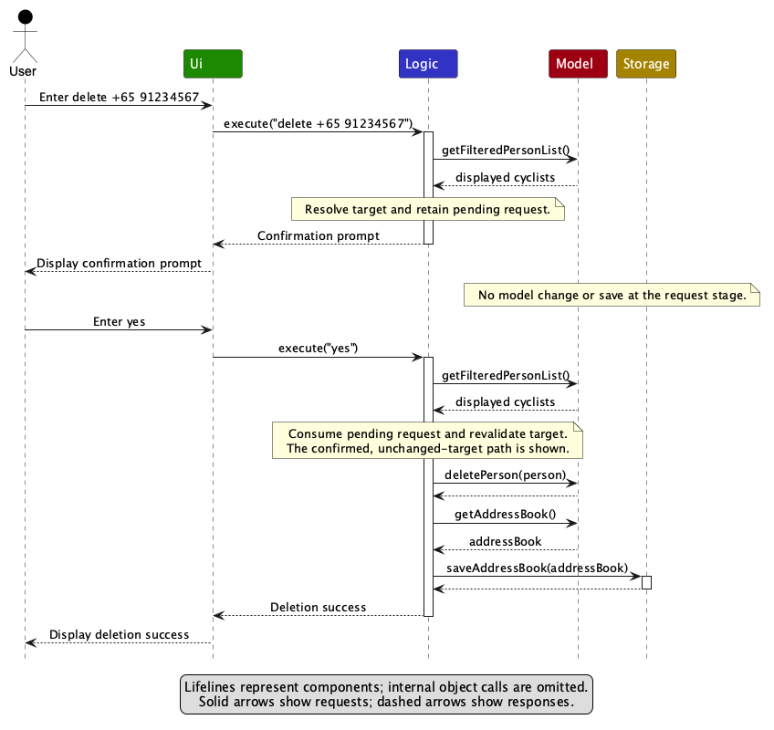
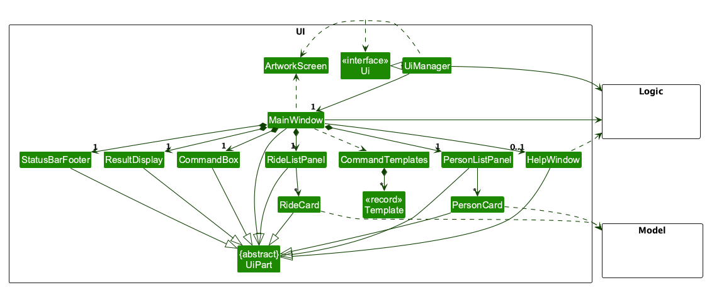
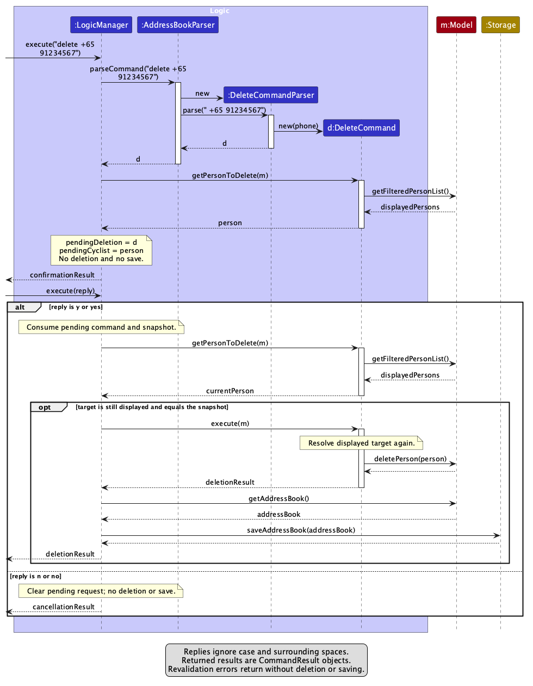
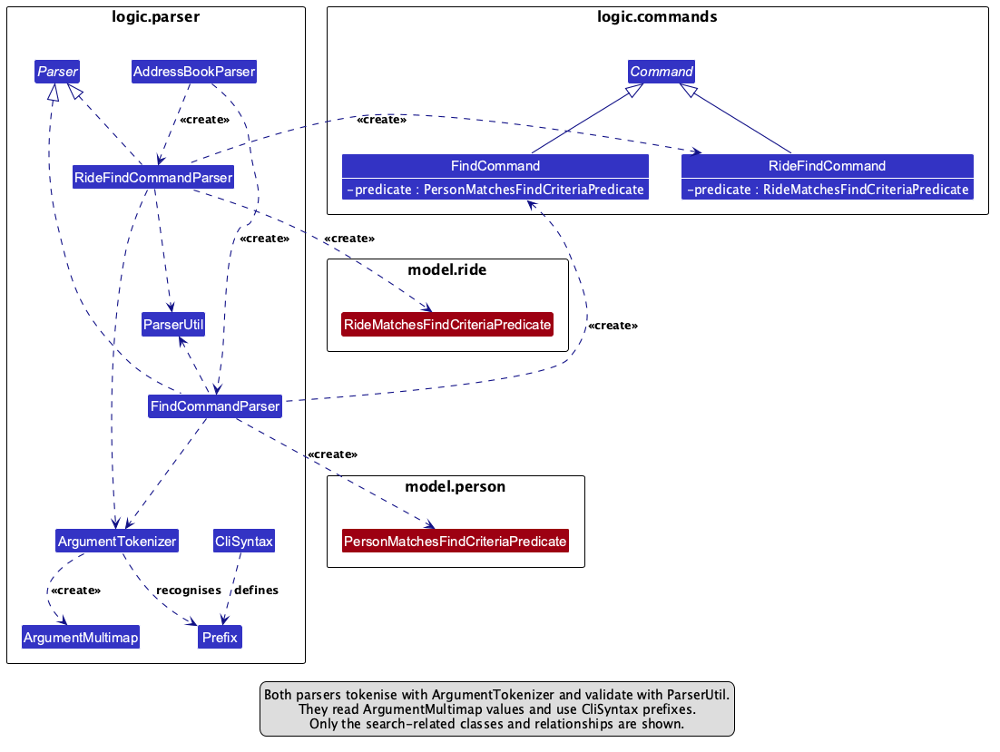
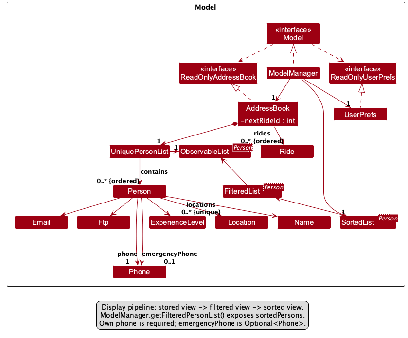
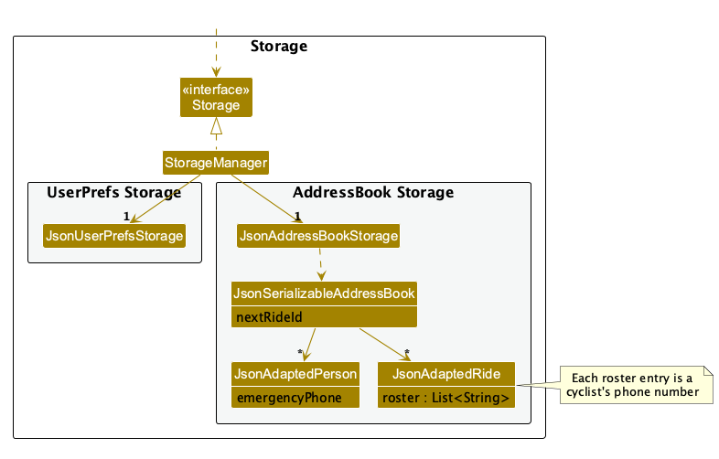
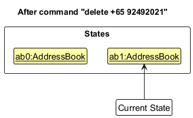

* Table of Contents
{:toc}

--------------------------------------------------------------------------------------------------------------------

## **Acknowledgements**

* _{List the sources of reused or adapted ideas, code, documentation, and third-party libraries here, with links to the originals.}_

--------------------------------------------------------------------------------------------------------------------

## **Setting up, getting started**

Refer to the guide [_Setting up and getting started_](SettingUp.md).

--------------------------------------------------------------------------------------------------------------------

## **Design**

:bulb: **Tip:** The `.puml` files used to create diagrams are in `docs/diagrams`. Refer to the [_PlantUML Tutorial_ at se-edu/guides](https://se-education.org/guides/tutorials/plantUml.html) to learn how to create and edit diagrams.

### Architecture

The ***Architecture Diagram*** given above explains the high-level design of the App.

The following provides a quick overview of the main components and their interactions.

**Main components of the architecture**

**`Main`** (consisting of classes [`Main`](https://github.com/se-edu/addressbook-level3/tree/master/src/main/java/seedu/address/Main.java) and [`MainApp`](https://github.com/se-edu/addressbook-level3/tree/master/src/main/java/seedu/address/MainApp.java)) is in charge of the app launch and shut down.
* At app launch, it initializes the other components in the correct sequence, and connects them up with each other.
* At shut down, it shuts down the other components and invokes cleanup methods where necessary.

The bulk of the app's work is done by the following four components:

* [**`UI`**](#ui-component): The UI of the App.
* [**`Logic`**](#logic-component): The command executor.
* [**`Model`**](#model-component): Holds the data of the App in memory.
* [**`Storage`**](#storage-component): Reads data from, and writes data to, the hard disk.

[**`Commons`**](#common-classes) represents a collection of classes used by multiple other components.

**How the architecture components interact with each other**

The *Sequence Diagram* below shows a confirmed cyclist deletion. The user first enters
`delete +65 91234567`, then enters `yes` through the same command box. `LogicManager`
resolves the displayed cyclist and holds the pending request without changing or saving
data. Only confirmation consumes the request, revalidates the target, deletes the cyclist
and saves the updated address book, including any affected ride rosters. The
lifelines below represent components; their internal object calls are omitted.

Each of the four main components (also shown in the diagram above),

* defines its *API* in an `interface` with the same name as the Component.
* provides its functionality through a concrete `{Component Name}Manager` class that implements the corresponding API interface.

For example, the `Logic` component defines its API in `Logic.java` and implements it in `LogicManager.java`. Other components interact with a component through its interface rather than its concrete class, preventing them from coupling to that component's implementation, as illustrated in the following partial class diagram.

The sections below give more details of each component.

### UI component

The **API** of this component is specified in [`Ui.java`](https://github.com/se-edu/addressbook-level3/tree/master/src/main/java/seedu/address/ui/Ui.java)

The UI consists of a `MainWindow` and its parts, such as `CommandBox`, `ResultDisplay`, `PersonListPanel`, `RideListPanel`, and `StatusBarFooter`. All of these, including `MainWindow`, inherit from the abstract `UiPart` class, which captures common behavior among classes that represent visible GUI parts.

The `UI` component uses the JavaFX UI framework. The layouts of these UI parts are defined in matching `.fxml` files in `src/main/resources/view`. For example, [`MainWindow.fxml`](https://github.com/se-edu/addressbook-level3/tree/master/src/main/resources/view/MainWindow.fxml) specifies the layout of [`MainWindow`](https://github.com/se-edu/addressbook-level3/tree/master/src/main/java/seedu/address/ui/MainWindow.java). The exception is `ArtworkScreen`, which is not a `UiPart` and has no `.fxml` file (see [Opening and closing artwork](#opening-and-closing-artwork)).

The `UI` component,

* executes user commands using the `Logic` component.
* listens for changes to `Model` data so that the UI can be updated with the modified data.
* keeps a reference to the `Logic` component, because the `UI` relies on the `Logic` to execute commands.
* depends on some classes in the `Model` component because it displays `Person` and `Ride` objects from the model.

#### Cyclist panel and ride panel

`MainWindow` is split into two columns. The left 70% holds the `CommandBox`, the `ResultDisplay` and the cyclist panel (`PersonListPanel`). The right 30% holds the ride panel (`RideListPanel`).

Each panel is given an `ObservableList` by `MainWindow` and builds one card for every item in it: `PersonListPanel` shows a `PersonCard` for each `Person` from `Logic#getFilteredPersonList()`, and `RideListPanel` shows a `RideCard` (laid out by `RideListCard.fxml`) for each `Ride` from `Logic#getFilteredRideList()`. Because the panels observe these lists, they refresh by themselves when cyclists or rides are added, edited, deleted or filtered. `RideCard` keeps its text formatting in small static methods so that they can be unit tested without the GUI.

The two panels are filtered independently of each other:

* `find`, `list` and `ridelist ID` change only the cyclist panel. In particular, `ridelist ID` shows the cyclists registered for that ride in the cyclist panel; it does not change the ride panel.
* `ridefind` changes only the ride panel, and `ridefind all` shows every ride again.

#### Help menu templates

`CommandTemplates` holds a list of `Template` records, one for each command. Each `Template` has the text shown in the Help menu and the starter text for the command box. Each menu item is a wrapping label. Whenever the **Help** menu opens, `MainWindow` builds the command items again and limits their width to the room between the **Help** menu and the right edge of the window, so a long command format wraps onto further lines instead of making the menu wider than the window. A wider window gives a wider menu, and a narrower window a narrower one. Lines wrap only between parameters, because spaces inside an optional group such as `[from/DATE [TIME]]` are replaced by no-break spaces (`CommandTemplates#keepOptionalGroupsTogether`). The menu font and padding in `DarkTheme.css` are kept small so that the height of the menu also stays inside the window. When `MainWindow` is set up, it adds one menu item per `Template` to the top of the **Help** menu, above **Full help...**. Choosing an item calls `CommandBox#setCommandText(...)` with that template's starter text. The command is only placed in the command box for the user to complete; it is not executed. The **Full help...** window (`HelpWindow`) lists the usage of every command, reusing the usage messages defined by the command classes in `Logic`, so `HelpWindow` depends on `Logic`.

#### Opening and closing artwork

`ArtworkScreen` shows a short, timed splash screen with a caption. It is drawn in code, so it is a plain class rather than a `UiPart`. `UiManager` shows the opening artwork before the main window appears, and `MainWindow` shows the closing artwork when the application exits. For this reason both classes depend on `ArtworkScreen`.

The cyclist panel observes `Logic#getFilteredPersonList()` and numbers cards from 1
using their current displayed positions. The read-only `RideListPanel` occupies the
right-hand 30% of the main window and observes `Logic#getFilteredRideList()`, so
`ridefind` changes which ride cards are displayed. It builds one `RideCard` (laid out
by `RideListCard.fxml`) for each matching ride. Ride cards show persistent IDs rather
than displayed positions. `RideCard` keeps its text formatting in small static methods
so that it can be unit tested without the GUI.

### Logic component

**API** : [`Logic.java`](https://github.com/se-edu/addressbook-level3/tree/master/src/main/java/seedu/address/logic/Logic.java)

Here's a (partial) class diagram of the `Logic` component:

The sequence diagram below illustrates the two inputs for cyclist deletion:
`execute("delete +65 91234567")`, followed by `execute("yes")` or `execute("no")`.
The example assumes that exactly one displayed cyclist has that phone number.
The `alt` frame distinguishes confirmation from cancellation; the nested `opt`
frame shows deletion and saving only after successful target revalidation.
Error responses are described below rather than expanded in the diagram.

How the `Logic` component works:

1. `LogicManager` passes a new command to `AddressBookParser`, which uses the matching
   parser (for example, `DeleteCommandParser`) to create a `Command` object.
1. Most commands execute immediately against the `Model`, after which `LogicManager`
   saves the address book and returns a `CommandResult`.
1. For `DeleteCommand`, `LogicManager` instead calls `getPersonToDelete(model)` to
   resolve the cyclist from the sorted displayed list. It stores `pendingDeletion`
   and the immutable `pendingCyclist` snapshot, then returns a confirmation prompt.
   This first input neither deletes a cyclist nor saves data.
1. The next input enters the same `Logic.execute` method. A `yes` reply consumes the
   pending request, resolves the target again and compares it with the snapshot.
   If the cyclist is still displayed and unchanged, the command executes
   `deletePerson(person)` and `LogicManager` saves the address book. A `no` reply
   clears the request and returns cancellation feedback without changing or saving data.

Replies are trimmed and accept `y`/`yes` or `n`/`no`, ignoring case. Invalid replies
retain the request. Another recognised command cancels it before normal parsing,
even if that command's arguments are invalid. See
[Cyclist deletion confirmation](#cyclist-deletion-confirmation) for the error and
cancellation behaviour. Ride deletion executes immediately and does not use this
confirmation flow.

Here are the other classes in `Logic` (omitted from the class diagram above) that are used for parsing a user command:

How the parsing works:
* When called upon to parse a user command, the `AddressBookParser` class creates an `XYZCommandParser` (`XYZ` is a placeholder for the specific command name, e.g., `AddCommandParser`). The parser uses the other classes shown above to parse the user command and create an `XYZCommand` object (e.g., `AddCommand`). The `AddressBookParser` returns that object as a `Command` object.
* All `XYZCommandParser` classes, such as `AddCommandParser` and `DeleteCommandParser`, implement the `Parser` interface so they can be treated similarly where appropriate, for example during testing.

### Model component
**API** : [`Model.java`](https://github.com/se-edu/addressbook-level3/tree/master/src/main/java/seedu/address/model/Model.java)

The `Model` component,

* stores cyclists as `Person` objects in an `AddressBook` containing a `UniquePersonList`.
  Each cyclist has a `Name`, their own `Phone`, an `Email`, an `Ftp`, an
  `ExperienceLevel` and a set of preferred cycling `Location` values. The separate
  emergency contact is an `Optional<Phone>`: one own phone is required, while the
  emergency phone may be absent for legacy records. Cyclists no longer have tags.
* selects matching cyclists using `FilteredList<Person>`, then exposes a live,
  unmodifiable `SortedList<Person>` through `getFilteredPersonList()`. It sorts by
  full name using `String.CASE_INSENSITIVE_ORDER`, with stored position as the
  tie-breaker. Names that are identical ignoring case retain their relative order,
  including after additions, edits and filtering. Filtering and sorting leave the
  stored list and JSON order unchanged; edit and delete target the cyclist's own phone.
  The transformation arrows point towards their underlying source lists: the
  stored-order view feeds the filtered view, which feeds the sorted view.
  `ModelManager` returns `sortedPersons` through the `Model` API.
* stores an ordered ride collection and `nextRideId` in `AddressBook`.
  `AddressBook#addRide` assigns persistent IDs that increase and are never reused;
  these IDs are independent of displayed positions. `ModelManager` also maintains
  a `FilteredList<Ride>` for `ridefind`, preserving stored ride order among matches.
  Rides are immutable, so changes replace the stored ride. A roster contains cyclist
  `Phone` values rather than direct `Person` references. `ridelist ID` filters the
  cyclist view to that ride's roster, still using the alphabetical display pipeline.
  Rides and cyclists are saved in the same address-book JSON file.
* stores a `UserPrefs` object representing the user's preferences (currently, the GUI
  settings), exposed through `ReadOnlyUserPrefs`.
* does not depend on the UI, Logic or Storage components; its domain entities make
  sense independently of those components.

### Storage component

**API** : [`Storage.java`](https://github.com/se-edu/addressbook-level3/tree/master/src/main/java/seedu/address/storage/Storage.java)

The `Storage` component,
* can save both address book data and user preference data in JSON format, and read them back into corresponding objects.
* saves cyclists and group rides in the same JSON file. `JsonSerializableAddressBook` holds a collection of `JsonAdaptedPerson` objects (the cyclists), a collection of `JsonAdaptedRide` objects (the rides) and the `nextRideId` counter. There is no separate ride storage file or class.
* saves the ride ID counter, `nextRideId`, so that ride IDs keep increasing and are never reused, even after rides are deleted or the address book is cleared. If the counter is missing when reading, numbering continues after the highest saved ride ID.
* saves a ride's roster in `JsonAdaptedRide` as a list of cyclist phone numbers (strings), not as `Person` objects. When reading, every roster phone must belong to a saved cyclist, and a roster must not contain duplicates or exceed the ride's maximum group size.
* saves a cyclist's optional emergency number in `JsonAdaptedPerson` as `emergencyPhone`.
* remains compatible with older files. `rides` and `nextRideId` are optional when reading, so files saved before rides existed load with no rides, a ride without a `roster` loads with an empty roster, and a cyclist without `emergencyPhone` loads with no emergency number. Invalid ride data makes the whole file invalid in the same way as invalid cyclist data.
* ignores the retired `tags` property in cyclist JSON records without validating its contents. New saves omit it. Supported cyclist fields retain their existing validation and legacy defaults.
* is implemented by `StorageManager`, which delegates the actual JSON file access to `JsonAddressBookStorage` and `JsonUserPrefsStorage` (one class per data file).
* depends on some classes in the `Model` component (because the `Storage` component's job is to save/retrieve objects that belong to the `Model`)

### Common classes

Classes used by multiple components are in the `seedu.address.commons` package.

--------------------------------------------------------------------------------------------------------------------

## **Implementation**

This section describes some noteworthy details on how certain features are implemented.

### Cyclist deletion confirmation

Cyclist deletion is a two-input interaction: for example, enter
`delete +65 91234567`, inspect the confirmation prompt, then enter `yes` or `no`
through the same command box. The sequence diagram in the
[Logic component](#logic-component) shows both inputs.

`LogicManager` resolves `delete PHONE` against the displayed list using
`DeleteCommand.getPersonToDelete`. This preserves the existing invalid-phone,
missing/hidden-target and ambiguous-target errors before a prompt is shown.
It stores the pending command and an immutable snapshot of that cyclist in memory,
in `pendingDeletion` and `pendingCyclist`, then returns a confirmation request to
the existing result panel without executing or saving the deletion. The command
box accepts the next reply through the same `Logic.execute` entry point.

Replies are trimmed and compared ignoring case. `y`/`yes` executes the pending
`DeleteCommand` and saves the book; `n`/`no` clears the request without changing the
model, filter or file. Before execution, the target must still be displayed and
have the same details as the snapshot. Confirmation state is consumed before
execution, so errors or failed saves cannot replay the deletion. Storage failures
retain the existing behaviour and error messages.

An unrecognised reply reports an error and retains the request. A supported command
word, including one with invalid arguments, cancels the request before normal
parsing/execution. Cancellation feedback is prepended to the new output or error;
Help and Exit flags are preserved. `AddressBookParser.isRecognisedCommand` makes
this distinction using the same case-sensitive command words. A subsequent `delete`
cancels the previous request first and creates a new request only if its own phone
target is valid. Pending requests are never serialised and disappear when the application closes or restarts.

### Emergency contact implementation

`Person` stores an `Optional<Phone>` emergency contact as a data field, shown as
the separate `emergencyPhone` relationship with multiplicity `0..1` in the
[model class diagram](#model-component). The cyclist's own `phone` relationship
has multiplicity `1`. New `add` commands require `sos/`; `edit` optionally replaces it and otherwise preserves it. All supplied numbers reuse `ParserUtil.parsePhone`, including repeated `sos/` find criteria. Find uses OR within each field and AND across supplied fields. Emergency contacts do not participate in cyclist identity because riders may share a contact. Edit and delete still target the cyclist’s own phone number.

`JsonAdaptedPerson` saves the `emergencyPhone` property. Missing or null values load as `Optional.empty()` for backwards compatibility, while supplied invalid values reject the record. `PersonCard` shows the number in a labelled SOS row, or **Not provided** for legacy records. Help formats and dropdown templates include the new prefix.

### Group ride creation (`rideadd`)

`rideadd n/NAME from/FROM to/TO l/LOCATION d/DISTANCE f/MINIMUM_POWER s/MAX_GROUP_SIZE [notes/NOTES]`
creates a group ride. The [model class diagram](#model-component) shows the ride
collection and ID counter at an overview level; the ride value classes are described below.

**Model.** A `Ride` (package `seedu.address.model.ride`) is immutable and holds an `int` ID, a `Name`, two
`RideDateTime` values (`from` and `to`), a `Location`, a `Distance`, a `MinimumPower`, a `GroupSize`, an
`Optional<Notes>` and a roster. `Name` and `Location` are reused from the cyclist model, so a ride follows the
same name and location rules as a cyclist. Every other field is a small value class with its own
`isValidXyz` method and `MESSAGE_CONSTRAINTS`, in the same style as `Ftp` and `Phone`:

* `RideDateTime` accepts only `DD-MM-YYYY TTTT`. A regular expression fixes the digit counts, and a strict
  `java.time` formatter then rejects dates that do not exist (such as 31 February) and times outside 0000 to 2359.
* `Distance` is a positive number of kilometres with up to 2 decimal places, stored in its simplest form so that
  `45`, `045` and `45.0` are equal.
* `MinimumPower` is a whole number from 1 to 600 watts, the same range as `Ftp`. It is a separate class so that its
  error message talks about minimum power instead of FTP.
* `GroupSize` is a positive whole number. `Notes` has at most 10 words, and repeated spaces are collapsed.
* The roster is an unmodifiable list of cyclist phone numbers. A new ride starts with an empty roster. Phone
  numbers are used because a cyclist's phone number is already how cyclists are identified.

`Ride`'s constructor rejects a `to` that is earlier than `from`, using `Ride.isValidPeriod`. A ride that ends at
the moment it starts is allowed.

**ID assignment.** The parser builds a ride whose ID is `Ride.UNASSIGNED_ID` (0). `Model#addRide` passes it to
`AddressBook#addRide`, which gives it the current `nextRideId`, increments the counter and returns the stored ride.
The ID is therefore decided in one place and `RideAddCommand` shows the stored ride to the user. IDs are never
reused, because the counter only goes up and is saved with the data. `AddressBook#setRides` raises the counter if it
is lower than the highest ride ID, so a hand-edited file cannot cause a clash. Rides are told apart by ID, so two
rides with identical details are allowed and `rideadd` has no duplicate check.

**Parsing.** `RideAddCommandParser` tokenises with the prefixes `n/`, `from/`, `to/`, `l/`, `d/`, `f/`, `s/` and
`notes/`. Prefixes are only recognised after whitespace, so `notes/` is not confused with `n/` and `to/` is not
confused with a word that happens to end in `to`. Rides reuse `PREFIX_NAME`, `PREFIX_LOCATION` and `PREFIX_FTP`
(for minimum power); `CliSyntax` adds `PREFIX_FROM`, `PREFIX_TO`, `PREFIX_DISTANCE`, `PREFIX_GROUP_SIZE` and
`PREFIX_NOTES`. A missing compulsory field or a non-empty preamble gives the usual invalid-format message with
`RideAddCommand.MESSAGE_USAGE`, a repeated prefix is reported by `verifyNoDuplicatePrefixesFor`, and each field is
parsed by a `ParserUtil` method that throws the field's own message. Values are checked in the order name, `from`,
`to`, location, distance, minimum power, group size and notes, and only the first error is reported. The check
that `to/` is not earlier than `from/` runs after every field is valid.

**Storage.** Rides are saved in the same `data/addressbook.json`, in a `rides` array, with a `nextRideId` number. `JsonAdaptedRide` mirrors `Ride`, including its roster as a list of cyclist phone numbers, and validates each field when loading, throwing an `IllegalValueException` with the field's message. `rides` and `nextRideId` are optional when reading, so files saved before rides existed load with no rides and `nextRideId` 1. Duplicate ride IDs or a non-positive `nextRideId` make the file invalid. If `nextRideId` is missing, numbering continues after the highest saved ID. See the [Storage component](#storage-component) for how these classes fit together.

**Design considerations.**

* *Where the ID is assigned.* Assigning it in the model keeps the parser free of state and keeps all numbering in
  one class. The alternative, a counter inside the parser, would be lost on restart and would be hard to test.
* *Where rides are stored.* Keeping rides in `AddressBook` means they are saved by the existing storage code after
  every command. A separate rides file would need its own load and save path and could get out of step with the
  cyclist data.
* *Dates.* `java.time.LocalDateTime` is used, with a strict parser, so invalid dates are rejected by the library
  instead of by hand-written checks. Time zones are not needed because every ride is local to the organiser.

### Group ride editing (`rideedit`)

`rideedit ID [n/NAME] [from/START] [to/END] [l/LOCATION] [d/DISTANCE] [f/MIN_FTP] [s/MAX_SIZE] [notes/NOTES]`
edits an existing ride without changing its identity or roster. The diagrams are not updated for Ride Edit in this
increment.

**Parsing.** `RideEditCommandParser` separates the positive ride ID from the prefixed fields and builds an
`EditRideDescriptor`. Each supplied value is parsed by the same `ParserUtil` method used by `rideadd`, while
duplicate prefixes, malformed IDs and a command with no editable field are rejected. Notes have three explicit
states: an omitted `notes/` preserves the existing value, a non-empty value replaces it and an empty value clears
it.

**Replacement and validation.** `RideEditCommand` finds the target by its unique ID and combines the descriptor
with the existing ride. It validates the complete resulting period, so changing only `from/` or `to/` cannot
produce an end time earlier than the start time. When minimum power or maximum group size is edited, the command
also checks the proposed value against the existing roster. It resolves roster phone numbers through the address
book, rejects a maximum below the roster count before checking cyclists' FTP, and rejects a minimum above any
member's FTP. The proposed replacement is immutable and retains the same ID and roster. Only after every validation
succeeds does the command call `Model#setRide`. `AddressBook#setRide` replaces the target at its current list
position, preserving other rides and the next ride ID counter. Failed parsing, a missing target or an invalid
resulting ride therefore leaves the model unchanged.

The address book's observable ride list emits the replacement, allowing the existing Rides panel to refresh. A
successful command returns through `LogicManager`, which saves the updated address book using the existing JSON
storage path. No separate Ride Edit storage format is required.

### Group ride deletion (`ridedelete`)

`RideDeleteCommandParser` parses the argument as one positive integer using the existing index parser; missing,
malformed, overflowing or additional arguments produce the standard invalid-command-format error.
`RideDeleteCommand` treats that value as a persistent ride ID rather than a list position. It finds the matching
ride before mutation and rejects an unknown ID.

On success, `RideDeleteCommand` calls `Model#deleteRide`, which delegates to `AddressBook#removeRide`. Removing the
immutable ride also removes its contained roster associations. It does not alter cyclist records, other rides or
their rosters, and `nextRideId` is preserved so remaining IDs are not renumbered and deleted IDs are not reused.
The existing observable ride list notifies the Rides panel, while `LogicManager` saves the updated model through
the existing JSON storage path. Ride deletion is immediate and does not use cyclist deletion confirmation.

### Ride roster management

`rideaddcyclist ID PHONE` and `ridedeletecyclist ID PHONE` share
`RideRosterCommandParser` and `RideRosterCommand`. The parser separates the first token
as a positive integer ride ID and validates the remaining text as a complete phone number.
The command resolves the ride by ID, independently of cyclist filtering. Addition requires
an existing cyclist, no duplicate membership, a free place and sufficient FTP. Removal
requires membership and leaves the cyclist record intact. Validation finishes before mutation.

`Ride#withRoster` creates an immutable replacement. `Model#setRide` delegates to
`AddressBook#setRide`, preserving the ride's ID, position and next-ID counter. The observable
list replacement refreshes its ride card. `LogicManager` saves through the existing JSON
path; the roster phone list already has storage support. Phone edits replace roster references
across rides, and confirmed cyclist deletion removes them. The deletion prompt explains this effect.

UML diagram updates are deferred to a later increment. Invalid requests throw before `setRide`.

### Ride roster display (`ridelist`)

`RideListCommandParser` accepts exactly one positive integer ID. `RideListCommand` finds the ride using
`Ride#getId()`, so the ID is persistent and is not a displayed position. Its roster contains `Phone` objects;
before filtering, the command resolves every phone against the complete person list rather than the currently
filtered view. An unknown ride or unresolved phone throws before the existing filter changes.

For a valid ride, `Model#updateFilteredPersonListForRide()` stores the selected persistent ID and selects people whose
phones occur in its current roster. `ModelManager` registers one listener on the existing observable ride list. Ride
replacement events refresh the predicate from the latest roster, so successful roster additions and removals update
the left panel automatically. The existing `SortedList` keeps results alphabetical, and the unchanged
`PersonListPanel` and `PersonCard` display them. The independent Rides panel is not filtered.

The selected ID, rather than a `Ride` object, remains active across immutable ride replacements. If that ride is
deleted, refreshing with an absent ID produces an empty cyclist list without selecting another ride. A generic
`Model#updateFilteredPersonList()` call clears the selected ID before applying its predicate, so `find` and `list`
replace Ride List filtering and later ride events cannot reactivate it.

The command does not mutate cyclist or ride data. `LogicManager` may still save the unchanged address book after a
successful command through its existing execution path. Validation finishes before the filter update, preserving
the previous filter on failure.

### \[Proposed\] Undo/redo feature

#### Proposed Implementation

The proposed undo/redo mechanism is facilitated by `VersionedAddressBook`. It extends `AddressBook` with an undo/redo history, stored internally as an `addressBookStateList` and `currentStatePointer`. Additionally, it implements the following operations:

* `VersionedAddressBook#commit()` — Saves the current address book state in its history.
* `VersionedAddressBook#undo()` — Restores the previous address book state from its history.
* `VersionedAddressBook#redo()` — Restores a previously undone address book state from its history.

These operations are exposed in the `Model` interface as `Model#commitAddressBook()`, `Model#undoAddressBook()` and `Model#redoAddressBook()` respectively.

Given below is an example usage scenario and how the undo/redo mechanism behaves at each step.

Step 1. The user launches the application for the first time. The `VersionedAddressBook` will be initialized with the initial address book state, and the `currentStatePointer` pointing to that single address book state.

Step 2. The user executes `delete 5` command to delete the 5th person in the address book. The `delete` command calls `Model#commitAddressBook()`, causing the modified state of the address book after the `delete 5` command executes to be saved in the `addressBookStateList`, and the `currentStatePointer` is shifted to the newly inserted address book state.

Step 3. The user executes `add n/David …​` to add a new person. The `add` command also calls `Model#commitAddressBook()`, causing another modified address book state to be saved into the `addressBookStateList`.

:information_source: **Note:** If a command fails its execution, it will not call `Model#commitAddressBook()`, so the address book state will not be saved into the `addressBookStateList`.

Step 4. The user now decides that adding the person was a mistake, and decides to undo that action by executing the `undo` command. The `undo` command will call `Model#undoAddressBook()`, which will shift the `currentStatePointer` once to the left, pointing it to the previous address book state, and restores the address book to that state.

:information_source: **Note:** If the `currentStatePointer` is at index 0, pointing to the initial AddressBook state, then there are no previous AddressBook states to restore. The `undo` command uses `Model#canUndoAddressBook()` to check if this is the case. If so, it will return an error to the user rather
than attempting to perform the undo.

The following sequence diagram shows how an undo operation goes through the `Logic` component:

:information_source: **Note:** The lifeline for `UndoCommand` should end at the destroy marker (X), but due to a limitation of PlantUML, it continues to the end of the diagram.

Similarly, how an undo operation goes through the `Model` component is shown below:

The `redo` command does the opposite — it calls `Model#redoAddressBook()`, which shifts the `currentStatePointer` once to the right, pointing to the previously undone state, and restores the address book to that state.

:information_source: **Note:** If the `currentStatePointer` is at index `addressBookStateList.size() - 1`, pointing to the latest address book state, then there are no undone AddressBook states to restore. The `redo` command uses `Model#canRedoAddressBook()` to check if this is the case. If so, it will return an error to the user rather than attempting to perform the redo.

Step 5. The user then decides to execute the command `list`. Commands that do not modify the address book, such as `list`, will usually not call `Model#commitAddressBook()`, `Model#undoAddressBook()` or `Model#redoAddressBook()`. Thus, the `addressBookStateList` remains unchanged.

Step 6. The user executes `clear`, which calls `Model#commitAddressBook()`. Since the `currentStatePointer` is not pointing at the end of the `addressBookStateList`, all address book states after the `currentStatePointer` will be purged. Reason: It no longer makes sense to redo the `add n/David …​` command. This is the behavior that most modern desktop applications follow.

The following activity diagram summarizes what happens when a user executes a new command:

#### Design considerations:

**Aspect: How undo & redo execute:**

* **Alternative 1 (current choice):** Saves the entire address book.
  * Pros: Easy to implement.
  * Cons: May have performance issues in terms of memory usage.

* **Alternative 2:** Individual command knows how to undo/redo by
  itself.
  * Pros: Will use less memory (e.g. for `delete`, just save the person being deleted).
  * Cons: We must ensure that the implementation of each individual command is correct.

_{more aspects and alternatives to be added}_

### \[Proposed\] Data archiving

_{Explain here how the data archiving feature will be implemented}_

--------------------------------------------------------------------------------------------------------------------

## **Documentation, logging, testing, dev-ops**

* [Documentation guide](Documentation.md)
* [Testing guide](Testing.md)
* [Logging guide](Logging.md)
* [DevOps guide](DevOps.md)

--------------------------------------------------------------------------------------------------------------------

## **Appendix: Requirements**

### Product scope

**Target user profile**:

Cyclique is designed for organisers of recreational cycling groups in Singapore who:
* have a need to manage a significant number of cyclists
* have a need to quickly access cyclists’ contact and emergency information
* organise group rides and needs to identify suitable cyclists based on factors such as preferred cycling location, FTP and experience level
* are comfortable with typing and using CLI apps

**Value proposition**:
Organisers of cycling groups often have rider contact and information scattered across chats, spreadsheets, and memory, making it hard to identify suitable participants. Cyclique keeps this information in one place and helps organisers find which riders suit a given ride, based on preferred cycling location, FTP and experience level.

### User stories

Priorities: High (must have) - `* * *`, Medium (nice to have) - `* *`, Low (unlikely to have) - `*`

| Priority | As a/an …                                    | I want to …                                                                                                  | So that I can …                                                                       |
| -------- | -------------------------------------------- | ------------------------------------------------------------------------------------------------------------ | ------------------------------------------------------------------------------------- |
| `* * *`  | proactive cycling organiser                  | add a new cyclist record with their name, phone number, and email                                            | keep basic contact details in one centralised directory                               |
| `* * *`  | community-focused cycling organiser          | view a complete list of all registered cyclists                                                              | see an overview of my entire cycling community at a glance                            |
| `* * *`  | attentive cycling organiser                  | edit an existing cyclist's contact details                                                                   | keep contact information up to date without recreating cyclist records                |
| `* * *`  | meticulous cycling organiser                 | delete a cyclist's record                                                                                    | keep my directory free of members who have permanently left the group                 |
| `* * *`  | safety-conscious cycling organiser           | store an emergency contact for each cyclist                                                                  | reach the appropriate person quickly when an emergency occurs                         |
| `* * *`  | logistics-minded cycling organiser           | record a cyclist's preferred cycling location                                                                | identify cyclists who prefer rides in different parts of Singapore                    |
| `* * *`  | attentive cycling organiser                  | record a cyclist's experience level                                                                          | identify riding groups that are appropriate for the cyclist                           |
| `* * *`  | pace-conscious cycling organiser             | record a cyclist's FTP                                                                                       | identify cyclists with a suitable fitness level for a planned ride                    |
| `* *`    | organised cycling organiser                  | create a record for a planned group ride                                                                     | keep track of the important details of an upcoming ride                               |
| `* *`    | selective cycling organiser                  | filter cyclists by multiple selected criteria, such as preferred location, experience level, and FTP range   | quickly shortlist suitable participants for a planned ride                            |
| `*`      | methodical cycling organiser                 | sort cyclist records by name or experience level in ascending or descending order                            | locate cyclists by name or compare their experience levels when forming riding groups |
| `*`      | busy cycling organiser with existing records | import cyclist records from a structured file                                                                | avoid entering every existing cyclist record manually                                 |

### Use cases

(For all use cases below, the **System** is `Cyclique` and the **Actor** is the `user`, unless specified otherwise)

**Shared precondition for UC01 – UC04**: Cyclique is running and ready to accept user requests.

**UC01 – Add Cyclist**

**Guarantees**

* On successful completion, exactly one new cyclist record containing the supplied details is added and displayed.
* Existing cyclist records remain unchanged.
* Invalid details are not added. If the supplied phone number matches an existing record, or the supplied email address matches one ignoring letter case, the directory remains unchanged. An identical name alone is allowed.

**MSS**

1.  User adds a new cyclist by providing the cyclist's name, phone number, email address, emergency number, FTP, experience level, and preferred cycling location(s).
2.  Cyclique adds the cyclist to the directory.
3.  Cyclique displays the newly-added cyclist.

    Use case ends.

**Extensions**

* 1a. User provides invalid cyclist details.
    * 1a1. Cyclique informs the user that the provided details are invalid.
    * 1a2. User provides revised cyclist details.

      Steps 1a1-1a2 are repeated until the details provided are valid.

      If the revised details duplicate an existing cyclist, extension 1b applies.

      Use case resumes from step 2.

* 1b. Cyclique detects that the provided phone number matches an existing cyclist's record, or that the email address matches one ignoring letter case.
    * 1b1. Cyclique displays `Another cyclist already has this phone number or email.` and leaves the directory unchanged.

      Use case ends.

**UC02 – List Cyclists**

**Guarantees**

* All cyclist records in the directory are displayed with their details.
* If the directory is empty, the user is informed that there are no cyclists.
* No cyclist records are changed.

**MSS**

1.  User requests to view all cyclists.
2.  Cyclique displays all cyclists currently registered in the directory together with their details.

    Use case ends.

**Extensions**

* 2a. The cyclist directory is empty.
    * 2a1. Cyclique informs the user that there are no cyclists in the directory.

      Use case ends.

**UC03 – Edit Cyclist**

**Guarantees**

* On successful completion, only the specified fields of the selected cyclist are updated, and the updated record is displayed.
* Unspecified fields and other cyclist records remain unchanged.
* Requests referring to a nonexistent cyclist, containing invalid details, or creating a phone match or case-insensitive email match with another cyclist do not change the directory. An identical name alone is allowed.

**MSS**

1.  User <u>views the cyclist list (UC02).</u>
2.  User requests to edit a specified cyclist and provides the revised details.
3.  Cyclique updates the specified details of the cyclist.
4.  Cyclique displays the updated cyclist information.

    Use case ends.

**Extensions**

* 1a. UC02 reports that the cyclist directory is empty.

    Use case ends.

* 2a. The specified cyclist does not exist in the displayed list.
    * 2a1. Cyclique informs the user that the cyclist cannot be found.

      Use case ends.

* 2b. User provides invalid cyclist details.
    * 2b1. Cyclique informs the user that the provided details are invalid.
    * 2b2. User provides revised cyclist details.

      Steps 2b1-2b2 are repeated until the details provided are valid.

      If the revised details duplicate another cyclist, extension 2c applies.

      Use case resumes from step 3.

* 2c. Cyclique detects that the revised phone number matches another cyclist's record, or that the revised email address matches one ignoring letter case.
    * 2c1. Cyclique displays `Another cyclist already has this phone number or email.` and leaves the directory unchanged.

      Use case ends.

**UC04 – Delete Cyclist**

**Guarantees**

* A cyclist record is permanently removed only after the user confirms its deletion.
* On successful completion, only the specified cyclist record is removed, and the updated cyclist directory is displayed.
* If the specified cyclist does not exist or the user declines confirmation, the directory remains unchanged.

**MSS**

1.  User <u>views the cyclist list (UC02).</u>
2.  User enters `delete PHONE` for a cyclist in the displayed list.
3.  Cyclique shows the target cyclist’s details and requests confirmation in the result panel.
4.  User enters `y` or `yes` in the command box, ignoring letter case.
5.  Cyclique permanently removes the cyclist from the directory.
6.  Cyclique displays the updated cyclist directory.

    Use case ends.

**Extensions**

* 1a. UC02 reports that the cyclist directory is empty.

    Use case ends.

* 2a. The specified cyclist does not exist.
    * 2a1. Cyclique informs the user that the cyclist cannot be found.

      Use case ends.

* 4a. User enters `n` or `no`, ignoring letter case.
    * 4a1. Cyclique displays `Deletion cancelled.` and leaves records, the filter and saved data unchanged.

      Use case ends.

* 4b. User enters an unrecognised reply.
    * 4b1. Cyclique displays an error and keeps waiting for confirmation or cancellation.

      Use case resumes at step 4.

* 4c. User enters another supported command.
    * 4c1. Cyclique cancels the pending deletion and executes the new command.
    * 4c2. Cyclique shows `Deletion cancelled.` followed by the command’s normal output or error.

      Use case ends. A new delete request starts this use case again.

### Non-Functional Requirements

**Testing conditions**

* Response-time requirements apply on a reference computer with a processor with at least two physical cores, 8 GB of RAM, SSD storage, and Java 25, with no other resource-intensive applications running. Record the processor model, operating system and version, and Java version with the test results.
* Test with Cyclique already running, its main screen ready for input, and up to 500 valid cyclist records loaded. Include a dataset of 500 records when checking the upper capacity limit.
* Measure response time from submission of a command or activation of a control until the requested information is visible and the application is ready for the next input. Exclude application startup and time spent entering input.

**Performance**

* Cyclique should display search or shortlist results within 2 seconds when storing up to 500 cyclists.
* Cyclique should display the cyclist list within 2 seconds when storing up to 500 cyclists.

**Usability**

* Adding or editing a cyclist should be completable using a single command entered from the main screen.
* Deleting a cyclist should require no more than one command and one confirmation entered from the main screen.
* Error messages should identify the invalid field, explain the violated constraint, and state the expected input format.

**Data requirements**

* Cyclist contact and emergency information must persist reliably across sessions (no data loss on app close/reopen).
* Cyclique should support storing records for at least 500 cyclists while meeting the stated performance requirements.
* Starting from the main screen with no cyclist selected or filter applied, a user who knows the target cyclist's name should be able to display that cyclist's emergency contact information within 2 user actions. Submitting one complete command (including typing it) or activating one GUI control counts as one action; each scrolling gesture also counts as one action. If names are shared, the user may use the cyclist's known phone number or email address to distinguish the target. The information should be displayed within 2 seconds of the final action under the testing conditions above.

**Environment/Compatibility**

* Cyclique should run on Windows, Linux, Unix, and macOS with Java 25 installed on computers meeting the reference hardware specification above. Only a keyboard and display should be required as input/output peripherals. Record the operating system version used for each compatibility test.

**Security/Privacy**

* Cyclique should store cyclist data only on the user's local computer.
* Cyclique should not transmit cyclist data to third parties.

**Reliability/Availability**

* Data saved by the last successfully executed command should remain available after Cyclique is unexpectedly terminated and restarted.

### Glossary

* **Auto-save**: Automatic saving of changes to persistent storage without requiring a separate save command.
* **CLI**: *Command-Line Interface*. An interface through which the user operates Cyclique primarily by typing text commands.
* **Cyclist**: A person whose contact and cycling-related information is stored and managed in Cyclique. The terms *rider* and *member* refer to the same concept; this documentation uses *cyclist* consistently.
* **Cyclist directory**: The collection of cyclist records stored in Cyclique.
* **Cycling organiser**: The primary user of Cyclique who manages cyclist records and organises recreational group rides.
* **Duplicate cyclist**: A cyclist entry with the same phone number or email address as an existing cyclist. Email comparison ignores letter case. Identical names alone do not make cyclists duplicates.
* **Experience level**: A categorical indication of a cyclist's riding experience. Cyclique uses three experience levels: **Beginner**, **Intermediate**, and **Advanced**.
* **Functional Threshold Power (FTP)**: A cyclist's cycling performance metric, measured in watts (W), representing the highest power they can approximately sustain for an extended period. In Cyclique, FTP is recorded as a whole number from 1 to 600 W.
* **Group ride**: An organised cycling session involving one or more cyclists. The term *ride meetup* refers to the same concept; this documentation uses *group ride* unless a feature specifically uses the term *ride meetup*.
* **GUI**: *Graphical User Interface*. The visual interface through which Cyclique displays cyclist information and command results.
* **JAR file**: A Java Archive file used to package and distribute the Cyclique application.
* **Java 25**: The minimum Java platform version required to run Cyclique, based on the project constraints.
* **Local storage**: Data stored on the user's own computer rather than on a remote server.
* **Mainstream OS**: Windows, Linux, Unix, or macOS
* **Parameter prefix**: A command prefix that identifies the type of value being supplied, such as `n/` for name, `p/` for phone number, `sos/` for emergency contact number, or `f/` for FTP.
* **Persistent data**: Data that remains available after Cyclique is closed and reopened.
* **Preferred cycling location**: A location where a cyclist prefers to ride or participate in group rides. A cyclist may have more than one preferred cycling location. The special value `any`, supplied as `l/any`, indicates that the cyclist has no location restriction and is considered to match every ride location.
* **Private contact detail**: A contact detail that is not meant to be shared with others
* **Ride roster**: The list of cyclists registered or confirmed to participate in a particular group ride.
* **Validation**: The process of checking whether user input satisfies Cyclique's specified input rules before accepting it.

--------------------------------------------------------------------------------------------------------------------

## **Appendix: Instructions for manual testing**

Use JDK 25 and a disposable folder containing the release JAR. Run
`java -version` to confirm the selected JDK, then `java -jar cyclique.jar`
from that folder. All commands below operate on test contacts; do not use real contact data.
Repeat the checks on each operating system supported by the release.

### Launch and shutdown

1. Launch in a folder without `preferences.json` or `data/addressbook.json`.
   Expected: The opening artwork is followed by the main window and sample contacts.
   Contact cards show labelled phone, SOS, email, FTP, experience and location fields.
1. Resize and move the window, then enter `exit`.
   Expected: The closing artwork appears and the application closes.
1. Launch again. Expected: The window size and position are retained.
1. Enter `help`, close its window, then press F1. Expected: Both actions open readable
   usage instructions for all supported commands. Closing help leaves the main window usable.
1. Close the main window using its close button. Expected: The application shuts down.

### Emergency contact regression

1. Launch with a copy of an older saved book whose cyclists have no `emergencyPhone` property. Expected: Records load, with **SOS: Not provided** on their cards.
1. Edit another field of a legacy cyclist, then restart. Expected: The emergency number remains absent.
1. Enter `edit PHONE sos/+65 99999999` using that cyclist’s own phone for `PHONE`. Expected: The SOS row and success message show the number; it remains after restarting.
1. Add a cyclist using all required fields including `sos/+65 99999999`. Expected: The labelled SOS number appears. A second cyclist may share it if their own phone and email are unique.
1. Repeat the add without `sos/`, with blank `sos/`, with `sos/99999999`, with `sos/+65 999-99999`, and with two `sos/` values. Expected: Each command is rejected without changing data. Repeat the invalid values and duplicate prefix with `edit PHONE`.
1. Enter `find sos/+65 99999999`, then repeat with a second `sos/` number. Expected: Exact emergency-number matches; repeated values use OR. Add `n/` and `p/` criteria. Expected: All supplied fields must match. Cyclists without emergency numbers do not match `sos/`.
1. Enter `help`, press F1 and inspect the Help dropdown. Expected: Add, edit and find formats include `sos/`; the add starter inserts it.
1. Resize the main window. Expected: SOS values wrap and remain readable without overlapping other fields.

### Adding and editing people

1. Enter `clear`, then
   `add n/John Doe p/+65 98765432 sos/+65 99999999 e/johnd@example.com f/300 x/Beginner l/any`.
   Expected: One contact appears with all supported fields and no tag row.
   The success message contains no residential address.
1. Try adding Alice with `a/10 Test Road` appended and `edit +65 98765432 a/10 Test Road`.
   Expected: Both commands are rejected and cyclist details remain unchanged.
1. Enter `add n/Alice Tan p/+65 91234567 sos/+65 99999999 e/alice@example.com f/1 x/Beginner l/East Coast l/Punggol`.
   Expected: A second contact appears with both locations.
1. Repeat John's add command. Expected: A duplicate-person error and no changes.
1. Enter `edit +65 98765432 p/+65 96742165 e/johndoe@example.com f/600 x/Advanced l/Punggol`.
   Expected: The success message contains no residential address. John's supplied fields change;
   his name remains unchanged. His location set is replaced with Punggol.
   Both contacts are displayed.
1. Try `edit +65 96742165`, `edit +65 96742165 n/John Updated f/601`,
   `edit +65 96742165 l/`, and `edit +65 96742165 p/+65 111 p/+65 222`.
   Expected: Each command shows an error and leaves every contact field unchanged.
1. Try add commands with missing required fields, `f/0`, `f/601`, `f/abc`, blank `l/`,
   invalid email, invalid experience, and phone numbers without a country code, without a separating space,
   with hyphens, with parentheses, or with fewer than three digits after the country code.
   Expected: Each command shows an error and adds no contact. FTP values 1 and 600 are accepted.

### Finding and listing people

Use John and Alice from the previous section.

1. Enter `find n/jOHn n/alice`. Expected: Both contacts appear, ignoring name keyword case.
1. Enter `find p/+65 96742165 p/+65 91234567`. Expected: Both contacts appear.
1. Enter `find n/john p/+65 96742165`. Expected: Only John appears.
1. Enter `find n/john p/+65 91234567`. Expected: No contacts appear; both fields must match.
1. Enter `find n/Jo` and `find p/+65 967`. Expected: No contacts appear; matches are exact
   phone numbers or full name words, rather than substrings.
1. Enter `find n/John Doe`. Expected: Only the cyclist with the complete full name `John Doe` appears,
   ignoring case.
1. Try `find`, `find john alice`, and `find p/`. Expected: Each shows an error without changing the current
   displayed list.
1. Enter `find n/john`, then `edit +65 91234567 n/Alice Updated`.
   Expected: The edit is rejected because Alice is outside the displayed list.
1. Enter `edit +65 96742165 n/John Updated`. Expected: John's name changes and both contacts appear.
1. Enter `list`. Expected: All stored contacts appear.

### Deletion confirmation regression

Use a disposable book with John and Alice from the adding/editing scenario.

1. Enter `delete +65 96742165`. Expected: The result panel shows John’s full details
   and requests `y`/`yes` or `n`/`no`; John remains on his card and in the saved file.
1. Enter `maybe`, then `yes please`. Expected: Each reply shows an error identifying
   the pending cyclist; no data changes. Enter `nO`. Expected: `Deletion cancelled.`;
   the records, active filter and saved JSON remain unchanged.
1. Repeat the request with `n`, `N`, `no`, `No` and `NO`, starting a new request each time.
   Expected: Every reply cancels without changes.
1. Start a new request and enter `list`. Expected: `Deletion cancelled.` followed by
   `Listed all persons.` Enter `yes`. Expected: `Unknown command.`; no cyclist is removed.
1. Start a new request and enter `edit +65 99999999 n/Unknown`. Expected: Cancellation
   followed by the usual missing-target error. Repeat with malformed `delete`.
   Expected: Cancellation followed by the usual invalid-format usage error.
1. Request John’s deletion, then enter `delete +65 91234567`. Expected: Cancellation
   of the first request followed by Alice’s details and a new prompt. Enter `NO`.
   Expected: Both cyclists remain.
1. Start a new request, enter `help` and close Help. Expected: The result panel reports
   cancellation and the normal Help output. Help usage explains confirmation replies.
1. Start a request, close Cyclique without confirming, and relaunch.
   Expected: Both cyclists remain; entering `yes` reports `Unknown command.`
1. Enter `find n/john`, request John’s deletion, check the details, then enter `YeS`.
   Expected: Only John is removed, the filtered display becomes empty, and the saved
   book omits John after restarting. Repeat with disposable added cyclists for `y`,
   `Y`, `yes`, `Yes`, `YES` and other capitalisations, including surrounding spaces.
1. Resize the window with a prompt visible. Expected: The target details and reply
   instructions remain readable. The command box accepts replies and clears after
   successful confirmation/cancellation; invalid replies retain the usual error styling.

### Deleting and clearing people

1. Enter `find n/john`, then `delete +65 91234567`.
   Expected: The command reports that Alice cannot be found in the displayed list;
   both stored contacts and the filter remain unchanged.
1. Enter `find n/nobody`, then `delete +65 96742165`.
   Expected: Deletion is rejected; both contacts remain stored and the display stays empty.
1. Enter `find n/alice`, then `delete +65 91234567`.
   Expected: Alice’s details and a yes/no request appear; Alice remains displayed and stored.
   Enter `yes`. Expected: Alice is deleted, the success message identifies Alice, and the display becomes empty.
1. Enter `list`, then `delete +65 96742165`. Check the target details, then enter `y`.
   Expected: John is deleted and the list is empty.
1. Try `delete +65 99999999`, `delete`, `delete 1`, `delete +65 12`, and `delete x`.
   Expected: An error appears and no contact is deleted.
1. Enter `clear` twice. Expected: The list remains empty and each command succeeds.

### Alphabetical display regression

Use a disposable test book. Check both cyclist names and card indexes after every step.

1. Enter `clear`, then add these contacts in the stated order:
   `add n/David p/+65 94444444 sos/+65 99999999 e/david@example.com f/300 x/Beginner l/any`,
   `add n/alex Zane p/+65 91111111 sos/+65 99999999 e/alexz@example.com f/300 x/Beginner l/any`,
   `add n/Alex Adams p/+65 92222222 sos/+65 99999999 e/alexa@example.com f/300 x/Beginner l/any`.
   Expected: `1. Alex Adams`, `2. alex Zane`, `3. David` (full names, ignoring case).
1. Enter `add n/Bernice p/+65 93333333 sos/+65 99999999 e/bernice@example.com f/300 x/Beginner l/any`.
   Expected: Bernice appears at index 3, between alex Zane and David; David becomes index 4.
1. Enter `find n/david n/bernice`. Expected: `1. Bernice`, `2. David`.
   Enter `list`. Expected: All four contacts return in alphabetical order, numbered 1 to 4.
1. Enter `edit +65 94444444 n/aaron`. Expected: aaron moves to index 1.
   Enter `edit +65 94444444 n/Zara`. Expected: Zara moves to index 4;
   the remaining fields and phone number are retained.
1. Enter `find n/bernice`, then
   `add n/BERNICE p/+65 95555555 sos/+65 99999999 e/bernice2@example.com f/300 x/Beginner l/any`.
   Expected: All contacts appear. Bernice is followed by BERNICE, in their stored order.
1. Enter `find n/bernice`. Expected: `1. Bernice` (`+65 93333333`),
   `2. BERNICE` (`+65 95555555`). Enter `edit +65 93333333 n/bernice`.
   Expected: All contacts appear, with bernice still before BERNICE. Enter `list`;
   the relative order is retained. Identical names are allowed with unique phone numbers and emails.
1. Enter `exit`, then relaunch. Expected: The initial display is alphabetical and
   the two case-equivalent names retain their relative order; indexes run from 1 to 5.
1. Enter `find n/bernice`, then `delete +65 94444444`.
   Expected: Deletion is rejected because Zara is hidden; all five contacts remain stored
   and the two matching cyclists stay numbered 1 and 2.
   Enter `delete +65 93333333`, then `yes`. Expected: BERNICE remains at index 1.
   Enter `list`. Expected: Alex Adams, alex Zane, BERNICE and Zara are numbered 1 to 4.
   Enter `delete +65 94444444`, then `yes`. Expected: Zara is deleted; the remaining cyclists are numbered 1 to 3.

### Error message consistency

Use the contacts from the alphabetical display scenario before deleting Zara.

1. Enter `find n/bernice`, then `delete +65 94444444` and `edit +65 94444444 n/Ben`.
   Expected: Both show exactly
   `Cyclist with phone number +65 94444444 cannot be found in the displayed list. Use list to show all cyclists.`
   The filter, cyclist details and saved data remain unchanged.
1. Try `delete +65 99999999` and `edit +65 99999999 n/Ben`.
   Expected: Both use the same wording with `+65 99999999`.
1. Enter `delete` or `edit`. Expected: The error begins `Invalid command format.`
   followed by usage instructions. Examples remain copyable command text.
1. Enter `list`, then try `edit +65 94444444 n/!`
   and `edit +65 94444444 x/Expert`.
   Expected: Each validation error ends with a full stop and no details change.
1. Enter `edit +65 94444444 n/Ben n/Zara`.
   Expected: `Multiple values specified for the following single-valued field(s): n/.`
   No details change.

### Adding a group ride

Rides appear as cards in the **Rides** panel, the column on the right of the window (about 30% of its width).
Each card shows the ride's ID and name in a yellow-tinted heading (for example `#1 Sunday Sunrise Ride`), then the start and end
(`18-10-2026 0630 to 18-10-2026 0930`), then labelled lines for Location, Distance, Min power and Max group, and a
Notes line only if the ride has notes. The command box, result box and cyclist list stay in the left 70%.
Check the panel after each step, and check the saved file `data/addressbook.json` where the steps say so.

1. Launch the application with no rides. Expected: The Rides panel shows `No rides yet. Use rideadd to create one.`

1. Enter `rideadd n/Sunday Sunrise Ride from/18-10-2026 0630 to/18-10-2026 0930 l/East Coast d/45 f/180 s/12 notes/Bring lights and a spare tube`.
   Expected: The result box shows `New ride added: Ride 1: Sunday Sunrise Ride; From: 18-10-2026 0630;
   To: 18-10-2026 0930; Location: East Coast; Distance: 45 km; Minimum power: 180 W; Max group size: 12;
   Notes: Bring lights and a spare tube; Cyclists on roster: 0`. The Rides panel shows the ride as `#1` and the
   cyclist list is unchanged.
1. Enter `rideadd n/Evening Spin from/20-10-2026 1800 to/20-10-2026 1930 l/Punggol d/30.5 f/150 s/8`.
   Expected: The message shows `Ride 2`, `Distance: 30.5 km` and `Notes: None`. The panel lists `#2` below `#1`.
1. Enter the first command again. Expected: A third ride is added as `Ride 3`. Rides with the same details are allowed.
1. Enter `rideadd s/12 f/180 d/45 l/East Coast to/18-10-2026 0930 from/18-10-2026 0630 n/Fields In Another Order`.
   Expected: The ride is added. Fields may be in any order.
1. Enter `rideadd n/Same Time from/18-10-2026 0630 to/18-10-2026 0630 l/East Coast d/45 f/180 s/12`.
   Expected: The ride is added, because the end time may equal the start time.
1. Enter `rideadd n/The Extraordinarily Long Weekend Charity Fundraiser Century Ride For Everyone from/31-12-2026 2300 to/01-01-2027 0100 l/Marina Bay Sands Waterfront Promenade and Gardens d/160.75 f/250 s/150 notes/Bring plenty of water and snacks for the whole day`.
   Expected: The ride appears as a card whose long name, location and notes wrap onto further lines inside the card.
   Make the window as narrow as it allows. Expected: The Rides panel shows no horizontal scrollbar and every card
   stays inside the column.
1. Enter `rideadd n/Any Place Ride from/21-10-2026 0600 to/21-10-2026 0800 l/any d/20 f/100 s/5`.
   Expected: The card's Location line shows `Any`, and the card has no Notes line.
1. Click a ride card. Expected: The card is highlighted with a yellow border.
1. Try each of these. Expected: Each one shows an error and adds no ride (the next added ride keeps the next number).
   * `rideadd` and `rideadd n/Only A Name` (missing fields: invalid command format message).
   * `rideadd n/Bad from/18-10-2026 0930 to/18-10-2026 0629 l/East Coast d/45 f/180 s/12` (end before start).
   * `from/` values `2026-10-18 0630`, `18-10-2026`, `31-02-2026 0630`, `18-10-2026 2400` and `18-10-2026 06:30`
     (date and time format).
   * `d/0`, `d/-3`, `d/45.123` and `d/far`; `f/0`, `f/601` and `f/strong`; `s/0`, `s/2.5` and `s/many`.
   * `n/Bad&Name`, `l/East Coast!` and a repeated prefix such as two `d/` values.
   * `notes/` with 11 words, and an empty `notes/`.
1. Enter `rideadd` with `notes/` of exactly 10 words. Expected: The ride is added.
1. Exit and open `data/addressbook.json`. Expected: A `rides` array holds every ride added, each with its `id`,
   and `nextRideId` is one more than the highest ID. Relaunch. Expected: The Rides panel shows the same rides.
   Add one more ride. Expected: Its ID continues from the saved counter and no ID is repeated.
1. Close the application, replace the disposable data file with `{ "persons" : [ ] }`, and launch.
   Expected: The application starts with an empty Rides panel and the next ride added is `Ride 1`. Restore your backup after
   the check if needed.

### Editing a group ride

Start with a fresh address book. Enter the following command to create a ride with known details:

`rideadd n/Morning Ride from/20-10-2026 1400 to/20-10-2026 1600 l/Punggol d/40 f/180 s/10 notes/Bring lights`

Record the assigned ride ID. The steps below assume it is `1`. If a different ID is assigned, substitute that ID in every command.

Add two cyclists with FTP values of 200 W and 250 W, then add both to ride 1 with `rideaddcyclist`. The following
steps use this roster to exercise Ride Edit validation.

1. Enter `rideedit 1 n/NightRide`. Expected: The result starts with `Edited ride: Ride 1: NightRide`; every other
   field, the roster and the ride's position in the Rides panel remain unchanged.
1. Enter `rideedit 1 l/East Coast Park f/200 notes/New meeting point`. Expected: All three supplied fields change,
   and every omitted field remains unchanged.
1. Enter `rideedit 1 notes/`. Expected: The result shows `Notes: None`, and the ride card no longer shows a Notes
   line. Enter `rideedit 1 n/Late Ride`. Expected: The absent `notes/` preserves `Notes: None`.
1. Enter `rideedit 1 from/20-10-2026 2000`. Expected: Cyclique reports
   `The end date and time (to/) cannot be earlier than the start date and time (from/).`
   The ride and saved data remain unchanged.
1. Enter `rideedit 1 to/20-10-2026 1300`. Expected: The same invalid-period error is reported, and no data changes.
1. Enter `rideedit 1 from/20-10-2026 1600 to/20-10-2026 1600`. Expected: The edit succeeds because equal start
   and end times are allowed.
1. Enter `rideedit 1 s/1 n/Too Small`. Expected: Cyclique reports
   `Cannot edit ride: maximum group size cannot be smaller than the current roster size.` The name and group size
   remain unchanged.
1. Enter `rideedit 1 f/201 notes/Changed notes`. Expected: Cyclique reports
   `Cannot edit ride: minimum FTP exceeds the FTP of an existing cyclist.` The minimum FTP and notes remain
   unchanged. Enter `rideedit 1 f/200 s/2`; expected: equality with the least-powerful cyclist and roster count is
   accepted.
1. Try `rideedit`, `rideedit 0 n/Bad`, `rideedit abc n/Bad`, `rideedit 999999 n/Bad` and `rideedit 1`.
   Expected: Each reports the relevant invalid-format, missing-ride or missing-field error without changing ride data.
1. Exit and relaunch. Expected: Successful edits remain visible and failed edits have not changed the saved ride.
   Add another ride. Expected: Its ID follows the previous counter rather than being affected by edits.

### Deleting a group ride

Use disposable test data and note the number of cyclist records before starting.

1. Enter `rideadd n/Delete Me from/18-10-2026 0630 to/18-10-2026 0730 l/East Coast d/20 f/150 s/8`.
1. Enter `rideadd n/Keep Me from/19-10-2026 0630 to/19-10-2026 0730 l/Punggol d/25 f/160 s/10`.
   Expected: Two ride cards appear. Record their assigned IDs and the second ride's complete details.
1. Enter `ridedelete ID`, replacing `ID` with the first ride's assigned ID.
   Expected: The result identifies the deleted ride, its card disappears, and the second ride remains unchanged.
   The cyclist-record count is unchanged.
1. Exit and relaunch Cyclique. Expected: The deleted ride remains absent and the second ride remains unchanged.
1. Add another valid ride. Expected: Its ID is higher than both recorded IDs; the deleted ID is not reused.

### Help dropdown and Full help for ride commands

1. Launch Cyclique without resizing the window, then click the **Help** menu. Expected: The whole dropdown fits
   inside the window, with no entry cut off at the right or bottom edge. Long formats such as `rideedit` and
   `ridefind` wrap onto further lines between parameters. Close the menu and make the window wider, then open the
   menu again. Expected: The menu is wider and fewer entries wrap. Make the window as narrow as it allows and open
   the menu again. Expected: The menu is narrower, every entry is still fully readable, and it still fits inside
   the window. The dropdown lists `rideadd n/NAME from/FROM to/TO l/LOCATION d/DISTANCE
   f/MIN_POWER s/MAX_GROUP_SIZE [notes/NOTES]` after `find`. It then lists `rideedit ID [n/NAME] [from/START]
   [to/END] [l/LOCATION] [d/DISTANCE] [f/MIN_POWER] [s/MAX_GROUP_SIZE] [notes/NOTES]`, followed by
   `ridedelete ID` before the roster commands and `list`.
1. Click the `rideadd` item. Expected: The command box contains `rideadd n/ from/ to/ l/ d/ f/ s/` with the cursor
   at the end, and the command is not run. Type a value straight after each prefix to complete it.
1. Click the `rideedit` item. Expected: The command box contains `rideedit ` with the cursor at the end, and the
   command is not run. Add the ride ID and at least one field; do not type the square brackets shown in the format.
1. Click the `ridedelete` item. Expected: The command box contains `ridedelete ` with the cursor at the end.
1. Choose **Full help...** (or enter `help`, or press F1). Expected: The window lists `rideadd` after `find` and
   `rideedit` after `rideadd`, followed by `ridedelete` before the roster commands and `list`. Ride Edit explains
   preserved fields and roster, notes clearing, invalid-edit atomicity and the `DD-MM-YYYY TTTT` date format. Its
   examples are executable and contain no square brackets. Ride Delete explains its positive ID requirement,
   no-confirmation behaviour and example command.

### Saving data and recovering from invalid files

1. Add John again, edit a field, and exit. Launch again.
   Expected: All saved fields and locations match the last successful command.
1. Request John’s deletion, confirm with `yes`, exit, and relaunch. Expected: John stays deleted.
1. Add John, enter `clear`, exit, and relaunch. Expected: The book stays empty.
1. With the application closed, back up the disposable `data/addressbook.json`, then remove it.
   Launch again. Expected: Sample contacts are loaded.
1. Close the application and replace the disposable data file contents with `{invalid json`.
   Launch again. Expected: An empty book is loaded without crashing; the log records the loading error.
   A successful add creates valid saved data. Restore the backup after the check if needed.
1. With the application closed, replace disposable `preferences.json` with `{invalid json`.
   Launch again. Expected: Default window preferences are used without crashing.

### Release regression: duplicate cyclist identities

1. Enter `clear`, then
   `add n/John Doe p/+65 98765432 sos/+65 99999999 e/john@example.com f/300 x/Beginner l/any`.
   Expected: John is added successfully.
1. Enter `add n/Jane Tan p/+65 98765432 sos/+65 99999999 e/jane@example.com f/250 x/Intermediate l/Punggol`.
   Expected: The add is rejected with `Another cyclist already has this phone number or email.`
   John remains unchanged and Jane is not added.
1. Enter `add n/Jane Tan p/+65 91234567 sos/+65 99999999 e/JOHN@EXAMPLE.COM f/250 x/Intermediate l/Punggol`.
   Expected: The add is rejected with the same message because email matching ignores letter case.
   John remains unchanged and Jane is not added.
1. Enter `add n/John Doe p/+65 91234567 sos/+65 99999999 e/jane@example.com f/250 x/Intermediate l/Punggol`.
   Expected: The second John Doe is added because both the phone number and email are unique.
1. Enter `edit +65 91234567 p/+65 98765432`.
   Expected: The edit is rejected with `Another cyclist already has this phone number or email.`
   Both cyclist records remain unchanged.
1. Enter `edit +65 91234567 e/JOHN@EXAMPLE.COM`.
   Expected: The edit is rejected with the same message. Email comparison ignores letter case,
   and both cyclist records remain unchanged.
1. Enter `find p/+65 91234567`, then `edit +65 91234567 p/+65 98765432`.
   Expected: Only the second John Doe (`+65 91234567`) is displayed, while the first
   John Doe (`+65 98765432`) is hidden. The edit is rejected with
   `Another cyclist already has this phone number or email.` because duplicate detection
   checks the entire directory, including filtered-out cyclists. The filtered list,
   both cyclist records and saved data remain unchanged.
1. Enter `edit +65 91234567 p/+65 91234567 e/jane@example.com`.
   Expected: Retaining the cyclist's own phone and email succeeds and both cyclists are displayed.
1. Enter `edit +65 91234567 p/+65 92345678 e/jane.updated@example.com`.
   Expected: Both unique values are applied, with all other cyclist fields unchanged.
1. Exit and relaunch the application.

   **Important:** Perform the following JSON tests using disposable test data only.
   After an invalid-data startup, close Cyclique without executing any commands,
   then restore the valid JSON backup before continuing. A successful command may
   overwrite the invalid data file.
   Expected: John at `+65 98765432` and John at `+65 92345678` retain all saved details.
1. Close the application and back up the disposable `data/addressbook.json`. In the working copy,
   change the second cyclist's phone to `+65 98765432`, then relaunch.
   Expected: The duplicate JSON is rejected through the invalid-data handling path. Cyclique starts
   with an empty directory and logs the loading error; neither duplicate record is silently discarded
   or made available for interactive repair. Close Cyclique and restore the backup.
1. In another working copy of the backup, keep the phone numbers unique but change the second cyclist's
   email to `JOHN@EXAMPLE.COM`, then relaunch.
   Expected: The case-insensitive duplicate email causes the JSON to be rejected in the same way.
   Close Cyclique, restore the valid backup and relaunch. Expected: Both valid records are loaded.

### Tag removal compatibility regression

Use a disposable data directory for these checks.

1. Open Help. Expected: Add and Edit entries contain no tag parameter.
1. Enter `add n/Tagless Rider p/+65 98888888 sos/+65 99999999 e/tagless@example.com f/250 x/Intermediate l/Punggol`.
   Expected: The card and success message show supported fields without tags or an empty tag row.
1. Enter `edit +65 98888888 n/Updated Rider`. Expected: The name changes; other fields remain unchanged.
1. Append `t/friend` to the add command above and try `edit +65 98888888 t/` and
   `edit +65 98888888 n/Changed t/friend`. Expected: Each command is rejected with tag-free usage;
   records and saved data remain unchanged.
1. Exit, add `"tags": ["friends", "invalid tag!"]` to a cyclist in the disposable JSON file,
   and relaunch. Expected: All supported fields load, with no tags on the card.
1. Edit a supported field, exit, and inspect the JSON. Expected: No cyclist has a `tags` field.
   Relaunch and confirm the edit persists.

### Roster Help dropdown regression

The roster dropdown templates are provided by `CommandTemplates`. The existing `MainWindow#addCommandsToHelpMenu`
creates the menu items and passes their starter text to `CommandBox#setCommandText`.
The Full help window reuses `RideRosterCommand#MESSAGE_USAGE`. UML updates are deferred to a later increment.

1. Open Help. Expected: after `rideadd`, `rideedit` and `ridedelete`, the dropdown shows
   `rideaddcyclist ID PHONE` followed by `ridedeletecyclist ID PHONE`.
1. Click the addition entry. Expected: the command box contains `rideaddcyclist `,
   with a trailing space and the caret at the end, ready for the ride ID and phone.
1. Open Help and click the removal entry. Expected: the command box contains
   `ridedeletecyclist `, replacing the previous contents and placing the caret at the end.
1. Confirm the labels display the literal `ID PHONE` arguments without short-form aliases.
   No `p/` prefix or placeholder arguments should be inserted into the command box.
1. Check that existing menu entries still insert their expected starter text and
   Full help... still opens the help window and includes the roster command usage.

### Ride roster regression (manual testing)

Use a separate data directory or back up your data first.

1. In a disposable folder with no rides, enter
   `add n/Roster Rider p/+65 91234567 sos/+65 99999999 e/roster@example.com f/180 x/Beginner l/any`.
   Then enter `rideadd n/Roster Check from/18-10-2026 0630 to/18-10-2026 0930 l/East Coast d/45 f/180 s/1`.
   Expected: ride 1 appears and its card says `No cyclists`.
1. Enter `find n/NoSuchCyclist`, then `rideaddcyclist 1 +65 91234567`.
   Expected: addition succeeds, the filter stays active and the ride card shows the phone.
1. Repeat using `rideaddcyclist`. Expected: already-on-roster error; no roster change.
1. Add another cyclist with FTP 179. Attempt to add them to ride 1.
   Expected: full-ride error. Remove the first cyclist using `ridedeletecyclist 1 +65 91234567` and retry.
   Expected: minimum-power error. An unknown cyclist or ride ID also reports an error.
1. Enter `rideaddcyclist 0 +65 91234567`, `rideaddcyclist 1`, and `rideaddcyclist 1 p/+65 91234567`.
   Expected: invalid-input errors with no data changes.
1. Add the first cyclist again. Run `list`, edit their phone to `+65 91111111`.
   Expected: the roster shows the new phone. Restart; expected: membership is preserved.
1. Delete that contact and cancel. Expected: roster unchanged. Delete again and confirm.
   Expected: the prompt explains removal from all rosters; the card says `No cyclists`.
1. Check Help dropdown and Full help for both commands. Create a second ride
   with maximum group size 12 and add several eligible cyclists. Resize the window; expected: text wraps and the ride card stays within its column.
1. Try `ridedeletecyclist` for a cyclist not on the roster. Expected: membership error;
   no contact records or other rides change.

### Ride list regression (manual testing)

Use the valid ride and cyclists created in the preceding roster scenario, and note their original details.

1. Add at least two eligible cyclists to one ride, then enter `ridelist ID` using that ride's displayed ID.
   Expected: only its roster members appear in the left panel, alphabetically; the Rides panel is unchanged.
1. Enter `list`. Expected: all cyclists return. Enter `find n/NoSuchCyclist`, then repeat `ridelist ID`.
   Expected: the complete ride roster replaces the empty Find result rather than intersecting with it.
1. Create a second ride without adding any cyclists. Enter `ridelist 2`, assuming its assigned ID is `2`.
   Expected: the left panel is empty and the result says `Ride 2 has no registered cyclists.` Substitute the
   actual assigned ride ID if it differs.
1. Enter `ridelist 999999`, `ridelist`, `ridelist 0`, `ridelist abc` and `ridelist 1 extra`.
   Expected: the unknown ID or invalid-format error appears, and the previous cyclist filter remains unchanged.
1. Add an eligible cyclist to the selected ride with `rideaddcyclist`. Expected: the cyclist appears immediately in
   the left panel without another `ridelist`. Remove that cyclist with `ridedeletecyclist`. Expected: the cyclist
   disappears immediately; removing the last member leaves the panel empty.
1. Change another ride's roster. Expected: the selected ride and its displayed members do not change.
1. Delete the selected ride with `ridedelete`. Expected: the left panel becomes empty and does not switch to another
   ride. Enter `list` or `find`; expected: it replaces the empty Ride List filter normally.
1. Recheck the cyclist and ride details, roster cards and IDs. Expected: only the requested roster changes occurred.
   Restart Cyclique; expected: the same stored data returns.

### Find and ridefind regression (manual testing)

Use disposable cyclist and ride data. Record the original details before applying filters.

1. Enter `list`. Expected: all cyclists appear in alphabetical order.
1. Enter `find n/john`, then `find n/john p/+65 91234567`. Expected: the first command matches the name keyword,
   and the second command matches both the name and phone fields.
1. Enter `find n/john n/alice`. Expected: cyclists matching either name keyword appear.
1. Enter `find n/nobody`. Expected: no cyclists appear and the result reports zero matches.
1. Try `find`, `find john`, `find p/invalid` and an FTP value outside `1` to `600`.
   Expected: each invalid command shows an error without changing the previous valid cyclist filter.
1. Enter `list`. Expected: the full cyclist list is restored.
1. Add at least three rides with different names, dates, locations, distances and minimum powers.
1. Enter `ridefind n/Sunday Sunrise Ride`. Expected: only the ride with that complete name appears, ignoring case.
1. Enter `ridefind from/18-10-2026 to/18-10-2026`. Expected: rides starting and ending within the inclusive date
   bounds appear. Date-only `from/` and `to/` use `0000` and `2359` respectively.
1. Enter `ridefind l/Tampines f/200`. Expected: only rides matching both the location and minimum-power criteria
   appear; a ride with a lower minimum power is excluded.
1. Enter `ridefind all`. Expected: every saved ride appears again, including rides hidden by the earlier filters.
1. Try `ridefind`, `ridefind from/invalid`, `ridefind from/19-10-2026 to/18-10-2026`, duplicate prefixes,
   and a distance, minimum power or group size outside its constraints. Expected: each invalid command shows an
   error and leaves the previous ride filter unchanged.
1. Restart Cyclique. Expected: filters do not alter saved cyclists or rides; all records remain available after
   using `list` and `ridefind all`.

### Defensive loading and ride ID boundaries

Use JDK 25, a disposable folder and a copy of the release JAR. Enable assertions with
`java -ea -jar cyclique.jar`. Close the application before each saved-file edit.

1. Test saved books containing `{}`, `{"persons":null}` and `{"persons":[null]}` separately.
   Expected: startup handles the loading failure and opens an empty book; the log explains the invalid data.
1. Start with `{"persons":[],"rides":[],"nextRideId":2147483646}` and add a valid ride.
   Expected: the assigned ID is `2147483646`. Try adding another ride.
   Expected: `No more ride IDs are available.` appears, and no second ride is added.
1. Restart and repeat the add attempt. Expected: the same error and unchanged saved ride.
1. Change the saved ride ID to `2147483647` and restart.
   Expected: startup handles the loading failure; the log explains the invalid ride ID.
1. Run the **Deletion confirmation regression** with assertions enabled.
   Expected: valid confirmation, cancellation and replacement requests complete without assertion failures.

### Ride boundary and corrupt-data regression

Use JDK 25 and a disposable folder with a copy of the release JAR. Launch with
`java -ea -jar cyclique.jar`. Back up disposable fixtures before corruption checks;
the existing recovery behaviour starts with an empty book after a loading failure.

1. Create `rideadd n/Boundary from/18-10-2026 0000 to/18-10-2026 2359 l/East Coast d/0.01 f/1 s/1`.
   Expected: a positive ID, the exact period and distance appear on the ride card.
1. Run `ridefind from/18-10-2026 to/18-10-2026`. Expected: the ride is included.
   Run `ridefind from/18-10-2026 0001`, then `ridefind to/18-10-2026 2358`.
   Expected: the ride is excluded in both cases. `ridefind all` restores it.
1. Enter `rideedit ID notes/Bring lights<TAB>s/2`, replacing `<TAB>` with a literal tab.
   Expected: notes read `Bring lights`, and maximum group size becomes 2. Restart and check both fields.
1. Try edits with distance 0, power 0 and 601, group size 0, an end one minute before the start,
   and notes containing 11 words. Expected: each reports an error and preserves the previous data.
   Exactly 10 words are accepted; an empty `notes/` edit clears notes.
1. Run the **Ride roster regression**, **Ride list regression**, and **Find and ridefind regression**
   scenarios for roster changes, live filters, persistence and layout.
1. Close the application, replace the disposable `data/addressbook.json` contents with `null` and relaunch.
   Expected: a loading warning is logged and startup reaches the empty-book UI without an uncaught exception.
1. Restore a valid fixture with a cyclist on a ride. Close before each edit. Separately duplicate the phone
   in its saved roster, add a valid-format phone with no corresponding cyclist, and set maximum group size
   below the saved roster size. Relaunch each fixture.
   Expected: each corrupted book is rejected with a specific loading warning; no invalid roster is displayed.
