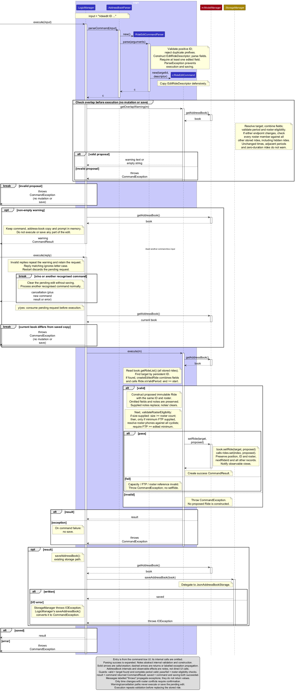
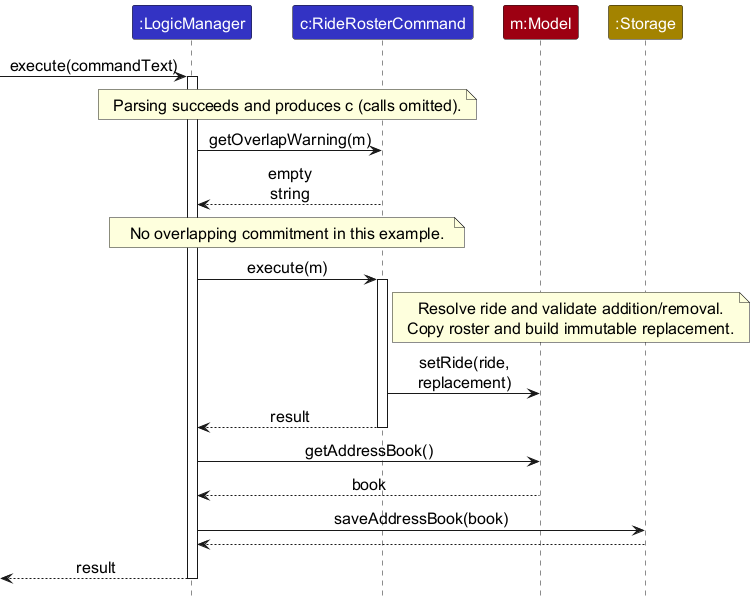
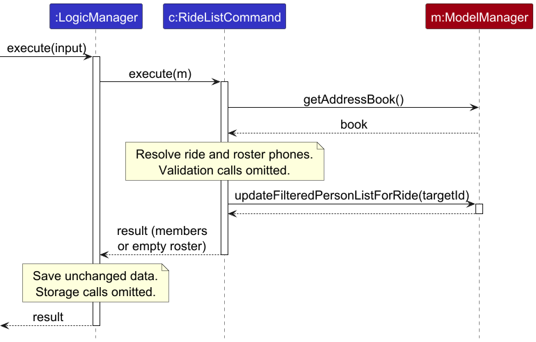
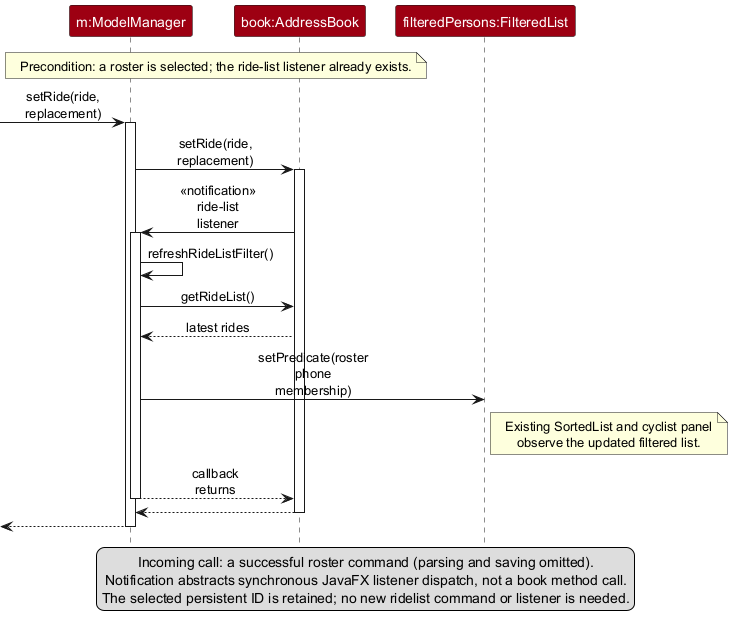

* Table of Contents
{:toc}

--------------------------------------------------------------------------------------------------------------------

## **Acknowledgements**

* Cyclique is adapted from [AddressBook-Level3 (AB3)](https://github.com/se-edu/addressbook-level3), created by the [SE-EDU initiative](https://se-education.org/). Its layered architecture, command/parser structure, JavaFX UI framework, JSON storage infrastructure and test utilities form the base of Cyclique. The [AB3 User Guide](https://se-education.org/addressbook-level3/UserGuide.html) and [Developer Guide](https://se-education.org/addressbook-level3/DeveloperGuide.html) provide the documentation structure, inherited design explanations and diagrams, and the proposed undo/redo design retained below. Cyclique adapts these for cyclist profiles, emergency contacts, group rides and rosters. AB3's [MIT licence](https://github.com/se-edu/addressbook-level3/blob/master/LICENSE) is retained in this repository.
* Runtime libraries: [JavaFX](https://openjfx.io/) provides the graphical interface; [Jackson](https://github.com/FasterXML/jackson) provides JSON serialisation, including Java date/time support.
* Development tools: [JUnit 5](https://junit.org/junit5/) supports automated tests; [Gradle](https://gradle.org/) and [Shadow](https://github.com/GradleUp/shadow) build and package the application; [Checkstyle](https://checkstyle.org/) checks Java style; [JaCoCo](https://www.jacoco.org/jacoco/) measures test coverage.
* Documentation tools: [PlantUML](https://plantuml.com/) produces the UML diagrams; [Jekyll](https://jekyllrb.com/), the [Minima theme](https://github.com/jekyll/minima) and [Jemoji](https://github.com/jekyll/jemoji) support the documentation website. The JavaFX control styling retains adaptations from [JMetro](https://pixelduke.com/2012/10/23/jmetro-windows-8-controls-on-java/), as credited in `DarkTheme.css`.

--------------------------------------------------------------------------------------------------------------------

## **Setting up, getting started**

Refer to the guide [_Setting up and getting started_](SettingUp.md).

--------------------------------------------------------------------------------------------------------------------

## **Design**

<div markdown="span" class="alert alert-primary">

:bulb: **Tip:** The `.puml` files used to create diagrams are in `docs/diagrams`. Refer to the [_PlantUML Tutorial_ at se-edu/guides](https://se-education.org/guides/tutorials/plantUml.html) to learn how to create and edit diagrams.
</div>

### Architecture


The ***Architecture Diagram*** given above explains the high-level design of the App.

The following provides a quick overview of the main components and their interactions.

**Main components of the architecture**

**`Main`** (consisting of classes [`Main`](https://github.com/AY2627S1-CS2103T-W11-1/tp/blob/master/src/main/java/seedu/address/Main.java) and [`MainApp`](https://github.com/AY2627S1-CS2103T-W11-1/tp/blob/master/src/main/java/seedu/address/MainApp.java)) is in charge of the app launch and shutdown.
* At app launch, it initialises the other components in the correct sequence, and connects them up with each other.
* At shutdown, it shuts down the other components and invokes cleanup methods where necessary.

The bulk of the app's work is done by the following four components:

* [**`UI`**](#ui-component): The UI of the App.
* [**`Logic`**](#logic-component): The command executor.
* [**`Model`**](#model-component): Holds the data of the App in memory.
* [**`Storage`**](#storage-component): Reads data from, and writes data to, the hard disk.

[**`Commons`**](#common-classes) represents a collection of classes used by multiple other components.

**How the architecture components interact with each other**

The *Sequence Diagram* below shows a confirmed cyclist deletion. The user first enters
`delete +65 91234567`, then enters `yes` through the same command box. `LogicManager`
resolves the displayed cyclist and holds the pending request without changing or saving
data. Only confirmation consumes the request, revalidates the target, deletes the cyclist
and saves the updated address book, including any affected ride rosters. The
lifelines below represent components; their internal object calls are omitted.


Each of the four main components (also shown in the diagram above),

* defines its *API* in an `interface` with the same name as the Component.
* provides its functionality through a concrete `{Component Name}Manager` class that implements the corresponding API interface.

For example, the `Logic` component defines its API in `Logic.java` and implements it in `LogicManager.java`. Other components interact with a component through its interface rather than its concrete class, preventing them from coupling to that component's implementation, as illustrated in the following partial class diagram.


The sections below give more details of each component.

### UI component

The **API** of this component is specified in [`Ui.java`](https://github.com/AY2627S1-CS2103T-W11-1/tp/blob/master/src/main/java/seedu/address/ui/Ui.java)


The UI consists of a `MainWindow` and its parts, such as `CommandBox`, `ResultDisplay`, `PersonListPanel`, `RideListPanel`, and `StatusBarFooter`. All of these, including `MainWindow`, inherit from the abstract `UiPart` class, which captures common behaviour among classes that represent visible GUI parts.

The `UI` component uses the JavaFX UI framework. The layouts of these UI parts are defined in matching `.fxml` files in `src/main/resources/view`. For example, [`MainWindow.fxml`](https://github.com/AY2627S1-CS2103T-W11-1/tp/blob/master/src/main/resources/view/MainWindow.fxml) specifies the layout of [`MainWindow`](https://github.com/AY2627S1-CS2103T-W11-1/tp/blob/master/src/main/java/seedu/address/ui/MainWindow.java). The exception is `ArtworkScreen`, which is not a `UiPart` and has no `.fxml` file (see [Opening and closing artwork](#opening-and-closing-artwork)).

The `UI` component,

* executes user commands using the `Logic` component.
* listens for changes to `Model` data so that the UI can be updated with the modified data.
* keeps a reference to the `Logic` component, because the `UI` relies on the `Logic` to execute commands.
* depends on some classes in the `Model` component because it displays `Person` and `Ride` objects from the model.

#### Cyclist panel and ride panel

`MainWindow` is split into two columns. The left 70% holds the `CommandBox`, the `ResultDisplay` and the cyclist panel (`PersonListPanel`). The right 30% holds the ride panel (`RideListPanel`).

Cyclist cards are numbered from 1 using their displayed positions; ride cards show persistent IDs. Each panel is given an `ObservableList` by `MainWindow` and builds one card for every item in it: `PersonListPanel` shows a `PersonCard` for each `Person` from `Logic#getFilteredPersonList()`, and `RideListPanel` shows a `RideCard` (laid out by `RideListCard.fxml`) for each `Ride` from `Logic#getFilteredRideList()`. Because the panels observe these lists, they refresh by themselves when cyclists or rides are added, edited, deleted or filtered. `RideCard` keeps its text formatting in small static methods so that they can be unit tested without the GUI. The cards keep values such as phone numbers, distances, powers and dates on one line by replacing their spaces with no-break spaces (`DisplayText#keepTogether`), so a label can only wrap between whole values. The ride card shows the roster across its full width, because a phone number is too wide for the narrow value column. The main window has a minimum width of 720 so that the Rides panel cannot become too narrow for these values.

The two panels are filtered independently of each other:

* `find`, `list` and `ridelist ID` change only the cyclist panel. In particular, `ridelist ID` shows the cyclists registered for that ride in the cyclist panel; it does not change the ride panel.
* `ridefind` changes only the ride panel, and `ridefind all` shows every ride again. When the filter hides every ride, `RideListPanel` shows `No rides match the current filter. Use ridefind all to show all rides.` instead of `No rides yet. Use rideadd to create one.`. It tells the two cases apart using the unfiltered list from `Logic#getRideList()`.

#### Help menu templates

`CommandTemplates` holds a list of `Template` records, one for each command. Each `Template` has the text shown in the Help menu and the starter text for the command box. Each menu item is a wrapping label. Whenever the **Help** menu opens, `MainWindow` builds the command items again and limits their width to the room between the **Help** menu and the right edge of the window, so a long command format wraps onto further lines instead of making the menu wider than the window. A wider window gives a wider menu, and a narrower window a narrower one. Lines wrap only between parameters, because spaces inside an optional group such as `[from/DATE [TIME]]` are replaced by no-break spaces (`CommandTemplates#keepOptionalGroupsTogether`). The menu font and padding in `DarkTheme.css` are kept small so that the height of the menu also stays inside the window. When `MainWindow` is set up, it adds one menu item per `Template` to the top of the **Help** menu, above **Full help...**. Choosing an item calls `CommandBox#setCommandText(...)` with that template's starter text. The command is only placed in the command box for the user to complete; it is not executed. The **Full help...** window (`HelpWindow`) lists the usage of every command, reusing the usage messages defined by the command classes in `Logic`, so `HelpWindow` depends on `Logic`.

#### Opening and closing artwork

`ArtworkScreen` shows a short, timed splash screen with a caption. It is drawn in code, so it is a plain class rather than a `UiPart`. `UiManager` shows the opening artwork before the main window appears, and `MainWindow` shows the closing artwork when the application exits. For this reason both classes depend on `ArtworkScreen`.

### Logic component

**API** : [`Logic.java`](https://github.com/AY2627S1-CS2103T-W11-1/tp/blob/master/src/main/java/seedu/address/logic/Logic.java)

Here's a (partial) class diagram of the `Logic` component:


The sequence diagram below illustrates the two inputs for cyclist deletion:
`execute("delete +65 91234567")`, followed by `execute("yes")` or `execute("no")`.
The example assumes that exactly one displayed cyclist has that phone number.
The `alt` frame distinguishes confirmation from cancellation; the nested `opt`
frame shows deletion and saving only after successful target revalidation.
Error responses are described below rather than expanded in the diagram.


How the `Logic` component works:

1. `LogicManager` passes a new command to `AddressBookParser`, which uses the matching
   parser (for example, `DeleteCommandParser`) to create a `Command` object.
1. Most commands execute immediately against the `Model`, after which `LogicManager`
   saves the address book and returns a `CommandResult`.
1. For `DeleteCommand`, `LogicManager` instead calls `getPersonToDelete(model)` to
   resolve the cyclist from the sorted displayed list. It stores `pendingDeletion`
   and the immutable `pendingCyclist` snapshot, then returns a confirmation prompt.
   This first input neither deletes a cyclist nor saves data.
1. The next input enters the same `Logic.execute` method. A `yes` reply consumes the
   pending request, resolves the target again and compares it with the snapshot.
   If the cyclist is still displayed and unchanged, the command executes
   `deletePerson(person)` and `LogicManager` saves the address book. A `no` reply
   clears the request and returns cancellation feedback without changing or saving data.

Replies are trimmed and accept `y`/`yes` or `n`/`no`, ignoring case. Invalid replies
retain the request. Another recognised command cancels it before normal parsing,
even if that command's arguments are invalid. See
[Cyclist deletion confirmation](#cyclist-deletion-confirmation) for the error and
cancellation behaviour. Ride deletion executes immediately and does not use this
confirmation flow.

Ride Edit and roster commands implement `OverlapAwareCommand`. Before executing one, `LogicManager` calls
`getOverlapWarning`; a non-empty result starts a separate pending ride request without mutation or saving.
See [Group ride editing](#group-ride-editing-rideedit) for confirmation, cancellation and snapshot validation.

The following partial class diagram shows how the `find` and `ridefind` commands are parsed.
It omits unrelated command parsers and validation classes.


How the parsing works:
* `AddressBookParser` selects the concrete parser for the command word. For cyclist search,
  `FindCommandParser` tokenises prefixes, validates each value with `ParserUtil`, creates a
  `PersonMatchesFindCriteriaPredicate`, and places it in a `FindCommand`. For ride search,
  `RideFindCommandParser` performs the equivalent work for ride fields and creates a
  `RideMatchesFindCriteriaPredicate` held by `RideFindCommand`.
* Both concrete parsers implement `Parser`, and both use `ArgumentTokenizer`,
  `ArgumentMultimap`, `Prefix` and the validation helpers shown in the diagram. A dashed
  line with a hollow triangle pointing to `Parser` shows interface implementation. A dashed
  arrow labelled `«create»` points to a class whose object is constructed by the class at
  the arrow's tail.

#### Optional quoted ride notes

`RideAddCommandParser` and `RideEditCommandParser` explicitly call
`ArgumentTokenizer.tokenizeWithQuotedNotes`; every other caller continues to call `tokenize`.
The existing tokenizer detects a supplied prefix after whitespace. Consequently, unquoted
`notes/Bring camera with aperture f/2` supplies both notes and minimum power; there is no way to infer intent.
The optional `notes/"Bring camera with aperture f/2"` syntax resolves that ambiguity for creation and editing.

The new entry point sorts the existing prefix positions and walks them in command order. A quote immediately
after a recognised `notes/` starts a quoted value; the first subsequent double quote closes it.
Prefix positions inside that range are excluded from argument extraction. Prefixes outside it retain their
normal meaning and ordering, including duplicates for `ArgumentMultimap#verifyNoDuplicatePrefixesFor` to reject.
During extraction, only quoted notes have their surrounding delimiters removed, before `ParserUtil#parseNotes`
and `Notes` apply word-count validation and whitespace normalisation.

Missing closing quotes, blank quoted values and non-whitespace text between the closing quote and the next
recognised prefix (or command end) throw `ParseException` with `MESSAGE_INVALID_QUOTED_NOTES`.
Both the quoted content and trailing whitespace use `Notes.isBlank`. Prefix recognition still uses
`Character.isWhitespace`: NBSP and NARROW NBSP are accepted after the quote but need an ordinary space
immediately before any following prefix.
Backslashes are literal; embedded double quotes and escape sequences are unsupported.
Bare `notes/` still clears notes in Ride Edit, while `notes/""` is rejected rather than treated as clearing.
The tokenizer owns quote syntax; the parsers and commands retain field, ID, period and roster validation.
Parsing failure never reaches execution or saving. A malformed parameter outside valid quoted notes likewise
fails its normal validation before mutation. Other fields have no new quote semantics, and the original
`tokenize` path, including Ride Find and repeated cyclist Find criteria, is unchanged.

Quoted notes are parsed before overlap processing. Invalid quoting creates no pending ride request. If a
request is already pending, a new recognised command cancels it before parsing, even when that new input is malformed.

For example, `rideedit 1 notes/"Bring camera with aperture f/2" s/5` supplies literal notes and maximum
group size 5, leaving minimum power, ID and roster unchanged. Use an existing ride ID; normal roster constraints
still apply. `rideedit 1 notes/"camera f/2` and `rideedit 1 notes/"camera"extra f/2` are rejected without
changing or saving any ride fields. The manual regression scenario below covers these cases and explicit power edits.

#### Unicode whitespace in ride notes (Issue #169)

`Notes` uses `Character.isWhitespace(cp) || Character.isSpaceChar(cp)` for blank detection and
normalisation, including NBSP, EM SPACE, NARROW NBSP and IDEOGRAPHIC SPACE. It trims separators, collapses
runs to ordinary spaces and validates 1–10 words, preserving all other code points. `trim()`, `isBlank()`
and default regex `\s` alone do not cover this rule. Ride Edit clears unquoted blank values through
`Notes.isBlank`; quoted blanks remain errors. Prefix recognition and the single-line command interface
are unchanged. Valid legacy notes normalise on loading; invalid notes are neither discarded nor truncated.

If loading fails, `MainApp.init()` retains the exception without creating model, logic or normal UI.
`start()` shows UiManager's standalone fatal dialog on the JavaFX Application Thread: a short header and
wrapped, scrollable content explain the file, safe loading reason and backup/correction steps. JSON excerpts
stay out of the dialog; full details remain logged. Sizing is deferred with `Platform.runLater` because
Dialog's shown event precedes native-window creation on GTK. The window stays within the usable screen.
Dismissal requests `Platform.exit()`; `stop()` skips saving when there is no model. The source file remains
unchanged until the user repairs it and restarts. Missing files still use sample data; valid empty books load.
No UML changes are needed: field validation remains internal to the existing command interactions.

### Model component
**API** : [`Model.java`](https://github.com/AY2627S1-CS2103T-W11-1/tp/blob/master/src/main/java/seedu/address/model/Model.java)


The `Model` component,

* stores cyclists as `Person` objects in an `AddressBook` containing a `UniquePersonList`.
  Each cyclist has a `Name`, their own `Phone`, an `Email`, an `Ftp`, an
  `ExperienceLevel` and a set of preferred cycling `Location` values. The separate
  emergency contact is an `Optional<Phone>`: one own phone is required, while the
  emergency phone may be absent for legacy records. Cyclists no longer have tags.
* selects matching cyclists using `FilteredList<Person>`, then exposes a live,
  unmodifiable `SortedList<Person>` through `getFilteredPersonList()`. It sorts by
  full name using `String.CASE_INSENSITIVE_ORDER`, with stored position as the
  tie-breaker. Names that are identical ignoring case retain their relative order,
  including after additions, edits and filtering. Filtering and sorting leave the
  stored list and JSON order unchanged; edit and delete target the cyclist's own phone.
  The transformation arrows point towards their underlying source lists: the
  stored-order view feeds the filtered view, which feeds the sorted view.
  `ModelManager` returns `sortedPersons` through the `Model` API.
* stores an ordered ride collection and `nextRideId` in `AddressBook`.
  `AddressBook#addRide` assigns persistent IDs that increase and are never reused;
  these IDs are independent of displayed positions. `ModelManager` also maintains
  a `FilteredList<Ride>` for `ridefind`, preserving stored ride order among matches.
  Rides are immutable, so changes replace the stored ride. A roster contains cyclist
  `Phone` values rather than direct `Person` references. `ridelist ID` filters the
  cyclist view to that ride's roster, still using the alphabetical display pipeline.
  Rides and cyclists are saved in the same address-book JSON file.
* stores a `UserPrefs` object representing the user's preferences (currently, the GUI
  settings), exposed through `ReadOnlyUserPrefs`.
* does not depend on the UI, Logic or Storage components; its domain entities make
  sense independently of those components.

### Storage component

**API** : [`Storage.java`](https://github.com/AY2627S1-CS2103T-W11-1/tp/blob/master/src/main/java/seedu/address/storage/Storage.java)


The `Storage` component,
* can save both address book data and user preference data in JSON format, and read them back into corresponding objects.
* saves cyclists and group rides in the same JSON file. `JsonSerializableAddressBook` holds a collection of `JsonAdaptedPerson` objects (the cyclists), a collection of `JsonAdaptedRide` objects (the rides) and the `nextRideId` counter. There is no separate ride storage file or class.
* saves the ride ID counter, `nextRideId`, so that ride IDs keep increasing and are never reused, even after rides are deleted or the address book is cleared. If the counter is missing when reading, numbering continues after the highest saved ride ID.
* saves a ride's roster in `JsonAdaptedRide` as a list of cyclist phone numbers (strings), not as `Person` objects. When reading, every roster phone must belong to a saved cyclist, and a roster must not contain duplicates or exceed the ride's maximum group size.
* saves a cyclist's optional emergency number in `JsonAdaptedPerson` as `emergencyPhone`.
* remains compatible with older files. `rides` and `nextRideId` are optional when reading, so files saved before rides existed load with no rides, a ride without a `roster` loads with an empty roster, and a cyclist without `emergencyPhone` loads with no emergency number. Invalid ride data makes the whole file invalid in the same way as invalid cyclist data.
* ignores the retired `tags` property in cyclist JSON records without validating its contents. New saves omit it. Supported cyclist fields retain their existing validation and legacy defaults.
* is implemented by `StorageManager`, which delegates the actual JSON file access to `JsonAddressBookStorage` and `JsonUserPrefsStorage` (one class per data file).
* depends on some classes in the `Model` component (because the `Storage` component's job is to save/retrieve objects that belong to the `Model`)

### Common classes

Classes used by multiple components are in the `seedu.address.commons` package.

--------------------------------------------------------------------------------------------------------------------

## **Implementation**

This section describes some noteworthy details on how certain features are implemented.

### Cyclist field validation

`Name` accepts Unicode letters and decimal digits, spaces, and combining marks attached to
letters or digits; the first character must be a letter or digit. A hyphen (`-`) or straight
apostrophe (`'`) may join letter/digit sequences, for example `Tan Wei-Ling` or `John O'Connor`.
Leading, trailing, consecutive or space-adjacent hyphens/apostrophes are rejected.
`AddCommandParser` passes `n/` through `ParserUtil.parseName`, which trims surrounding
whitespace and validates it before constructing `Name`. The spelling is preserved in the
cyclist record and JSON storage. Edit and ride commands share the same name rules.
`Location` instead accepts
only English letters (A–Z, a–z), digits, spaces, hyphens and apostrophes, and must not be blank.
Cyclist and ride commands reuse these value classes, so their names support Unicode while
their locations use the narrower rule. See `Name#isValidName` and `Location#isValidLocation`.

### Cyclist and ride filtering

The `find` command accepts `n/` for name, `p/` for the cyclist's own phone, `sos/` for an
emergency phone, `f/` for a minimum FTP, `x/` for experience level and `l/` for preferred
location. At least one criterion is required. The `n/`, `p/`, `sos/`, `x/` and `l/` prefixes
can each be repeated: values within one field use OR matching, while different fields use
AND. The `f/` prefix accepts only one minimum FTP value, and a cyclist matches when their
FTP is greater than or equal to that value. Names and preferred locations match complete words case-insensitively;
a name containing spaces matches when all supplied words are present in the same order, even
when other words appear between them. A multi-word location criterion follows the same rule. For example,
`find l/Punggol x/Intermediate f/250` finds intermediate cyclists who prefer Punggol and have
an FTP of at least 250 watts. Preferred locations match case-insensitively against any
supplied `l/` value. A cyclist whose stored preferred location is `any` matches every
location criterion; searching for `l/any` alone matches only cyclists with that stored
preference. Emergency-phone matching checks the optional emergency contact, not the
cyclist's own phone.

`find` applies its predicate to the model's person filter. The filtered person view is then
sorted alphabetically by full name before `getFilteredPersonList()` supplies the observable
list displayed by the cyclist panel.

The `ridefind` command accepts one value for each of `n/` (name), `from/`, `to/`, `l/`
(location), `d/` (distance), `f/` (minimum power), `s/` (maximum group size) and `notes/`.
Each prefix may appear only once, and all supplied ride criteria must match. The special
input `ridefind all` clears the ride criteria. Date-only boundaries expand to
0000 for `from/` and 2359 for `to/`; when both are supplied, the end must not be earlier than
the start. A ride matches only if it starts at or after `from/` and ends at or before `to/`.
The `n/` value matches complete words in the ride name in the supplied order, ignoring case;
other complete words may appear between the requested words. For example, both
`ridefind n/Sunday` and `ridefind n/Sunday Ride` match `Sunday Sunrise Ride`, while
`ridefind n/Ride Sunday` does not. Partial word fragments are not accepted, so `ridefind n/Rise`
does not match `Sunrise`. The `l/` value follows the same rule for ride locations: for example,
`ridefind l/East Park` matches `East Coast Park`.
The `d/` and `s/` values
compare their respective numeric fields for equality, while `notes/` performs a
case-insensitive whole-word or phrase match against the ride's notes. For example,
`ridefind l/Tampines f/200` lists rides at Tampines whose minimum
power is at least 200 watts. Unlike cyclist `find`, ridefind does not compare a ride's
minimum power with a cyclist's FTP: its `f/` value is compared directly with the ride's
`MinimumPower`, and a ride matches when its stored value is greater than or equal to the
criterion. Case-insensitive notes matching uses `Locale.ROOT`, so the same search gives
consistent results regardless of the computer's language settings.

Ride Find keeps `ArgumentTokenizer#tokenize`: quotes remain ordinary search characters and do not protect
prefixes. The whole-word and phrase predicate is unchanged.

`ridefind` applies `RideMatchesFindCriteriaPredicate` to the model's filtered ride list. The
ride panel observes that list and refreshes its displayed ride cards; it does not change the
cyclist panel. Conversely, `ridelist ID` is the command that filters the cyclist panel to the
selected ride's roster.

### Cyclist deletion confirmation

Cyclist deletion is a two-input interaction: for example, enter
`delete +65 91234567`, inspect the confirmation prompt, then enter `yes` or `no`
through the same command box. The sequence diagram in the
[Logic component](#logic-component) shows both inputs.

`LogicManager` resolves `delete PHONE` against the displayed list using
`DeleteCommand.getPersonToDelete`. This preserves the existing invalid-phone,
missing/hidden-target and ambiguous-target errors before a prompt is shown.
It stores the pending command and an immutable snapshot of that cyclist in memory,
in `pendingDeletion` and `pendingCyclist`, then returns a confirmation request to
the existing result panel without executing or saving the deletion. The command
box accepts the next reply through the same `Logic.execute` entry point.

Replies are trimmed and compared ignoring case. `y`/`yes` executes the pending
`DeleteCommand` and saves the book; `n`/`no` clears the request without changing the
model, filter or file. Before execution, the target must still be displayed and
have the same details as the snapshot. Confirmation state is consumed before
execution, so errors or failed saves cannot replay the deletion. Storage failures
retain the existing behaviour and error messages.

An unrecognised reply reports an error and retains the request. A supported command
word, including one with invalid arguments, cancels the request before normal
parsing/execution. Cancellation feedback is prepended to the new output or error;
Help and Exit flags are preserved. `AddressBookParser.isRecognisedCommand` makes
this distinction using the same case-sensitive command words. A subsequent `delete`
cancels the previous request first and creates a new request only if its own phone
target is valid. Pending requests are never serialised and disappear when the application closes or restarts.

### Emergency contact implementation

`Person` stores an `Optional<Phone>` emergency contact as a data field, shown as
the separate `emergencyPhone` relationship with multiplicity `0..1` in the
[model class diagram](#model-component). The cyclist's own `phone` relationship
has multiplicity `1`. New `add` commands require `sos/`; `edit` optionally replaces it and otherwise preserves it. All supplied numbers reuse `ParserUtil.parsePhone`, including repeated `sos/` find criteria. Find uses OR within each field and AND across supplied fields. Emergency contacts do not participate in cyclist identity because riders may share a contact. Edit and delete still target the cyclist’s own phone number.

`JsonAdaptedPerson` saves the `emergencyPhone` property. Missing or null values load as `Optional.empty()` for backwards compatibility, while supplied invalid values reject the record. `PersonCard` shows the number in a labelled SOS row, or **Not provided** for legacy records. Help formats and dropdown templates include the new prefix.

### Group ride creation (`rideadd`)

`rideadd n/NAME from/FROM to/TO l/LOCATION d/DISTANCE f/MIN_POWER s/MAX_GROUP_SIZE [notes/NOTES]`
creates a group ride. The [model class diagram](#model-component) shows the ride
collection and ID counter at an overview level; the ride value classes are described below.

**Model.** A `Ride` (package `seedu.address.model.ride`) is immutable and holds an `int` ID, a `Name`, two
`RideDateTime` values (`from` and `to`), a `Location`, a `Distance`, a `MinimumPower`, a `GroupSize`, an
`Optional<Notes>` and a roster. `Name` and `Location` are reused from the cyclist model, so a ride follows the
same name and location rules as a cyclist. Every other field is a small value class with its own
`isValidXyz` method and `MESSAGE_CONSTRAINTS`, in the same style as `Ftp` and `Phone`:

* `RideDateTime` accepts only `DD-MM-YYYY TTTT`. A regular expression fixes the digit counts, and a strict
  `java.time` formatter then rejects dates that do not exist (such as 31 February) and times outside 0000 to 2359.
* `Distance` is a positive number of kilometres with up to 2 decimal places, stored in its simplest form so that
  `45`, `045` and `45.0` are equal.
* `MinimumPower` is a whole number from 1 to 600 watts, the same range as `Ftp`. It is a separate class so that its
  error message talks about minimum power instead of FTP.
* `GroupSize` is a positive whole number. `Notes` has at most 10 words, and repeated spaces are collapsed.
* The roster is an unmodifiable list of cyclist phone numbers. A new ride starts with an empty roster. Phone
  numbers are used because a cyclist's phone number is already how cyclists are identified.

`Ride`'s constructor rejects a `to` that is earlier than `from`, using `Ride.isValidPeriod`. A ride that ends at
the moment it starts is allowed.

**ID assignment.** The parser builds a ride whose ID is `Ride.UNASSIGNED_ID` (0). `Model#addRide` passes it to
`AddressBook#addRide`, which gives it the current `nextRideId`, increments the counter and returns the stored ride.
The ID is therefore decided in one place and `RideAddCommand` shows the stored ride to the user. IDs are never
reused, because the counter only goes up and is saved with the data. `AddressBook#setRides` raises the counter if it
is lower than the highest ride ID, so a hand-edited file cannot cause a clash. Rides are told apart by ID, so two
rides with identical details are allowed and `rideadd` has no duplicate check.

**Parsing.** `RideAddCommandParser` tokenises with the prefixes `n/`, `from/`, `to/`, `l/`, `d/`, `f/`, `s/` and
`notes/`, using `ArgumentTokenizer#tokenizeWithQuotedNotes` as described in
[Optional quoted ride notes](#optional-quoted-ride-notes). Outside quoted notes, prefixes are only recognised
after whitespace, so `notes/` is not confused with `n/` and `to/` is not
confused with a word that happens to end in `to`. Rides reuse `PREFIX_NAME`, `PREFIX_LOCATION` and `PREFIX_FTP`
(for minimum power); `CliSyntax` adds `PREFIX_FROM`, `PREFIX_TO`, `PREFIX_DISTANCE`, `PREFIX_GROUP_SIZE` and
`PREFIX_NOTES`. A missing compulsory field or a non-empty preamble gives the usual invalid-format message with
`RideAddCommand.MESSAGE_USAGE`, a repeated prefix is reported by `verifyNoDuplicatePrefixesFor`, and each field is
parsed by a `ParserUtil` method that throws the field's own message. Values are checked in the order name, `from`,
`to`, location, distance, minimum power, group size and notes, and only the first error is reported. The check
that `to/` is not earlier than `from/` runs after every field is valid.

For example, `rideadd n/Camera Ride from/29-10-2026 1600 to/29-10-2026 1800 l/East Coast d/20 f/180 s/2 notes/"Bring camera with aperture f/2"`
creates notes `Bring camera with aperture f/2` and minimum power 180 W.
Quote syntax is checked during tokenisation before the field checks above.

**Storage.** Rides are saved in the same `data/addressbook.json`, in a `rides` array, with a `nextRideId` number. `JsonAdaptedRide` mirrors `Ride`, including its roster as a list of cyclist phone numbers, and validates each field when loading, throwing an `IllegalValueException` with the field's message. `rides` and `nextRideId` are optional when reading, so files saved before rides existed load with no rides and `nextRideId` 1. Duplicate ride IDs or a non-positive `nextRideId` make the file invalid. If `nextRideId` is missing, numbering continues after the highest saved ID. See the [Storage component](#storage-component) for how these classes fit together.

**Design considerations.**

* *Where the ID is assigned.* Assigning it in the model keeps the parser free of state and keeps all numbering in
  one class. The alternative, a counter inside the parser, would be lost on restart and would be hard to test.
* *Where rides are stored.* Keeping rides in `AddressBook` means they are saved by the existing storage code after
  every command. A separate rides file would need its own load and save path and could get out of step with the
  cyclist data.
* *Dates.* `java.time.LocalDateTime` is used, with a strict parser, so invalid dates are rejected by the library
  instead of by hand-written checks. Time zones are not needed because every ride is local to the organiser.

### Group ride editing (`rideedit`)

`rideedit ID [n/NAME] [from/START] [to/END] [l/LOCATION] [d/DISTANCE] [f/MIN_POWER] [s/MAX_GROUP_SIZE] [notes/NOTES]`
edits an existing ride without changing its identity or roster. The diagram focuses on a successful edit,
including confirmation when times overlap. Parsing, validation failures and cancellation are described below.

[](images/RideEditSequenceDiagram.png)

*Select the diagram to open it at full size.*

**Parsing.** `RideEditCommandParser` separates the positive ride ID from the prefixed fields and builds an
`EditRideDescriptor`. Each supplied value is parsed by the same `ParserUtil` method used by `rideadd`, while
duplicate prefixes, malformed IDs and a command with no editable field are rejected. Notes have three explicit
states: an omitted `notes/` preserves the existing value, a non-blank value replaces it and empty or
whitespace-only unquoted `notes/` clears it. Tokenisation uses the explicit quoted-notes entry point described in
[Optional quoted ride notes](#optional-quoted-ride-notes); quoted empty values are rejected.

**Replacement and validation.** `RideEditCommand` finds the target by its unique ID and combines the descriptor
with the existing ride. It validates the complete resulting period, so changing only `from/` or `to/` cannot
produce an end time earlier than the start time; equal start and end times are accepted. After the period check,
`createEditedRide` constructs the proposed immutable `Ride`, retaining the same ID and roster. Next,
`validateRosterEligibility` checks an edited maximum group size against the roster count before checking an edited
minimum FTP. Only when minimum FTP is supplied does it resolve each roster phone against all cyclists, rejecting
an unresolved phone or a minimum above any member's FTP. An unrelated edit does not resolve roster phones.
Both `getOverlapWarning` and `execute` perform these checks. The warning check does not replace or save the ride.
Only after validation succeeds and any required overlap confirmation is accepted does `execute` call
`Model#setRide`. `ModelManager` delegates to `AddressBook#setRide`, which replaces the target at its current list position, preserving other rides and the next
ride ID counter. Failed parsing, a missing target or an invalid resulting ride therefore leaves the model unchanged.

**Conditional overlap confirmation.** Before execution, `LogicManager` calls `RideEditCommand#getOverlapWarning`.
If either endpoint actually changes, the command checks the proposed period against all other stored rides
for every cyclist on its roster, including rides hidden by filters. Adjacent periods and zero-duration rides
do not conflict. An edit with unchanged times, or without a conflict, executes immediately.

For a conflicting edit, `LogicManager` retains the command, a copy of the address book and the warning text
in memory. It returns the warning without applying any fields or saving. A later `y`/`yes` reply consumes the
pending request, rejects it if the address book has changed, then executes and saves the whole edit.
An `n`/`no` reply cancels without saving; replies are case-insensitive. An invalid reply repeats the warning,
while another recognised command cancels the edit and is processed normally. Restarting discards the request.

The address book's observable ride list emits a successful replacement, allowing the existing Rides panel to
refresh. Cyclist records are unchanged. `LogicManager` saves the updated address book using the existing JSON
storage path. No separate Ride Edit storage format is required.

### Group ride deletion (`ridedelete`)

`RideDeleteCommandParser` parses the argument as one positive integer using the existing index parser; missing,
malformed, overflowing or additional arguments produce the standard invalid-command-format error.
`RideDeleteCommand` treats that value as a persistent ride ID rather than a list position. It finds the matching
ride before mutation and rejects an unknown ID.

On success, `RideDeleteCommand` calls `Model#deleteRide`, which delegates to `AddressBook#removeRide`. Removing the
immutable ride also removes its contained roster associations. It does not alter cyclist records, other rides or
their rosters, and `nextRideId` is preserved so remaining IDs are not renumbered and deleted IDs are not reused.
The existing observable ride list notifies the Rides panel, while `LogicManager` saves the updated model through
the existing JSON storage path. Ride deletion is immediate and does not use cyclist deletion confirmation.

### Ride roster management

`rideaddcyclist ID PHONE` and `ridedeletecyclist ID PHONE` share `RideRosterCommandParser` and `RideRosterCommand`. The parser separates the first token as a positive integer ride ID and validates the remaining text as a complete phone number. `AddressBookParser` selects `isJoining = true` for addition and `false` for removal; the shared parser passes this flag to the command.

The sequence diagram below shows either roster operation succeeding, with no pending cyclist deletion and no
overlap warning needed. The separate confirmation phase is omitted. Local validation and collection operations
are summarised in notes to keep the diagram focused on parsing, immutable replacement and saving.

`LogicManager` first calls `RideRosterCommand#getOverlapWarning`, which validates the proposed roster without
replacing it. Addition checks the joining cyclist against all other stored rides using `RideOverlapWarning`;
removal needs no overlap confirmation. A warning uses the same deferred execution and snapshot validation as
Ride Edit. Execution repeats normal roster validation before replacement.

[](images/RideRosterSequenceDiagram.png)

*Select the diagram to open it at full size.*

The command searches the complete ride collection by persistent ID, rather than a displayed position, so `ridefind` does not restrict which ride can be changed. A roster stores `Phone` objects, not direct `Person` references. The command first copies the selected ride's roster into a local `ArrayList<Phone>`.

For addition, it resolves the phone against `Model#getAddressBook().getPersonList()`, including cyclists hidden by `find` or `ridelist`. It then checks duplicate membership, maximum group size and the cyclist's FTP against the ride's minimum power, in that order, before adding the phone to the copy. For removal, `roster.remove(phone)` both removes the phone from the copy and checks membership: a `false` result causes a `CommandException`. Removal leaves the cyclist record intact. Parsing and validation failures occur before the stored ride is replaced, and do not reach the save step.

`Ride#withRoster(...)` constructs an immutable replacement with the same ID and other details. `ModelManager#setRide(...)` implements `Model#setRide(...)` and delegates to `AddressBook#setRide(...)`, preserving the ride's list position and next-ID counter. Replacing the observable list entry refreshes its ride card within the current `ridefind` view. If `ridelist ID` is active for that ride, the model's ride-list listener also refreshes the cyclist filter from the new roster; the existing sorted view keeps those cyclists alphabetical.

The command returns a `CommandResult` to `LogicManager`, which calls its `saveAddressBook()` helper before returning the result to the UI. The helper passes the complete address book to `Storage#saveAddressBook(...)`; cyclists, rides and roster phone lists share the existing JSON file. A storage failure reports an error after the in-memory replacement; it does not roll back that replacement.

Cyclist phone edits use `AddressBook#setPerson(...)` to replace the old phone in every ride roster. Confirmed cyclist deletion reaches `AddressBook#removePerson(...)`, which removes the phone from every roster. Both operations construct replacement rides with `withRoster(...)` and save through the existing logic path. The cyclist deletion prompt explains this effect; requesting or cancelling deletion leaves the rosters unchanged.

### Ride roster display (`ridelist`)

`ridelist ID` displays registered cyclists in the left-hand cyclist panel. The first diagram shows a
successful initial selection, with parsing, local validation and filtering calls, and storage calls omitted.

[](images/RideListSequenceDiagram.png)

*Select the diagram to open it at full size.*

`RideListCommandParser` accepts exactly one positive integer ID. `RideListCommand` finds the ride using
`Ride#getId()`, so the ID is persistent and is not a displayed position. Its roster contains `Phone` objects;
before filtering, the command resolves every phone against the complete person list rather than the currently
filtered view. An unknown ride or unresolved phone throws before the existing filter changes.

For a valid ride, `Model#updateFilteredPersonListForRide(ID)` stores `activeRideListId` in `ModelManager` and calls
`refreshRideListFilter()`. This retrieves the latest roster by persistent ID and sets the `FilteredList<Person>`
predicate to match its phone references. The existing `SortedList<Person>` takes that filtered view and orders it
by full name, ignoring case, with stored position as the tie-breaker. `PersonListPanel` observes the sorted view
through its `ListView` and displays the matching `PersonCard` objects. An empty roster produces an empty cyclist
view and an empty-roster command result. The right-hand Rides panel has an independent filter and is unchanged.

The separate refresh diagram shows the later model interaction. Its labelled `«notification»` arrow abstracts
synchronous JavaFX listener dispatch; the roster command's parsing and saving are omitted.

[](images/RideRosterRefreshSequenceDiagram.png)

*Select the diagram to open it at full size.*

`ModelManager` registers one listener on the existing observable ride list in its constructor, before commands
execute. A successful `RideRosterCommand` calls `Ride#withRoster` to construct an immutable replacement, then calls
`Model#setRide`. `ModelManager` delegates to `AddressBook#setRide`, whose list replacement notifies the existing
listener. Its lambda invokes `refreshRideListFilter()` during replacement, replacing the cyclist predicate from
the latest roster. The observable filtering and sorting pipeline refreshes the left panel automatically, without
another `ridelist`, a new listener or a direct call from the roster command to `RideListCommand` or the panel.

The selected ID, rather than a `Ride` object, remains active across immutable ride replacements. If that ride is
deleted, refreshing with an absent ID produces an empty cyclist list without selecting another ride. A generic
`Model#updateFilteredPersonList()` call clears the selected ID before applying its predicate, so `find`, `list`
and a successful cyclist addition replace Ride List filtering; later ride events cannot reactivate it.
Another successful `ridelist` selects its own persistent ID. `ModelManager#setAddressBook()` cancels the active selection before resetting the data, while
retaining the existing observable lists and listener.

The command does not mutate cyclist or ride data. `LogicManager` still saves the unchanged address book after a
successful command through its existing execution path. Validation finishes before the filter update, preserving
the previous filter on failure.

### \[Proposed\] Undo/redo feature

This feature is not implemented. The following adapts AB3's whole-book snapshot design
for Cyclique's confirmed deletion, rides and persistent ride IDs.

#### State and history

A proposed `VersionedAddressBook` would retain complete, immutable snapshots of cyclists,
rides and roster phone references, with a pointer to the active snapshot. Startup would
record the loaded book as the initial snapshot. Restoring a
snapshot would restore those records together, so undoing a cyclist deletion also restores
their memberships; undoing a phone edit restores the matching roster references.
It would reset display filters and discard pending confirmation requests.

The ride-ID counter needs a separate high-water mark, initialised from persisted data and
advanced whenever an ID is allocated. On undo or redo, the next ID would
be the maximum of the current high-water mark and the restored snapshot's `nextRideId`.
Restoring an older snapshot must never make an allocated ID available again. The next
successful save would persist this counter alongside the restored records, including
when a ride creation or `clear` is undone. Already exhausted IDs remain exhausted.

#### Example interaction

1. Start with a displayed cyclist at `+65 91234567` who belongs to ride 1.
2. Request `delete +65 91234567`. Reviewing or cancelling the request creates no history entry.
3. Confirm deletion. Only after revalidation and actual removal would the mechanism append
   one snapshot containing both the cyclist removal and the updated ride roster.
4. Add a cyclist using a complete valid `add` command. This would append another snapshot.
5. Undo once to remove that addition; undo again to restore the deleted cyclist and membership.
   Redo would reapply each recorded state, without requesting deletion confirmation again.
6. After an undo, a new state-changing command such as `clear` would discard the redo branch.
   Clearing would retain the ride-ID high-water mark.

Rejected commands, cancelled requests and read-only commands such as `list` would not add
history entries. A command that changes in-memory records but then fails to save would
still need a history entry: the current application retains those changes. Undo and redo
would use the existing saving path and report saving errors without promising persistence
or rollback. History and its pointer would be held only for the running session.

#### Design considerations

* **Whole-book snapshots (proposed choice):** Restore cyclists and ride memberships together
  without implementing a separate inverse for every command. The cost is memory proportional
  to the dataset and number of retained states; a history limit would need to be specified
  and tested before implementation.
* **Per-command inverse operations:** Use less memory, but must correctly restore phone
  references, memberships and deleted rides across every command. This adds more cases to
  maintain and test. The non-reused ride-ID policy applies to either design.

--------------------------------------------------------------------------------------------------------------------

## **Documentation, logging, testing, dev-ops**

* [Documentation guide](Documentation.md)
* [Testing guide](Testing.md)
* [Logging guide](Logging.md)
* [DevOps guide](DevOps.md)

--------------------------------------------------------------------------------------------------------------------

## **Appendix: Requirements**

### Product scope

**Target user profile**:

Cyclique is designed for organisers of recreational cycling groups in Singapore who:
* have a need to manage a significant number of cyclists
* have a need to quickly access cyclists’ contact and emergency information
* organise group rides and needs to identify suitable cyclists based on factors such as preferred cycling location, FTP and experience level
* are comfortable with typing and using CLI apps

**Value proposition**:
Organisers of cycling groups often have rider contact and information scattered across chats, spreadsheets, and memory, making it hard to identify suitable participants. Cyclique keeps this information in one place and helps organisers find which riders suit a given ride, based on preferred cycling location, FTP and experience level.


### User stories

Priorities: High (must have) - `* * *`, Medium (nice to have) - `* *`, Low (unlikely to have) - `*`

The status column distinguishes current requirements from future work. Current cyclist search uses a minimum FTP; configurable sorting and structured-file import are future requirements.

| Priority | As a/an …                                    | I want to …                                                                                                  | So that I can …                                                                       | Status |
| -------- | -------------------------------------------- | ------------------------------------------------------------------------------------------------------------ | ------------------------------------------------------------------------------------- | ------ |
| `* * *`  | proactive cycling organiser                  | add a new cyclist record with their name, phone number, and email                                            | keep basic contact details in one centralised directory                               | Implemented |
| `* * *`  | community-focused cycling organiser          | view a complete list of all registered cyclists                                                              | see an overview of my entire cycling community at a glance                            | Implemented |
| `* * *`  | attentive cycling organiser                  | edit an existing cyclist's contact details                                                                   | keep contact information up to date without recreating cyclist records                | Implemented |
| `* * *`  | meticulous cycling organiser                 | delete a cyclist's record                                                                                    | keep my directory free of members who have permanently left the group                 | Implemented |
| `* * *`  | safety-conscious cycling organiser           | store an emergency contact for each cyclist                                                                  | reach the appropriate person quickly when an emergency occurs                         | Implemented |
| `* * *`  | logistics-minded cycling organiser           | record a cyclist's preferred cycling location                                                                | identify cyclists who prefer rides in different parts of Singapore                    | Implemented |
| `* * *`  | attentive cycling organiser                  | record a cyclist's experience level                                                                          | identify riding groups that are appropriate for the cyclist                           | Implemented |
| `* * *`  | pace-conscious cycling organiser             | record a cyclist's FTP                                                                                       | identify cyclists with a suitable fitness level for a planned ride                    | Implemented |
| `* *`    | organised cycling organiser                  | create a record for a planned group ride                                                                     | keep track of the important details of an upcoming ride                               | Implemented |
| `* *`    | selective cycling organiser                  | filter cyclists by multiple selected criteria, such as preferred location, experience level, and minimum FTP   | quickly shortlist suitable participants for a planned ride                            | Implemented |
| `*`      | methodical cycling organiser                 | sort cyclist records by name or experience level in ascending or descending order                            | locate cyclists by name or compare their experience levels when forming riding groups | Future |
| `*`      | busy cycling organiser with existing records | import cyclist records from a structured file                                                                | avoid entering every existing cyclist record manually                                 | Future |
| `* *` | organised cycling organiser | edit a planned ride's details while retaining its registrations | keep plans up to date without rebuilding its roster | Implemented |
| `* *` | organised cycling organiser | delete a cancelled ride without deleting cyclist records | keep the ride schedule relevant while retaining my contacts | Implemented |
| `* *` | busy cycling organiser | find rides by their details, dates and notes | locate the plans I need to manage | Implemented |
| `* *` | responsible cycling organiser | register an eligible cyclist for a ride | plan participation within the ride's capacity and fitness requirements | Implemented |
| `* *` | organised cycling organiser | remove a cyclist from one ride without deleting their contact record | keep that ride's roster up to date when plans change | Implemented |
| `* *` | attentive cycling organiser | view a ride's registered cyclists | review the current participants and their contact details | Implemented |
| `* * *` | safety-conscious cycling organiser | find cyclists by name, own phone or emergency contact number | retrieve the correct contact information quickly | Implemented |
| `* *` | cycling organiser new to Cyclique | view command formats and examples from within Cyclique | learn how to carry out my tasks | Implemented |
| `*` | cycling organiser starting a new directory | clear all cyclist and ride records | remove test or obsolete data before starting again | Implemented |

**Conditions of satisfaction for roster review:** After selecting a ride's roster, successfully adding or removing a member of that ride updates the displayed cyclists without another roster-view request.

### Use cases

(For all use cases below, the **System** is `Cyclique` and the **Actor** is the `user`, unless specified otherwise)

**Shared precondition for UC01 – UC04**: Cyclique is running and ready to accept user requests.

**UC01 – Add Cyclist**

**Guarantees**

* On successful completion, exactly one new cyclist record containing the supplied details is added and displayed.
* Existing cyclist records remain unchanged.
* Invalid details are not added. If the supplied phone number matches an existing record, or the supplied email address matches one ignoring letter case, the directory remains unchanged. An identical name alone is allowed.

**MSS**

1.  User adds a new cyclist by providing the cyclist's name, phone number, email address, emergency number, FTP, experience level, and preferred cycling location(s).
2.  Cyclique adds the cyclist to the directory.
3.  Cyclique displays the newly-added cyclist.

    Use case ends.

**Extensions**

* 1a. User provides invalid cyclist details.
    * 1a1. Cyclique informs the user that the provided details are invalid.
    * 1a2. User provides revised cyclist details.

      Steps 1a1-1a2 are repeated until the details provided are valid.

      If the revised details duplicate an existing cyclist, extension 1b applies.

      Use case resumes from step 2.

* 1b. Cyclique detects that the provided phone number matches an existing cyclist's record, or that the email address matches one ignoring letter case.
    * 1b1. Cyclique explains the duplicate phone number or email and leaves the directory unchanged.

      Use case ends.

**UC02 – List Cyclists**

**Guarantees**

* All cyclist records in the directory are displayed with their details.
* If the directory is empty, no cyclist records are displayed; there is no dedicated empty-directory notification.
* No cyclist records are changed.

**MSS**

1.  User requests to view all cyclists.
2.  Cyclique displays all cyclists currently registered in the directory together with their details.

    Use case ends.

**Extensions**

* 2a. The cyclist directory is empty.
    * 2a1. Cyclique displays an empty cyclist list.

      Use case ends.

**UC03 – Edit Cyclist**

**Guarantees**

* On successful completion, only the specified fields of the selected cyclist are updated.
* The current cyclist filter remains active and is re-evaluated. The updated record is displayed only if it still matches that filter.
* Unspecified fields and other cyclist records remain unchanged.
* Requests referring to a nonexistent cyclist, containing invalid details, or creating a phone match or case-insensitive email match with another cyclist do not change the directory. An identical name alone is allowed.

**MSS**

1.  User <u>views the cyclist list (UC02).</u>
2.  User requests to edit a specified cyclist and provides the revised details.
3.  Cyclique updates the specified details of the cyclist.
4.  Cyclique reports success and refreshes the displayed cyclist list while retaining the current filter.

    Use case ends.

**Extensions**

* 1a. UC02 displays an empty cyclist list.

    Use case ends.

* 2a. The specified cyclist does not exist in the displayed list.
    * 2a1. Cyclique informs the user that the cyclist cannot be found.

      Use case ends.

* 2b. User provides invalid cyclist details.
    * 2b1. Cyclique informs the user that the provided details are invalid.
    * 2b2. User provides revised cyclist details.

      Steps 2b1-2b2 are repeated until the details provided are valid.

      If the revised details duplicate another cyclist, extension 2c applies.

      Use case resumes from step 3.

* 2c. Cyclique detects that the revised phone number matches another cyclist's record, or that the revised email address matches one ignoring letter case.
    * 2c1. Cyclique explains the duplicate phone number or email and leaves the directory unchanged.

      Use case ends.

* 2d. The revised FTP is below the minimum for a ride in which the cyclist is registered.
    * 2d1. Cyclique identifies the conflicting ride and required FTP. None of the requested field changes are applied.

      Use case ends.

**UC04 – Delete Cyclist**

**Guarantees**

* A cyclist record is permanently removed only after the user confirms its deletion.
* On successful completion, the specified cyclist and their ride memberships are removed. Other cyclists and ride details remain unchanged, and the updated directory is displayed.
* If the specified cyclist does not exist or the user declines confirmation, the directory remains unchanged.

**MSS**

1.  User <u>views the cyclist list (UC02).</u>
2.  User requests deletion of a specified cyclist from the displayed list.
3.  Cyclique identifies the target cyclist, explains the effect on ride memberships and requests confirmation.
4.  User reviews the target and confirms deletion.
5.  Cyclique permanently removes the cyclist from the directory.
6.  Cyclique displays the updated cyclist directory.

    Use case ends.

**Extensions**

* 1a. UC02 displays an empty cyclist list.

    Use case ends.

* 2a. The specified cyclist does not exist.
    * 2a1. Cyclique informs the user that the cyclist cannot be found.

      Use case ends.

* 4a. User declines confirmation.
    * 4a1. Cyclique cancels deletion and leaves records, the current selection and saved data unchanged.

      Use case ends.

* 4b. User gives an unrecognised response.
    * 4b1. Cyclique displays an error and keeps waiting for confirmation or cancellation.

      Use case resumes at step 4.

* 4c. User enters another supported command.
    * 4c1. Cyclique cancels the pending deletion and executes the new command.
    * 4c2. Cyclique reports the cancellation and the outcome of the new request.

      Use case ends. A new delete request starts this use case again.

**Shared precondition for UC05 – UC07**: Cyclique is running and ready to accept user requests.

**UC05 – Register Cyclist for Ride**

**Guarantees**

* On success, the selected cyclist is registered exactly once for the selected ride and the updated roster is saved.
* The cyclist record, other rides and their memberships remain unchanged.
* A request rejected during parsing or validation leaves all records and rosters unchanged.

**MSS**

1. User requests to register a specified cyclist for a specified ride.
2. Cyclique registers the cyclist and reports success.

   Use case ends.

**Extensions**

* 1a. The request contains invalid identifying details.
    * 1a1. Cyclique explains the required input format.

      Use case ends.

* 2a. The specified ride or cyclist does not exist.
    * 2a1. Cyclique identifies the missing record.

      Use case ends.

* 2b. The cyclist is already registered, the ride is full or the cyclist's FTP is below the minimum.
    * 2b1. Cyclique explains why registration is rejected.

      Use case ends.

* 2c. The cyclist is already registered for another ride whose time overlaps this ride.
    * 2c1. Cyclique identifies the conflicting commitment and requests confirmation.
    * 2c2. User confirms the overlapping registration.

      Use case resumes at step 2. If the user declines, the request ends without registration. An unrecognised reply repeats the confirmation request; another supported command cancels it and starts that command's interaction.

**Related interaction – Remove Cyclist from Ride**: The user requests to remove a specified cyclist from a ride. Cyclique removes only that membership and reports success, retaining the cyclist record and other memberships. Unlike registration, removal is permitted regardless of capacity or FTP. Invalid identifiers, an unknown ride or an absent membership end the interaction with an error and no changes. The saving-failure behaviour below also applies to removal.

**UC06 – Edit Ride with Existing Registrations**

**Guarantees**

* On success, supplied ride details are updated and saved. The ride's ID, roster and unspecified details are preserved.
* An edit rejected during parsing or validation applies none of the supplied changes. Cyclique does not remove members to satisfy a new limit.

**MSS**

1. User identifies a ride and supplies revised details.
2. Cyclique updates the ride and reports success.

   Use case ends.

**Extensions**

* 1a. The request has an invalid identifier or field value, repeats a single-valued field, or supplies no changes.
    * 1a1. Cyclique explains the input error.

      Use case ends.

* 2a. The ride does not exist.
    * 2a1. Cyclique informs the user that the ride cannot be found.

      Use case ends.

* 2b. The resulting end is earlier than the start.
    * 2b1. Cyclique explains that the ride period is invalid.

      Use case ends.

* 2c. The revised capacity is below the current membership count, or the revised minimum FTP exceeds a member's FTP.
    * 2c1. Cyclique explains the conflicting roster constraint.

      Use case ends.

**Related interaction – Confirm an Overlapping Time Edit**: If a revised ride period conflicts with a registered cyclist's other commitments, Cyclique requests confirmation before applying the edit. The confirmation, cancellation and replacement-command interaction follows UC05 extension 2c. Confirmation resumes at step 2; cancellation leaves the ride unchanged.

**UC07 – Review a Ride's Registered Cyclists**

**Guarantees**

* The selected ride's registered cyclists are displayed alphabetically, replacing any previous cyclist search.
* Selecting a roster changes no saved records. Successful membership changes to that ride refresh the selection automatically.

**MSS**

1. User requests to view the cyclists registered for a specified ride.
2. Cyclique displays those cyclists and reports the selected ride.

   Use case ends.

**Extensions**

* 1a. The ride identifier is invalid.
    * 1a1. Cyclique explains the required input format and retains the previous selection.

      Use case ends.

* 2a. The ride does not exist or a registered cyclist cannot be resolved.
    * 2a1. Cyclique reports the missing ride or cyclist and retains the previous selection.

      Use case ends.

* 2b. The roster is empty.
    * 2b1. Cyclique displays no cyclists and informs the user that the ride has no registered cyclists.

      Use case ends.

**Saving failures for UC05 – UC07**: If saving fails, Cyclique reports a saving error. A registration, removal or edit already applied remains in the running application; it is not rolled back, and persistence of the change is not guaranteed. A roster-review request changes no cyclist or ride records, but its updated display selection can remain active after a saving error. These outcomes are distinct from parsing or validation rejections.

**Subsequent interactions**: Registering or removing a cyclist from the selected ride (UC05 and its related removal interaction) refreshes the displayed members. Deleting that ride leaves the selection empty. A new cyclist search, listing all cyclists, successfully adding a cyclist, clearing the directory, or selecting another roster replaces the selection. Successful cyclist edits preserve the active selection, including when roster phone references change.

### Non-Functional Requirements

**Testing conditions**

* Response-time requirements apply on a reference computer with a processor with at least two physical cores, 8 GB of RAM, SSD storage, and Java 25, with no other resource-intensive applications running. Record the processor model, operating system and version, and Java version with the test results.
* These are acceptance targets, not measured performance results. Test with Cyclique already running and its main screen ready for input. Use up to 500 valid cyclists, 100 rides and 50 registered cyclists per ride (up to 5,000 roster memberships), with capacities and minimum FTP values that admit those rosters. Include the maximum-size dataset, empty and full rosters, repeated memberships across rides, and rides hidden by a filter. Record the actual volumes and timings with the results.
* Measure response time from submission of a command or activation of a control until the requested information is visible and the application is ready for the next input. Exclude application startup and time spent entering input.

**Performance**

* Under the testing conditions above, cyclist search/list and ride search/roster selection should each display results within 2 seconds.
* Roster addition/removal and ride edits should update the selected roster and ride cards, complete JSON saving and accept the next input within 2 seconds. Measure confirmed changes from submission of confirmation; exclude time spent awaiting the user.

**Usability**

* Adding or editing a cyclist should be completable using a single command entered from the main screen.
* Deleting a cyclist should require no more than one command and one confirmation entered from the main screen.
* Error messages should identify the invalid field, explain the violated constraint, and state the expected input format.

**Data requirements**

* Cyclist contact and emergency information must persist reliably across sessions (no data loss on app close/reopen).
* Cyclique should support storing records for at least 500 cyclists while meeting the stated performance requirements.
* Starting from the main screen with no filter applied, a user who knows a unique name or the
  target cyclist's unique phone number should be able to display their emergency contact within
  2 user actions and within 2 seconds of the final action under the testing conditions above.
  Submitting one complete command (including typing it) or activating one GUI control counts as
  one action; each scrolling gesture also counts as one action.
* Test a unique name with a name search. For duplicate names, use a dataset containing 50 cyclists
  with the same name and distinct phone numbers, and search using the target's known unique phone.
  Verify that only the intended cyclist and their emergency number appear without scrolling.
  Email search is not supported and is not part of this acceptance test.

**Environment/Compatibility**

* The same release JAR must work on Windows (including WSL), Linux and macOS (Intel and ARM), with JDK 25. Representative test configurations are Windows 11, Ubuntu 24.04 LTS and macOS 14 or later, including both Mac architectures. These are compatibility requirements, not a claim that every configuration has passed testing. Record the operating system version, architecture and results for each release compatibility test. Only a keyboard and display should be required as input/output peripherals.

**Security/Privacy**

* Cyclique should store cyclist data only on the user's local computer.
* Cyclique should not transmit cyclist data to third parties.

**Reliability/Availability**

* Data saved by the last successfully executed command should remain available after Cyclique is unexpectedly terminated and restarted.

### Glossary

* **Auto-save**: Automatic saving of changes to persistent storage without requiring a separate save command.
* **CLI**: *Command-Line Interface*. An interface through which the user operates Cyclique primarily by typing text commands.
* **Cyclist**: A person whose contact and cycling-related information is stored and managed in Cyclique. The terms *rider* and *member* refer to the same concept; this documentation uses *cyclist* consistently.
* **Cyclist directory**: The collection of cyclist records stored in Cyclique.
* **Cycling organiser**: The primary user of Cyclique who manages cyclist records and organises recreational group rides.
* **Duplicate cyclist**: A cyclist entry with the same phone number or email address as an existing cyclist. Email comparison ignores letter case. Identical names alone do not make cyclists duplicates.
* **Experience level**: A categorical indication of a cyclist's riding experience. Cyclique uses three experience levels: **Beginner**, **Intermediate**, and **Advanced**.
* **Functional Threshold Power (FTP)**: A cyclist's cycling performance metric, measured in watts (W), representing the highest power they can approximately sustain for an extended period. In Cyclique, FTP is recorded as a whole number from 1 to 600 W.
* **Group ride**: An organised cycling session involving one or more cyclists. The term *ride meetup* refers to the same concept; this documentation uses *group ride* unless a feature specifically uses the term *ride meetup*.
* **GUI**: *Graphical User Interface*. The visual interface through which Cyclique displays cyclist information and command results.
* **JAR file**: A Java Archive file used to package and distribute the Cyclique application.
* **Java 25**: The minimum Java platform version required to run Cyclique, based on the project constraints.
* **Local storage**: Data stored on the user's own computer rather than on a remote server.
* **Compatibility target**: An operating system version and processor architecture explicitly listed in the environment requirements above.
* **Parameter prefix**: A command prefix that identifies the type of value being supplied, such as `n/` for name, `p/` for phone number, `sos/` for emergency contact number, or `f/` for FTP.
* **Persistent data**: Data that remains available after Cyclique is closed and reopened.
* **Preferred cycling location**: A location where a cyclist prefers to ride or participate in group rides. A cyclist may have more than one preferred cycling location. The special value `any`, supplied as `l/any`, indicates that the cyclist has no location restriction and is considered to match every ride location.
* **Private contact detail**: A contact detail that is not meant to be shared with others
* **Ride roster**: The list of cyclists registered or confirmed to participate in a particular group ride.
* **Validation**: The process of checking whether user input satisfies Cyclique's specified input rules before accepting it.

--------------------------------------------------------------------------------------------------------------------

## **Appendix: Instructions for manual testing**

Use JDK 25 and a disposable folder containing the release JAR. Run
`java -version` to confirm the selected JDK, then `java -jar cyclique.jar`
from that folder. All commands below operate on test contacts; do not use real contact data.
Repeat the checks on each operating system supported by the release.

### Preparing an empty test book

When a scenario below asks for an **empty test book**, close Cyclique in the disposable test folder, create its `data` directory if necessary, and save the following as `data/addressbook.json`:

```json
{
  "persons": [],
  "rides": [],
  "nextRideId": 1
}
```

Relaunch from that folder. Expected: no cyclists or rides are loaded, and the first ride added receives ID 1. Do not delete the file to prepare this state: a missing file loads sample data. Do not use `clear` to reset IDs: it preserves the next ride ID. Reset this fixture only while the application is closed and only in the disposable folder.

### Launch and shutdown

1. Launch in a folder without `preferences.json` or `data/addressbook.json`.
   Expected: The opening artwork is followed by the main window with Alex Tan, Bernice Lee and Chloe Lim,
   each with an SOS number, and Sunday Sunrise Ride (ID 1) and Evening Spin (ID 2) with empty rosters.
   Contact cards show labelled phone, SOS, email, FTP, experience and location fields.
1. Resize and move the window, then enter `exit`.
   Expected: The closing artwork appears and the application closes.
1. Launch again. Expected: The window size and position are retained.
1. Enter `help`, close its window, then press F1. Expected: Both actions open readable
   usage instructions for all supported commands. Closing help leaves the main window usable.
1. Close the main window using its close button. Expected: The application shuts down.

### Emergency contact regression

1. Launch with a copy of an older saved book whose cyclists have no `emergencyPhone` property. Expected: Records load, with **SOS: Not provided** on their cards.
1. Edit another field of a legacy cyclist, then restart. Expected: The emergency number remains absent.
1. Enter `edit PHONE sos/+65 99999999` using that cyclist’s own phone for `PHONE`. Expected: The SOS row and success message show the number; it remains after restarting.
1. Add a cyclist using all required fields including `sos/+65 99999999`. Expected: The labelled SOS number appears. A second cyclist may share it if their own phone and email are unique.
1. Repeat the add without `sos/`, with blank `sos/`, with `sos/99999999`, with `sos/+65 999-99999`, and with two `sos/` values. Expected: Each command is rejected without changing data. Repeat the invalid values and duplicate prefix with `edit PHONE`.
1. Enter `find sos/+65 99999999`, then repeat with a second `sos/` number. Expected: Exact emergency-number matches; repeated values use OR. Add `n/` and `p/` criteria. Expected: All supplied fields must match. Cyclists without emergency numbers do not match `sos/`.
1. Enter `help`, press F1 and inspect the Help dropdown. Expected: Add, edit and find formats include `sos/`; the add starter inserts it.
1. Resize the main window. Expected: SOS values wrap and remain readable without overlapping other fields.

### Adding and editing cyclists

1. Enter `clear`, then
   `add n/John Doe p/+65 98765432 sos/+65 99999999 e/johnd@example.com f/300 x/Beginner l/any`.
   Expected: One contact appears with all supported fields and no tag row.
   The success message contains no residential address.
1. Try adding Alice with `a/10 Test Road` appended and `edit +65 98765432 a/10 Test Road`.
   Expected: Both commands are rejected and cyclist details remain unchanged.
1. Enter `add n/Alice Tan p/+65 91234567 sos/+65 99999999 e/alice@example.com f/1 x/Beginner l/East Coast l/Punggol`.
   Expected: A second contact appears with both locations.
1. Repeat John's add command. Expected: A duplicate-person error and no changes.
1. Enter `edit +65 98765432 p/+65 96742165 e/johndoe@example.com f/600 x/Advanced l/Punggol`.
   Expected: The success message contains no residential address. John's supplied fields change;
   his name remains unchanged. His location set is replaced with Punggol.
   Both contacts are displayed.
1. Try `edit +65 96742165`, `edit +65 96742165 n/John Updated f/601`,
   `edit +65 96742165 l/`, and `edit +65 96742165 p/+65 111 p/+65 222`.
   Expected: Each command shows an error and leaves every contact field unchanged.
1. Try add commands with missing required fields, `f/0`, `f/601`, `f/abc`, blank `l/`,
   invalid email, invalid experience, and phone numbers without a country code, without a separating space,
   with hyphens, with parentheses, or with fewer than three digits after the country code.
   Expected: Each command shows an error and adds no contact. FTP values 1 and 600 are accepted.

### Finding and listing cyclists

Use John and Alice from the previous section.

1. Enter `find n/jOHn n/alice`. Expected: Both contacts appear, ignoring name keyword case.
1. Enter `find p/+65 96742165 p/+65 91234567`. Expected: Both contacts appear.
1. Enter `find n/john p/+65 96742165`. Expected: Only John appears.
1. Enter `find n/john p/+65 91234567`. Expected: No contacts appear; both fields must match.
1. Enter `find n/Jo` and `find p/+65 967`. Expected: No contacts appear; matches are exact
   phone numbers or full name words, rather than substrings.
1. Enter `find n/John Doe`. Expected: Cyclists whose names contain `John` followed by `Doe` appear,
   ignoring case. `find n/Doe John` does not match the same names.
1. Enter `find l/East Coast`. Expected: Cyclists with a preferred location containing the complete
   words `East Coast` in order appear; a location such as `East Coast Park` matches.
1. Try `find`, `find john alice`, and `find p/`. Expected: Each shows an error without changing the current
   displayed list.
1. Enter `find n/john`, then `edit +65 91234567 n/Alice Updated`.
   Expected: The edit is rejected because Alice is outside the displayed list.
1. Enter `edit +65 96742165 n/John Updated`. Expected: John's name changes and only John remains displayed;
   the `john` name filter stays active and Alice remains hidden.
1. Enter `list`. Expected: All stored contacts appear.

### Deletion confirmation regression

Use a disposable book with John and Alice from the adding/editing scenario.

1. Enter `delete +65 96742165`. Expected: The result panel shows John’s full details
   and requests `y`/`yes` or `n`/`no`; John remains on his card and in the saved file.
1. Enter `maybe`, then `yes please`. Expected: Each reply shows an error identifying
   the pending cyclist; no data changes. Enter `nO`. Expected: `Deletion cancelled.`;
   the records, active filter and saved JSON remain unchanged.
1. Repeat the request with `n`, `N`, `no`, `No` and `NO`, starting a new request each time.
   Expected: Every reply cancels without changes.
1. Start a new request and enter `list`. Expected: `Deletion cancelled.` followed by
   `Listed all persons.` Enter `yes`. Expected: `Unknown command.`; no cyclist is removed.
1. Start a new request and enter `edit +65 99999999 n/Unknown`. Expected: Cancellation
   followed by the usual missing-target error. Repeat with malformed `delete`.
   Expected: Cancellation followed by the usual invalid-format usage error.
1. Request John’s deletion, then enter `delete +65 91234567`. Expected: Cancellation
   of the first request followed by Alice’s details and a new prompt. Enter `NO`.
   Expected: Both cyclists remain.
1. Start a new request, enter `help` and close Help. Expected: The result panel reports
   cancellation and the normal Help output. Help usage explains confirmation replies.
1. Start a request, close Cyclique without confirming, and relaunch.
   Expected: Both cyclists remain; entering `yes` reports `Unknown command.`
1. Enter `find n/john`, request John’s deletion, check the details, then enter `YeS`.
   Expected: Only John is removed, the filtered display becomes empty, and the saved
   book omits John after restarting. Repeat with disposable added cyclists for `y`,
   `Y`, `yes`, `Yes`, `YES` and other capitalisations, including surrounding spaces.
1. Resize the window with a prompt visible. Expected: The target details and reply
   instructions remain readable. The command box accepts replies and clears after
   successful confirmation/cancellation; invalid replies retain the usual error styling.

### Deleting and clearing cyclists

Prepare an [empty test book](#preparing-an-empty-test-book), then enter these commands independently of the preceding deletion-confirmation scenario:

* `add n/John Updated p/+65 96742165 sos/+65 99999999 e/johndoe@example.com f/600 x/Advanced l/Punggol`
* `add n/Alice Tan p/+65 91234567 sos/+65 99999999 e/alice@example.com f/1 x/Beginner l/East Coast l/Punggol`

Expected: both cyclists are displayed and neither has a pending deletion request.

1. Enter `find n/john`, then `delete +65 91234567`.
   Expected: The command reports that Alice cannot be found in the displayed list;
   both stored contacts and the filter remain unchanged.
1. Enter `find n/nobody`, then `delete +65 96742165`.
   Expected: Deletion is rejected; both contacts remain stored and the display stays empty.
1. Enter `find n/alice`, then `delete +65 91234567`.
   Expected: Alice’s details and a yes/no request appear; Alice remains displayed and stored.
   Enter `yes`. Expected: Alice is deleted, the success message identifies Alice, and the display becomes empty.
1. Enter `list`, then `delete +65 96742165`. Check the target details, then enter `y`.
   Expected: John is deleted and the list is empty.
1. Try `delete +65 99999999`, `delete`, `delete 1`, `delete +65 12`, and `delete x`.
   Expected: An error appears and no contact is deleted.
1. Enter `clear` twice. Expected: The list remains empty and each command succeeds. Each result message ends with the ID that the next ride will get (for example `the next ride you add will be ride 3.`), and a ride added afterwards receives exactly that ID.
1. Add a cyclist, then enter `clear 1` and `clear n/Alex`. Expected: Each is rejected with `Invalid command format.`
   and the `clear` usage, and the cyclist and any rides remain. Then enter `clear`. Expected: Everything is deleted.

### Alphabetical display regression

Use a disposable test book. Check both cyclist names and card indexes after every step.

1. Enter `clear`, then add these contacts in the stated order:
   `add n/David p/+65 94444444 sos/+65 99999999 e/david@example.com f/300 x/Beginner l/any`,
   `add n/alex Zane p/+65 91111111 sos/+65 99999999 e/alexz@example.com f/300 x/Beginner l/any`,
   `add n/Alex Adams p/+65 92222222 sos/+65 99999999 e/alexa@example.com f/300 x/Beginner l/any`.
   Expected: `1. Alex Adams`, `2. alex Zane`, `3. David` (full names, ignoring case).
1. Enter `add n/Bernice p/+65 93333333 sos/+65 99999999 e/bernice@example.com f/300 x/Beginner l/any`.
   Expected: Bernice appears at index 3, between alex Zane and David; David becomes index 4.
1. Enter `find n/david n/bernice`. Expected: `1. Bernice`, `2. David`.
   Enter `list`. Expected: All four contacts return in alphabetical order, numbered 1 to 4.
1. Enter `edit +65 94444444 n/aaron`. Expected: aaron moves to index 1.
   Enter `edit +65 94444444 n/Zara`. Expected: Zara moves to index 4;
   the remaining fields and phone number are retained.
1. Enter `find n/bernice`, then
   `add n/BERNICE p/+65 95555555 sos/+65 99999999 e/bernice2@example.com f/300 x/Beginner l/any`.
   Expected: All contacts appear. Bernice is followed by BERNICE, in their stored order.
1. Enter `find n/bernice`. Expected: `1. Bernice` (`+65 93333333`),
   `2. BERNICE` (`+65 95555555`). Enter `edit +65 93333333 n/bernice`.
   Expected: Only bernice and BERNICE remain displayed, in that order; the `bernice` name filter stays active.
   Enter `list`. Expected: All five contacts appear, with bernice still before BERNICE.
   Identical names are allowed with unique phone numbers and emails.
1. Enter `exit`, then relaunch. Expected: The initial display is alphabetical and
   the two case-equivalent names retain their relative order; indexes run from 1 to 5.
1. Enter `find n/bernice`, then `delete +65 94444444`.
   Expected: Deletion is rejected because Zara is hidden; all five contacts remain stored
   and the two matching cyclists stay numbered 1 and 2.
   Enter `delete +65 93333333`, then `yes`. Expected: BERNICE remains at index 1.
   Enter `list`. Expected: Alex Adams, alex Zane, BERNICE and Zara are numbered 1 to 4.
   Enter `delete +65 94444444`, then `yes`. Expected: Zara is deleted; the remaining cyclists are numbered 1 to 3.

### Registered cyclist FTP edit regression

Use a disposable test book. Add Charlotte with
`add n/Charlotte Ng p/+65 93210283 sos/+65 99999999 e/charlotte@example.com f/280 x/Beginner l/any`.
Create a ride using
`rideadd n/Hill Repeats from/29-10-2026 0630 to/29-10-2026 0930 l/Mandai d/40 f/250 s/5`.
Use its assigned ID wherever `ID` appears below, and register Charlotte with `rideaddcyclist ID +65 93210283`.

1. Enter `ridelist ID`, then `edit +65 93210283 f/200`.
   Expected: The edit is rejected with
   `Cannot edit cyclist: FTP 200 W is below the minimum 250 W for ride ID (Hill Repeats).`,
   with the actual ride ID substituted. Charlotte retains FTP 280 and remains in the filtered roster.
1. Enter `edit +65 93210283 n/Changed p/+65 91111111 f/249`.
   Expected: The same conflict is reported for FTP 249. The name, phone, FTP, roster and saved data remain unchanged.
1. Enter `ridefind n/NoSuchRide`, then `find n/Charlotte`, and repeat `edit +65 93210283 f/200`.
   Expected: The hidden ride still prevents the edit; both filters and all stored details remain unchanged.
1. Enter `edit +65 93210283 p/+65 91111111 f/250`.
   Expected: Equality with the ride minimum is accepted. The phone changes in both the cyclist record and roster,
   and the cyclist filter remains active. Enter `edit +65 91111111 f/251`. Expected: Success.
1. Enter `rideedit ID f/250`. Expected: Success, with the roster still eligible.
1. Remove Charlotte using `ridedeletecyclist ID +65 91111111`, then `edit +65 91111111 f/200`.
   Expected: The FTP edit succeeds once no registration requires a higher FTP.
1. Exit and relaunch. Expected: Successful edits and the roster removal persist; rejected field changes are absent.

### Filtered cyclist edit regression

Use a disposable test book. Add John Doe (`+65 87438809`, `john.doe@example.com`), John Lee
(`+65 87438808`, `john.lee@example.com`) and Alex Yeoh (`+65 87438807`, `alex@example.com`), each with
`sos/+65 99999999 f/280 x/Beginner l/any`. Keep their phone numbers and emails unique.

1. Enter `find n/John`, then `edit +65 87438809 f/200` and `edit +65 87438808 f/210`.
   Expected: Both edits succeed without repeating the search. Only the two Johns remain displayed,
   in alphabetical order with consecutive card indexes. Their cards show the edited FTP values.
1. Enter `edit +65 87438809 n/James Doe`, then `edit +65 87438808 n/James Lee`.
   Expected: Each cyclist disappears after no longer matching `John`; the final display is empty.
   Enter `list`. Expected: Alex, James Doe and James Lee appear, with both edits retained.
1. Add a ride requiring 1 W, register both James cyclists, and enter `ridelist ID` using its assigned ID.
   Enter `edit +65 87438809 n/Zed Rider p/+65 91111111 f/220`.
   Expected: Only James Lee and Zed Rider appear, in that order. The ride roster contains Zed's new phone.
1. Enter `edit +65 87438808 f/230`, then register Alex on the same ride.
   Expected: The edit retains the roster filter and Alex appears immediately after registration.
1. While the roster filter is active, try `edit +65 87438808 f/601` and
   `edit +65 87438808 p/+65 87438807`. Expected: Both are rejected without changing the display or saved data.
1. Enter `find p/+65 91111111`, then `edit +65 91111111 p/+65 92222222`.
   Expected: The cyclist disappears because their number no longer matches the search; the ride roster uses
   the new number. Enter `list`, exit and relaunch. Expected: All successful edits and roster references persist.

### Phone target error regression

Use a disposable test book with a cyclist visible in the left panel.

1. Enter `edit 87438807 f/130`, `delete 87438807`, `find p/87438807`, and
   `add n/Phone Test p/81234567 sos/+65 89999999 e/phone.test@example.com f/200 x/Beginner l/any`.
   Expected: All four report
   `Phone numbers must start with a '+' followed by the country code, for example '+65 91234567'.`
1. Enter `edit +6587438807 f/130` and `delete +6587438807`.
   Expected: Both report that one space is required between the country code and the number.
1. Enter `edit +65  87438807 f/130` and `delete +65  87438807` (two spaces after the country code).
   Expected: Both report that exactly one space is required.
1. Enter `edit +65 12 f/130` and `delete +65 12`.
   Expected: Both report the invalid-phone constraint and an accepted example.
1. Enter `edit`, `edit f/130`, and `delete`.
   Expected: Each reports `Invalid command format.` followed by the relevant command usage.
1. Expected throughout: The cyclist records, ride rosters, active filter and saved data remain unchanged.
   No deletion confirmation is requested for any malformed target.

### Unicode name regression

Launch Cyclique in a disposable test folder with an empty cyclist list.

1. Enter `add n/José Tan p/+65 91234567 sos/+65 99999999 e/jose@example.com f/200 x/Beginner l/any`.
   Expected: The cyclist is added and their card and success message display `José Tan` accurately.
1. Enter `edit +65 91234567 n/李明`, then `edit +65 91234567 n/Zoë Tan`.
   Expected: Both edits succeed and display the supplied spelling. Enter `find n/Zoë`.
   Expected: The cyclist appears. Enter `list` to restore the full cyclist display.
1. Enter `rideadd n/Élan Ride from/29-10-2026 0630 to/29-10-2026 0930 l/Mandai d/40 f/150 s/5`.
   Expected: The ride is added and its name is displayed accurately. Using its assigned ID,
   enter `rideedit ID n/晨骑`. Expected: The ride name changes successfully.
1. Try `edit +65 91234567 n/José--Tan`, `edit +65 91234567 n/`, and `rideedit ID n/Ride!`.
   Expected: Each is rejected with name constraints explaining the supported Unicode characters;
   cyclist and ride details remain unchanged.
1. Exit and relaunch. Expected: The cyclist retains `Zoë Tan` and the ride retains `晨骑`.

### Hyphenated and apostrophised name regression

Use an empty disposable test book and unique phone numbers and emails.

1. Enter `add n/Tan Wei-Ling p/+65 91111111 sos/+65 99999999 e/weiling@example.com f/250 x/Beginner l/any`.
1. Enter `add n/John O'Connor p/+65 92222222 sos/+65 88888888 e/johnoconnor@example.com f/250 x/Beginner l/any`.
   Expected for both additions: The success message and cyclist card preserve the exact name.
1. Enter `find n/Wei-Ling`, then `find n/O'Connor`.
   Expected: Each search displays only the corresponding cyclist. Enter `list`.
1. Enter `edit +65 91111111 n/Tan Wei-Ling O'Connor`.
   Expected: The card and success message preserve both punctuation characters.
1. Try editing that cyclist to `-Tan`, `Tan-`, `O''Connor`, `Tan -Wei` and `Tan- Wei`.
   Expected: Each command reports name constraints and leaves both records unchanged.
1. Enter `rideadd n/John's Coast-to-Coast from/29-10-2026 0630 to/29-10-2026 0930 l/Mandai d/40 f/150 s/5`.
   Expected: The ride name is displayed exactly. Edit it with `rideedit ID n/Wei-Ling's Ride`.
   Expected: The name changes successfully. `rideedit ID n/Ride--Name` is rejected without changes.
1. Enter `ridefind n/Wei-Ling's Ride`. Expected: Only the edited ride is listed.
   Enter `ridefind all`. Expected: The full ride list is restored.
1. Enter each of the following commands in turn.
   Expected: Each is rejected with name constraints, and no ride is added.
   * `rideadd n/-Night Ride from/29-10-2026 0630 to/29-10-2026 0930 l/Mandai d/40 f/150 s/5`
   * `rideadd n/Ride.2 from/29-10-2026 0630 to/29-10-2026 0930 l/Mandai d/40 f/150 s/5`
   * `rideadd n/Ride/2 from/29-10-2026 0630 to/29-10-2026 0930 l/Mandai d/40 f/150 s/5`
1. Exit and relaunch. Expected: Both cyclist names and `Wei-Ling's Ride` retain their spelling.

### Email local-part regression

Launch Cyclique in a disposable test folder. Use an empty cyclist list and unique phone numbers and emails.

1. Enter `add n/Alpha Rider p/+65 91234567 sos/+65 99999999 e/rider__club@example.com f/200 x/Beginner l/any`.
   Expected: The cyclist is added and their card displays `rider__club@example.com`.
1. Enter `edit +65 91234567 e/rider++club@example.com`.
   Expected: The edit succeeds and the card displays `rider++club@example.com`.
1. Add a second cyclist using
   `add n/Beta Rider p/+65 92234567 sos/+65 99999999 e/beta++club@example.com f/200 x/Beginner l/any`.
   Expected: The cyclist is added. Edit Alpha's email to `rider_+.-club@example.com`, then
   `rider_club@example.com`. Expected: Both edits succeed.
1. Try editing Alpha's email to `rider..club@example.com`, `__rider@example.com`,
   `rider++@example.com` and `rider__club@exam_ple.com`.
   Expected: Each edit is rejected with the email constraints, which explicitly prohibit consecutive periods
   and special characters at either end of the local part. The cyclist details remain unchanged.
1. Exit and relaunch. Expected: Alpha retains `rider_club@example.com` and Beta retains `beta++club@example.com`.

### Error message consistency

Use the contacts from the alphabetical display scenario before deleting Zara.

1. Enter `find n/bernice`, then `delete +65 94444444` and `edit +65 94444444 n/Ben`.
   Expected: Both show exactly
   `Cyclist with phone number +65 94444444 cannot be found in the displayed list. Use list to show all cyclists.`
   The filter, cyclist details and saved data remain unchanged.
1. Try `delete +65 99999999` and `edit +65 99999999 n/Ben`.
   Expected: Both use the same wording with `+65 99999999`.
1. Enter `delete` or `edit`. Expected: The error begins `Invalid command format.`
   followed by usage instructions. Examples remain copyable command text.
1. Enter `list`, then try `edit +65 94444444 n/!`
   and `edit +65 94444444 x/Expert`.
   Expected: Each validation error ends with a full stop and no details change.
1. Enter `edit +65 94444444 n/Ben n/Zara`.
   Expected: `Multiple values specified for the following single-valued field(s): n/.`
   No details change.

### Adding a group ride

Rides appear as cards in the **Rides** panel, the column on the right of the window (about 30% of its width).
Each card shows the ride's ID and name in a yellow-tinted heading (for example `#1 Sunday Sunrise Ride`), then the start and end
(`18-10-2026 0630 to 18-10-2026 0930`), then labelled lines for Location, Distance, Min power and Max group, and a
Notes line only if the ride has notes. The command box, result box and cyclist list stay in the left 70%.
Check the panel after each step, and check the saved file `data/addressbook.json` where the steps say so.

1. Prepare an [empty test book](#preparing-an-empty-test-book). Expected: The Rides panel shows `No rides yet. Use rideadd to create one.` The next ride ID is 1.

1. Enter `rideadd n/Sunday Sunrise Ride from/18-10-2026 0630 to/18-10-2026 0930 l/East Coast d/45 f/180 s/12 notes/Bring lights and a spare tube`.
   Expected: The result box shows `New ride added: Ride 1: Sunday Sunrise Ride; From: 18-10-2026 0630;
   To: 18-10-2026 0930; Location: East Coast; Distance: 45 km; Minimum power: 180 W; Max group size: 12;
   Notes: Bring lights and a spare tube; Cyclists on roster: 0`. The Rides panel shows the ride as `#1` and the
   cyclist list is unchanged.
1. Enter `rideadd n/Evening Spin from/20-10-2026 1800 to/20-10-2026 1930 l/Punggol d/30.5 f/150 s/8`.
   Expected: The message shows `Ride 2`, `Distance: 30.5 km` and `Notes: None`. The panel lists `#2` below `#1`.
1. Enter the first command again. Expected: A third ride is added as `Ride 3`. Rides with the same details are allowed.
1. Enter `rideadd s/12 f/180 d/45 l/East Coast to/18-10-2026 0930 from/18-10-2026 0630 n/Fields In Another Order`.
   Expected: The ride is added. Fields may be in any order.
1. Enter `rideadd n/Same Time from/18-10-2026 0630 to/18-10-2026 0630 l/East Coast d/45 f/180 s/12`.
   Expected: The ride is added, because the end time may equal the start time.
1. Enter `rideadd n/The Extraordinarily Long Weekend Charity Fundraiser Century Ride For Everyone from/31-12-2026 2300 to/01-01-2027 0100 l/Marina Bay Sands Waterfront Promenade and Gardens d/160.75 f/250 s/150 notes/Bring plenty of water and snacks for the whole day`.
   Expected: The ride appears as a card whose long name, location and notes wrap onto further lines inside the card. Make the window as narrow as it allows (it cannot go below 720 pixels wide). Expected: The Rides panel shows no horizontal scrollbar and every card stays inside the column. Each date and time, the distance and the minimum power stay on one line instead of breaking in the middle, and the location wraps only between words.
1. Add two cyclists to the same ride with `rideaddcyclist ID PHONE`. Expected: The ride card lists each phone number on its own line, one below the other, even when the window is wide. Make the window as narrow as it allows. Expected: A phone number is still never broken in the middle.
1. Enter `rideadd n/Any Place Ride from/21-10-2026 0600 to/21-10-2026 0800 l/any d/20 f/100 s/5`.
   Expected: The card's Location line shows `Any`, and the card has no Notes line.
1. Click a ride card. Expected: The card is highlighted with a yellow border.
1. Try each of these. Expected: Each one shows an error and adds no ride (the next added ride keeps the next number).
   * `rideadd` and `rideadd n/Only A Name` (missing fields: invalid command format message).
   * `rideadd n/Bad from/18-10-2026 0930 to/18-10-2026 0629 l/East Coast d/45 f/180 s/12` (end before start).
   * `from/` values `2026-10-18 0630`, `18-10-2026`, `31-02-2026 0630`, `18-10-2026 2400` and `18-10-2026 06:30`
     (date and time format).
   * `d/0`, `d/-3`, `d/45.123` and `d/far`; `f/0`, `f/601` and `f/strong`; `s/0`, `s/2.5` and `s/many`.
   * `n/Bad&Name`, `l/East Coast!` and a repeated prefix such as two `d/` values.
   * `notes/` with 11 words, and an empty `notes/`.
1. Enter `rideadd` with `notes/` of exactly 10 words. Expected: The ride is added.
1. Exit and open `data/addressbook.json`. Expected: A `rides` array holds every ride added, each with its `id`,
   and `nextRideId` is one more than the highest ID. Relaunch. Expected: The Rides panel shows the same rides.
   Add one more ride. Expected: Its ID continues from the saved counter and no ID is repeated.
1. Close the application, replace the disposable data file with `{ "persons" : [ ] }`, and launch.
   Expected: The application starts with an empty Rides panel and the next ride added is `Ride 1`. Restore your backup after
   the check if needed.

### Editing a group ride

Prepare an [empty test book](#preparing-an-empty-test-book). Enter the following command to create a ride with known details:

`rideadd n/Morning Ride from/20-10-2026 1400 to/20-10-2026 1600 l/Punggol d/40 f/180 s/10 notes/Bring lights`

Record the assigned ride ID. The steps below assume it is `1`. If a different ID is assigned, substitute that ID in every command.

Add two cyclists with FTP values of 200 W and 250 W, then add both to ride 1 with `rideaddcyclist`. The following
steps use this roster to exercise Ride Edit validation.

1. Enter `rideedit 1 n/NightRide`. Expected: The result starts with `Edited ride: Ride 1: NightRide`; every other
   field, the roster and the ride's position in the Rides panel remain unchanged.
1. Enter `rideedit 1 l/East Coast Park f/200 notes/New meeting point`. Expected: All three supplied fields change,
   and every omitted field remains unchanged.
1. Enter `rideedit 1 notes/`. Expected: The result shows `Notes: None`, and the ride card no longer shows a Notes
   line. Enter `rideedit 1 n/Late Ride`. Expected: The absent `notes/` preserves `Notes: None`.
1. Enter `rideedit 1 from/20-10-2026 2000`. Expected: Cyclique reports
   `The end date and time (to/) cannot be earlier than the start date and time (from/).`
   The ride and saved data remain unchanged.
1. Enter `rideedit 1 to/20-10-2026 1300`. Expected: The same invalid-period error is reported, and no data changes.
1. Enter `rideedit 1 from/20-10-2026 1600 to/20-10-2026 1600`. Expected: The edit succeeds because equal start
   and end times are allowed.
1. Enter `rideedit 1 s/1 n/Too Small`. Expected: Cyclique reports
   `Cannot edit ride: maximum group size cannot be smaller than the current roster size.` The name and group size
   remain unchanged.
1. Enter `rideedit 1 f/201 notes/Changed notes`. Expected: Cyclique reports
   `Cannot edit ride: minimum FTP exceeds the FTP of an existing cyclist.` The minimum FTP and notes remain
   unchanged. Enter `rideedit 1 f/200 s/2`; expected: equality with the least-powerful cyclist and roster count is
   accepted.
1. Try `rideedit`, `rideedit 0 n/Bad`, `rideedit abc n/Bad`, `rideedit 999999 n/Bad` and `rideedit 1`.
   Expected: Each reports the relevant invalid-format, missing-ride or missing-field error without changing ride data.
1. Exit and relaunch. Expected: Successful edits remain visible and failed edits have not changed the saved ride.
   Add another ride. Expected: Its ID follows the previous counter rather than being affected by edits.

### Unicode whitespace in ride notes (Issue #169)

Use the disposable ride and registered cyclist from **Literal prefixes in ride notes (Issue #155)** below.
Record its ID, fields, roster and JSON. Substitute the actual ID for `1` and paste the actual character for
`<SEP>`, testing ASCII SPACE, U+2003 EM SPACE, U+00A0 NBSP, U+202F NARROW NBSP and U+3000 IDEOGRAPHIC SPACE.

1. Enter `rideedit 1 notes/Bring<SEP><SEP>lights`, also adding separators at both ends; repeat quoted.
   Expected: `Bring lights` in feedback/card/JSON, with single ordinary spaces; other fields and roster unchanged.
1. Supply `one two three four five six seven eight nine ten` with every space replaced by `<SEP>`.
   Expected: accepted, quoted and unquoted. Append `<SEP>eleven` and repeat with Ride Edit and Ride Add.
   Expected: the notes constraint; unchanged records, filters and JSON; rejected additions consume no ID.
1. Apply `ridefind notes/lights` and `ridelist 1`, restore `Bring lights`, then enter `rideedit 1 notes/<SEP>`.
   Expected: absent notes, `Notes: None`, hidden Notes row, ride removed from notes search, roster filter retained.
   Repeat bare `notes/` and mixed separators. Blank Ride Add and quoted blanks must be rejected without changes.
1. Repeat Issue #155 below and **Ride overlap confirmation regression** with Unicode-spaced notes.
   Valid notes and time changes wait for confirmation together; invalid notes create no pending request.
1. Restart after successful additions, replacement and clearing; verify notes, IDs and rosters persist.
   In a backed-up disposable JSON file, test blank EM SPACE/NBSP and eleven-word EM SPACE/NBSP notes.
   Expected: a readable fatal dialog with file, reason and recovery instructions; OK/close stay on-screen.
   Dismiss and relaunch: no main window or JSON changes. Correct the file explicitly, restart and run `list`;
   all unrelated records and rosters must survive. Never corrupt a real user book for these checks.

### Literal prefixes in ride notes (Issue #155)

Use a disposable book. Enter
`rideadd n/Alpha Ride from/29-10-2026 1600 to/29-10-2026 1800 l/East Coast d/20 f/180 s/2`.
Record the assigned ID and substitute it for `1` below if different; `clear` does not reset the ID counter.
Add `add n/Camera Rider p/+65 91234567 sos/+65 99999999 e/camera@example.com f/250 x/Beginner l/any`,
then `rideaddcyclist 1 +65 91234567`. Record all ride fields and the roster.

1. Enter `rideedit 1 notes/"Bring camera with aperture f/2"`.
   Expected: result and card show notes `Bring camera with aperture f/2` without delimiters and minimum power
   180 W. ID, roster and every other field are unchanged.
1. Enter `rideedit 1 notes/"Bring camera with aperture f/2" s/5`.
   Expected: only maximum group size additionally changes to 5; minimum power remains 180 W.
1. Repeat the preceding quoted edit with actual U+00A0 NBSP and U+202F NARROW NBSP after the closing quote,
   first at command end, then followed by an ordinary space and `s/5`. Expected: both forms succeed;
   non-whitespace trailing text is rejected. NBSP/NARROW NBSP alone before `s/5` still does not introduce a prefix.
1. Enter `rideedit 1 f/200 notes/"Bring camera with aperture f/2"`.
   Expected: minimum power becomes 200 W; the complete notes, ID, roster and other fields are preserved.
1. Enter `rideedit 1 notes/"Bring camera with aperture f/2` (no closing quote),
   `rideedit 1 notes/"camera"extra f/2`, `rideedit 1 notes/""`, and `rideedit 1 notes/"camera" s/bad` separately.
   Expected: quote errors begin `Invalid quoted ride notes.`; the last input reports the group-size constraint.
   Each rejection preserves all fields, roster, filters and saved data from the preceding successful command.
1. Enter `rideadd n/Camera Ride from/29-10-2026 1600 to/29-10-2026 1800 l/East Coast d/20 f/180 s/2 notes/"Bring camera with aperture f/2"`.
   Expected: a new ride with minimum power 180 W and complete literal notes. Repeat with a missing closing quote:
   expected rejection with no new ride or consumed ID. Then add a ride with the same required fields but omit
   `notes/`; expected: the next consecutive ID and no notes.
1. Enter `ridefind notes/camera`. Expected: both camera-note rides match the whole word. Restore `ridefind all`.
   Enter `rideedit 1 notes/Bring water f/200`, then `rideedit 1 f/200 notes/Bring water`.
   Expected: both unquoted orders work, giving notes `Bring water` and minimum power 200 W.
1. Restore `rideedit 1 notes/"Bring camera with aperture f/2"`, then exit and relaunch.
   Expected: complete notes, minimum power 200 W, maximum group size 5, ID and roster persist.
   Inspect the disposable JSON: notes contain literal `f/2` without surrounding quote characters.
1. Open Full help. Expected: Ride Add and Ride Edit explain optional quotes, literal prefixes and unsupported
   escaping. Help menu starters remain unchanged and still allow unquoted input.

### Deleting a group ride

Use disposable test data and note the number of cyclist records before starting.

1. Enter `rideadd n/Delete Me from/18-10-2026 0630 to/18-10-2026 0730 l/East Coast d/20 f/150 s/8`.
1. Enter `rideadd n/Keep Me from/19-10-2026 0630 to/19-10-2026 0730 l/Punggol d/25 f/160 s/10`.
   Expected: Two ride cards appear. Record their assigned IDs and the second ride's complete details.
1. Enter `ridedelete ID`, replacing `ID` with the first ride's assigned ID.
   Expected: The result identifies the deleted ride, its card disappears, and the second ride remains unchanged.
   The cyclist-record count is unchanged.
1. Exit and relaunch Cyclique. Expected: The deleted ride remains absent and the second ride remains unchanged.
1. Add another valid ride. Expected: Its ID is higher than both recorded IDs; the deleted ID is not reused.

### Help dropdown and Full help for ride commands

1. Launch Cyclique without resizing the window, then click the **Help** menu. Expected: The whole dropdown fits inside the window, with no entry cut off at the right or bottom edge. Long formats such as `rideedit` and `ridefind` wrap onto further lines between parameters. Close the menu and make the window wider, then open the menu again. Expected: The menu is wider and fewer entries wrap. Make the window as narrow as it allows and open the menu again. Expected: The menu is narrower, every entry is still fully readable, and it still fits inside the window. The entries have a little space between them. The dropdown lists `rideadd (ra) n/NAME from/FROM to/TO l/LOCATION d/DISTANCE f/MIN_POWER s/MAX_GROUP_SIZE [notes/NOTES]` after `find`. It then lists `rideedit (re) ID [n/NAME] [from/START] [to/END] [l/LOCATION] [d/DISTANCE] [f/MIN_POWER] [s/MAX_GROUP_SIZE] [notes/NOTES]`, followed by `ridedelete (rd) ID` before the roster commands and `list`.
1. Click the `rideadd` item. Expected: The command box contains `rideadd n/ from/ to/ l/ d/ f/ s/` with the cursor
   at the end, and the command is not run. Type a value straight after each prefix to complete it.
1. Click the `rideedit` item. Expected: The command box contains `rideedit ` with the cursor at the end, and the
   command is not run. Add the ride ID and at least one field; do not type the square brackets shown in the format.
1. Click the `ridedelete` item. Expected: The command box contains `ridedelete ` with the cursor at the end.
1. Choose **Full help...** (or enter `help`, or press F1). Expected: The window lists `rideadd` after `find` and
   `rideedit` after `rideadd`, followed by `ridedelete` before the roster commands and `list`. Ride Edit explains
   preserved fields and roster, notes clearing, invalid-edit atomicity and the `DD-MM-YYYY TTTT` date format. Its
   examples are executable and contain no square brackets. Ride Delete explains its positive ID requirement,
   no-confirmation behaviour and example command.

### Saving data and recovering from invalid files

1. Add John again, edit a field, and exit. Launch again.
   Expected: All saved fields and locations match the last successful command.
1. Request John’s deletion, confirm with `yes`, exit, and relaunch. Expected: John stays deleted.
1. Add John, enter `clear`, exit, and relaunch. Expected: The book stays empty.
1. With the application closed, back up the disposable `data/addressbook.json`, then remove it.
   Launch again. Expected: Sample contacts are loaded.
1. Close the application and replace the disposable data file contents with `{invalid json`.
   Launch again. Expected: startup stops before the command UI; a fatal dialog reports the file and loading error
   and asks for backup and correction. Dismiss it to exit. The original data file remains unchanged.
   Restore the valid backup and relaunch before entering commands.
1. With the application closed, replace disposable `preferences.json` with `{invalid json`.
   Launch again. Expected: Default window preferences are used without crashing.

### Release regression: duplicate cyclist identities

1. Enter `clear`, then
   `add n/John Doe p/+65 98765432 sos/+65 99999999 e/john@example.com f/300 x/Beginner l/any`.
   Expected: John is added successfully.
1. Enter `add n/Jane Tan p/+65 98765432 sos/+65 99999999 e/jane@example.com f/250 x/Intermediate l/Punggol`.
   Expected: The add is rejected with `Another cyclist already has this phone number or email.`
   John remains unchanged and Jane is not added.
1. Enter `add n/Jane Tan p/+65 91234567 sos/+65 99999999 e/JOHN@EXAMPLE.COM f/250 x/Intermediate l/Punggol`.
   Expected: The add is rejected with the same message because email matching ignores letter case.
   John remains unchanged and Jane is not added.
1. Enter `add n/John Doe p/+65 91234567 sos/+65 99999999 e/jane@example.com f/250 x/Intermediate l/Punggol`.
   Expected: The second John Doe is added because both the phone number and email are unique.
1. Enter `edit +65 91234567 p/+65 98765432`.
   Expected: The edit is rejected with `Another cyclist already has this phone number or email.`
   Both cyclist records remain unchanged.
1. Enter `edit +65 91234567 e/JOHN@EXAMPLE.COM`.
   Expected: The edit is rejected with the same message. Email comparison ignores letter case,
   and both cyclist records remain unchanged.
1. Enter `find p/+65 91234567`, then `edit +65 91234567 p/+65 98765432`.
   Expected: Only the second John Doe (`+65 91234567`) is displayed, while the first
   John Doe (`+65 98765432`) is hidden. The edit is rejected with
   `Another cyclist already has this phone number or email.` because duplicate detection
   checks the entire directory, including filtered-out cyclists. The filtered list,
   both cyclist records and saved data remain unchanged.
1. Enter `edit +65 91234567 p/+65 91234567 e/jane@example.com`.
   Expected: Retaining the cyclist's own phone and email succeeds; the phone filter remains active,
   so only the second John Doe is displayed.
1. Enter `edit +65 91234567 p/+65 92345678 e/jane.updated@example.com`.
   Expected: Both unique values are applied, with all other cyclist fields unchanged.
1. Exit and relaunch the application.

   **Important:** Perform the following JSON tests using disposable test data only.
   Invalid data stops startup before commands are available and leaves the original file unchanged.
   Restore the valid JSON backup and relaunch before continuing.
   Expected: John at `+65 98765432` and John at `+65 92345678` retain all saved details.
1. Close the application and back up the disposable `data/addressbook.json`. In the working copy,
   change the second cyclist's phone to `+65 98765432`, then relaunch.
   Expected: the duplicate JSON stops startup; a fatal dialog reports the file and loading error; after dismissal
   the application exits and the original file remains unchanged. Neither duplicate record is made available
   for interactive repair.
   Restore the valid backup and relaunch.
1. In another working copy of the backup, keep the phone numbers unique but change the second cyclist's
   email to `JOHN@EXAMPLE.COM`, then relaunch.
   Expected: The case-insensitive duplicate email causes the JSON to be rejected in the same way.
   Close Cyclique, restore the valid backup and relaunch. Expected: Both valid records are loaded.

### Tag removal compatibility regression

Use a disposable data directory for these checks.

1. Open Help. Expected: Add and Edit entries contain no tag parameter.
1. Enter `add n/Tagless Rider p/+65 98888888 sos/+65 99999999 e/tagless@example.com f/250 x/Intermediate l/Punggol`.
   Expected: The card and success message show supported fields without tags or an empty tag row.
1. Enter `edit +65 98888888 n/Updated Rider`. Expected: The name changes; other fields remain unchanged.
1. Append `t/friend` to the add command above and try `edit +65 98888888 t/` and
   `edit +65 98888888 n/Changed t/friend`. Expected: Each command is rejected with tag-free usage;
   records and saved data remain unchanged.
1. Exit, add `"tags": ["friends", "invalid tag!"]` to a cyclist in the disposable JSON file,
   and relaunch. Expected: All supported fields load, with no tags on the card.
1. Edit a supported field, exit, and inspect the JSON. Expected: No cyclist has a `tags` field.
   Relaunch and confirm the edit persists.


### Roster Help dropdown regression

The roster dropdown templates are provided by `CommandTemplates`. The existing `MainWindow#addCommandsToHelpMenu`
creates the menu items and passes their starter text to `CommandBox#setCommandText`.
The Full help window reuses `RideRosterCommand#MESSAGE_USAGE`.

1. Open Help. Expected: after `rideadd`, `rideedit` and `ridedelete`, the dropdown shows
   `rideaddcyclist (rac) ID PHONE` followed by `ridedeletecyclist (rdc) ID PHONE`.
1. Click the addition entry. Expected: the command box contains `rideaddcyclist `,
   with a trailing space and the caret at the end, ready for the ride ID and phone.
1. Open Help and click the removal entry. Expected: the command box contains
   `ridedeletecyclist `, replacing the previous contents and placing the caret at the end.
1. Confirm the labels show each alias beside the full command name and retain the literal `ID PHONE` arguments.
   No `p/` prefix or placeholder arguments should be inserted into the command box.
1. Check that existing menu entries still insert their expected starter text and
   Full help... still opens the help window and includes the roster command usage.

### Ride roster regression (manual testing)

Prepare an [empty test book](#preparing-an-empty-test-book) in a disposable folder.

Also check hidden ride updates: with two rides and an eligible cyclist, use `ridefind` to show
only the other ride. Add and remove the cyclist from the hidden ride by persistent ID, repeating
with `rac` and `rdc`. The Rides panel must retain the search, the cyclist filter must remain active,
and membership changes must persist after restart. For an overlapping addition, check the same
filters before and after `yes`. A `rideedit` that leaves its target hidden must still reveal it.

1. Enter
   `add n/Roster Rider p/+65 91234567 sos/+65 99999999 e/roster@example.com f/180 x/Beginner l/any`.
   Then enter `rideadd n/Roster Check from/18-10-2026 0630 to/18-10-2026 0930 l/East Coast d/45 f/180 s/1`.
   Expected: ride 1 appears and its card says `No cyclists`.
1. Enter `find n/NoSuchCyclist`, then `rideaddcyclist 1 +65 91234567`.
   Expected: addition succeeds, the filter stays active and the ride card shows the phone.
1. Repeat using `rideaddcyclist`. Expected: already-on-roster error; no roster change.
1. Add another cyclist with FTP 179. Attempt to add them to ride 1.
   Expected: full-ride error. Remove the first cyclist using `ridedeletecyclist 1 +65 91234567` and retry.
   Expected: minimum-power error. An unknown cyclist or ride ID also reports an error.
1. Enter `rideaddcyclist 0 +65 91234567`, `rideaddcyclist 1`, and `rideaddcyclist 1 p/+65 91234567`.
   Expected: invalid-input errors with no data changes.
1. With ride 1's roster empty, enter `rideaddcyclist 001 +65 91234567`, then `ridelist 01`.
   Expected: the cyclist is added to ride 1 and appears in the left panel.
   Enter `rideedit 0001 l/Marina Bay`, then `ridedeletecyclist 01 +65 91234567`.
   Expected: ride 1's location changes and its roster becomes empty; the cyclist record remains saved.
   Try both roster commands with IDs `00`, `+01`, `-01` and `02147483648`.
   Expected: each ID is rejected without changing the roster or saved data.
   On a disposable second ride, verify that `ridedelete` also accepts its ID with leading zeroes.
1. Enter `ridedeletecyclist` and `ridedeletecyclist 1`, then `rideaddcyclist` and `rideaddcyclist 1`.
   Expected: `Invalid command format.` followed by the entered command's syntax and example; no data changes.
   Removal shows `Example: ridedeletecyclist 1 +65 91234567`;
   addition shows `Example: rideaddcyclist 1 +65 91234567`.
1. Add the first cyclist again. Run `list`, edit their phone to `+65 91111111`.
   Expected: the roster shows the new phone. Restart; expected: membership is preserved.
1. Delete that contact and cancel. Expected: roster unchanged. Delete again and confirm.
   Expected: the prompt explains removal from all rosters; the card says `No cyclists`.
1. Check Help dropdown and Full help for both commands. Expected: Full help includes both command syntaxes
   and their matching examples. Only the addition usage explains overlap confirmation with `y`/`yes` or `n`/`no`.
   Create a second ride
   with maximum group size 12 and add several eligible cyclists. Resize the window; expected: text wraps and the ride card stays within its column.
1. Try `ridedeletecyclist` for a cyclist not on the roster. Expected: membership error;
   no contact records or other rides change.

### Ride list regression (manual testing)

Prepare an [empty test book](#preparing-an-empty-test-book). The preceding roster scenario deletes its
original cyclist and uses a capacity-one ride, so prepare these independent fixtures:

```text
add n/Alice Rider p/+65 91111111 sos/+65 99999999 e/alice.roster@example.com f/250 x/Beginner l/any
add n/Bob Rider p/+65 92222222 sos/+65 99999999 e/bob.roster@example.com f/250 x/Beginner l/any
rideadd n/Roster View from/29-10-2026 0800 to/29-10-2026 1000 l/Punggol d/20 f/180 s/3
```

Note their original details. The ride receives ID 1.

1. Add at least two eligible cyclists to one ride, then enter `ridelist ID` using that ride's displayed ID.
   Expected: only its roster members appear in the left panel, alphabetically; the Rides panel is unchanged.
1. Enter `list`. Expected: all cyclists return. Enter `find n/NoSuchCyclist`, then repeat `ridelist ID`.
   Expected: the complete ride roster replaces the empty Find result rather than intersecting with it.
1. Create a second ride without adding any cyclists. Enter `ridelist 2`, assuming its assigned ID is `2`.
   Expected: the left panel is empty and the result says `Ride 2 has no registered cyclists.` Substitute the
   actual assigned ride ID if it differs.
1. Enter `ridelist 999999`, `ridelist`, `ridelist 0`, `ridelist abc` and `ridelist 1 extra`.
   Expected: the unknown ID or invalid-format error appears, and the previous cyclist filter remains unchanged.
1. Add an eligible cyclist to the selected ride with `rideaddcyclist`. Expected: the cyclist appears immediately in
   the left panel without another `ridelist`. Remove that cyclist with `ridedeletecyclist`. Expected: the cyclist
   disappears immediately; removing the last member leaves the panel empty.
1. While a roster is selected, add a new cyclist with a unique phone and email who is not on that roster.
   Expected: the successful addition ends roster selection and displays all cyclists. Select the populated ride
   from the first step again, then edit a displayed member's name. Expected: only that ride's members remain
   displayed, in the updated alphabetical order; editing does not end roster selection.
1. Change another ride's roster. Expected: the selected ride and its displayed members do not change.
1. Delete the selected ride with `ridedelete`. Expected: the left panel becomes empty and does not switch to another
   ride. Enter `list` or `find`; expected: it replaces the empty Ride List filter normally.
1. Recheck the cyclist and ride details, roster cards and IDs. Expected: the new cyclist and edited name remain,
   the selected ride is deleted, and the requested membership changes persist for surviving rides. All other
   records and surviving ride IDs are unchanged. Restart Cyclique; expected: these same changes remain saved.

### Find and ridefind regression (manual testing)

The ride panel resets its active `ridefind` filter when an added or edited ride would otherwise be hidden, and when the address
book is cleared.

Use disposable cyclist and ride data. Record the original details before applying filters.

1. Enter `list`. Expected: all cyclists appear in alphabetical order.
1. Enter `find n/john`, then `find n/john p/+65 91234567`. Expected: the first command matches the name keyword,
   and the second command matches both the name and phone fields.
1. Enter `find n/john n/alice`. Expected: cyclists matching either name keyword appear.
1. Enter `find n/nobody`. Expected: no cyclists appear and the result reports zero matches.
1. Try `find`, `find john`, `find p/invalid` and an FTP value outside `1` to `600`.
   Expected: each invalid command shows an error without changing the previous valid cyclist filter.
1. Enter `list`. Expected: the full cyclist list is restored.
1. Add at least three rides with different names, dates, locations, distances and minimum powers.
1. Enter `ridefind n/Sunday`. Expected: rides whose names contain `Sunday` as a complete word appear, ignoring case.
1. Enter `ridefind n/Sunday Ride`. Expected: `Sunday Sunrise Ride` appears because intervening complete words are allowed.
1. Enter `ridefind n/Sunrise Ride`. Expected: `Sunday Sunrise Ride` appears because the complete words occur in order.
1. Enter `ridefind l/East Park`. Expected: `East Coast Park` appears because intervening complete words are allowed.
1. Enter `ridefind n/Ride Sunday`. Expected: no ride appears because the requested words are in the wrong order.
1. Enter `ridefind notes/lights`. Expected: rides whose notes contain `lights` appear, including notes with additional words and regardless of case.
1. Enter `ridefind from/18-10-2026 to/18-10-2026`. Expected: rides starting and ending within the inclusive date
   bounds appear. Date-only `from/` and `to/` use `0000` and `2359` respectively.
1. Enter `ridefind l/Tampines f/200`. Expected: only rides matching both the location and minimum-power criteria
   appear; a ride with a lower minimum power is excluded.
1. Enter `ridefind n/No Such Ride`. Expected: The result box shows `0 ride(s) listed!` and the Rides panel shows `No rides match the current filter. Use ridefind all to show all rides.`, not the `No rides yet` message.
1. Enter `ridefind all`. Expected: every saved ride appears again, including rides hidden by the earlier filters.
1. Try `ridefind`, `ridefind from/invalid`, `ridefind from/19-10-2026 to/18-10-2026`, duplicate prefixes,
   and a distance, minimum power or group size outside its constraints. Expected: each invalid command shows an
   error and leaves the previous ride filter unchanged.
1. Restart Cyclique. Expected: filters do not alter saved cyclists or rides; all records remain available after
   using `list` and `ridefind all`.


### Defensive loading and ride ID boundaries

Use JDK 25, a disposable folder and a copy of the release JAR. Enable assertions with
`java -ea -jar cyclique.jar`. Close the application before each saved-file edit.

1. Test saved books containing `{}`, `{"persons":null}` and `{"persons":[null]}` separately.
   Expected: startup stops before command handling; a fatal dialog explains the loading failure and recovery steps.
   Dismissal exits without changing the original file. Restore a valid fixture before continuing.
1. Start with `{"persons":[],"rides":[],"nextRideId":2147483646}` and add a valid ride.
   Expected: the assigned ID is `2147483646`. Try adding another ride.
   Expected: `No more ride IDs are available.` appears, and no second ride is added.
1. Restart and repeat the add attempt. Expected: the same error and unchanged saved ride.
1. Change the saved ride ID to `2147483647` and restart.
   Expected: a fatal dialog reports the loading failure; dismissal exits without changing the file.
1. Run the **Deletion confirmation regression** with assertions enabled.
   Expected: valid confirmation, cancellation and replacement requests complete without assertion failures.


### Ride boundary and corrupt-data regression

Use JDK 25 and a disposable folder with a copy of the release JAR. Launch with
`java -ea -jar cyclique.jar`. Back up disposable fixtures before corruption checks;
a loading failure stops startup before command handling and leaves the original file unchanged.

1. Create `rideadd n/Boundary from/18-10-2026 0000 to/18-10-2026 2359 l/East Coast d/0.01 f/1 s/1`.
   Expected: a positive ID, the exact period and distance appear on the ride card.
1. Run `ridefind from/18-10-2026 to/18-10-2026`. Expected: the ride is included.
   Run `ridefind from/18-10-2026 0001`, then `ridefind to/18-10-2026 2358`.
   Expected: the ride is excluded in both cases. `ridefind all` restores it.
1. Enter `rideedit ID notes/Bring lights<TAB>s/2`, replacing `<TAB>` with a literal tab.
   Expected: notes read `Bring lights`, and maximum group size becomes 2. Restart and check both fields.
1. Enter `rideedit ID d/20<SEP>f/180` using actual SPACE, TAB, U+2003 EM SPACE and U+3000 IDEOGRAPHIC SPACE
   in turn. Expected: distance 20 km and minimum power 180 W; other fields and the roster stay unchanged.
   Repeat Ride Add with these separators between `d/20` and `f/180`; expected: the same numeric values.
   Repeat with U+00A0 NBSP and U+202F NARROW NBSP; expected: rejection, as neither introduces a parameter.
   If the command box removes pasted TAB characters, verify TAB through the parser and integration tests.
1. Try edits with distance 0, power 0 and 601, group size 0, an end one minute before the start,
   and notes containing 11 words. Expected: each reports an error and preserves the previous data.
   Exactly 10 words are accepted; an empty `notes/` edit clears notes.
1. Run the **Ride roster regression**, **Ride list regression**, and **Find and ridefind regression**
   scenarios for roster changes, live filters, persistence and layout.
1. Close the application, replace the disposable `data/addressbook.json` contents with `null` and relaunch.
   Expected: startup stops before the command UI; a fatal dialog reports the file and recovery instructions.
   Dismiss it and verify that the application exits and the original file remains unchanged.
1. Restore a valid fixture with a cyclist on a ride. Close before each edit. Separately duplicate the phone
   in its saved roster, add a valid-format phone with no corresponding cyclist, and set maximum group size
   below the saved roster size. Relaunch each fixture.
   Expected: each corrupted book is rejected with a specific loading warning; no invalid roster is displayed.

### Ride overlap confirmation regression

Use JDK 25 and a disposable folder with a copy of the release JAR. Start with an empty book.
Use the assigned ride IDs below if they differ from 1, 2 and 3.

1. Add `add n/Overlap Tester p/+65 91234567 sos/+65 98765432 e/overlap@example.com f/250 x/Beginner l/any`.
1. Create `rideadd n/Ride A from/29-10-2026 0800 to/29-10-2026 1000 l/East Coast d/20 f/180 s/10`
   and `rideadd n/Ride B from/29-10-2026 0900 to/29-10-2026 1100 l/East Coast d/20 f/180 s/10`.
1. Enter `rideaddcyclist 1 +65 91234567`, then `ridefind n/Ride B`, then
   `rideaddcyclist 2 +65 91234567`. Expected: an overlap warning names the proposed ride and
   cyclist, Ride A's ID, name and period, despite Ride A being hidden. No roster change is saved.
   The heading and conflict details remain white. The instruction line uses the theme's yellow accent and shows
   `Enter y/yes to proceed or n/no to cancel.` immediately below its heading, before the conflict details.
   The result pane normally prefers 100px and expands towards 200px while this confirmation is pending.
   At the normal and maximised window sizes, both lines must be visible without scrolling; conflict details
   scroll within the pane. At the minimum window size, the pane stays within 100px and 200px and the cyclist panel
   remains usable. Cancelling, confirming or entering another command restores the normal preferred height.
1. Enter `maybe`. Expected: an error repeats the warning. Enter `NO`. Expected: cancellation;
   `ridelist 2` remains empty. Retry the registration and enter `YeS`. Expected: the normal success
   message in the normal feedback colour, and `ridelist 2` now displays the cyclist. Resize the window
   and check warning readability.
1. Enter `rideedit 2 from/29-10-2026 1000`. Expected: immediate success with adjacent times.
   Enter `rideedit 2 from/29-10-2026 0900 notes/Bring lights`. Expected: warning with no partial edit.
   Enter `no`. Expected: the start remains 1000 and notes remain unchanged. Repeat the edit and enter
   `yes`. Expected: the entire edit succeeds. `rideedit 2 notes/Bring water` succeeds without a warning.
1. Create `rideadd n/Ride C from/29-10-2026 0930 to/29-10-2026 0930 l/East Coast d/1 f/180 s/10`.
   Enter `rideaddcyclist 3 +65 91234567`. Expected: immediate success for the zero-duration ride.
1. Enter `rideedit 2 to/29-10-2026 1130`, then `help`. Expected: the pending edit is cancelled,
   Help opens normally, and Ride B still ends at 1100. Close Help and enter `yes`.
   Expected: unknown command; the cancelled edit cannot be confirmed.
1. Request that time edit again, close and restart Cyclique, then enter `yes`.
   Expected: unknown command; the unconfirmed edit is discarded. Previously confirmed rosters,
   times and notes remain saved. Recheck the existing **Deletion confirmation regression**.
1. Enter `rideedit 2 notes/"Bring camera with aperture f/2"`. Expected: immediate success, complete literal notes,
   unchanged minimum power 180 W and roster. Restore `rideedit 2 notes/Bring water` for the next check.
1. Enter `rideedit 2 notes/"Bring camera with aperture f/2" to/29-10-2026 1130`.
   Expected: warning; notes remain `Bring water`, end remains 1100, roster and saved JSON remain unchanged.
   Enter `no`; expected: the whole edit is cancelled. Repeat the command and enter `yes`.
   Expected: complete literal notes and end 1130 are saved together, with minimum power 180 W and roster unchanged.
1. Enter `rideedit 2 from/29-10-2026 0830 notes/"camera f/2` (no closing quote).
   Expected: `Invalid quoted ride notes.`; no warning, pending request, field changes or save.
   Enter `yes`; expected: unknown command. Restart; the preceding confirmed notes, end and roster remain saved.

### Ride command alias regression

Use disposable test data and replace IDs and phone numbers with the saved values. Use a cyclist with no overlapping registration for the immediate-success steps below.

1. Enter `ra n/Alias Ride from/29-10-2026 0800 to/29-10-2026 1000 l/East Coast d/20 f/180 s/10`.
   Expected: a ride is created with the same feedback and card as `rideadd`.
1. Enter `re ID notes/Bring lights`, then `rf n/Alias Ride`. Expected: the notes change and only the matching ride appears.
1. Add an eligible cyclist using `rac ID PHONE`, then enter `rl ID`. Expected: that cyclist appears in the cyclist panel.
1. Enter `rdc ID PHONE`. Expected: membership is removed and the selected cyclist panel refreshes.
1. Request `delete PHONE`, then enter `rf all`. Expected: deletion is cancelled, all rides appear and the cyclist remains saved.
1. Request `delete PHONE` again, then enter `re`. Expected: cancellation followed by the usual edit usage error;
   entering `yes` afterwards reports an unknown command.
1. Enter `RA` and `racID`. Expected: unknown command; no data changes.
1. Open Help. Expected: all seven ride entries show the alias beside the full command name, for example
   `rideadd (ra)` and `rideaddcyclist (rac)`. Select an entry: only its full command starter is inserted.
   Open Full help: the same aliases appear beside their own command headings, rather than in a separate list.
1. Enter `rd ID`. Expected: the ride is removed immediately, as for `ridedelete`; the cyclist remains saved.
1. Restart. Expected: the saved edits and removal persist. Repeat with the full command names to check compatibility.
1. Repeat the overlap warning steps above using `rac` and `re`. Expected: aliases show the same warnings and require confirmation. While a warning is pending, enter `rf all`: the change is cancelled and all rides are shown; a subsequent `yes` cannot apply the cancelled change.
