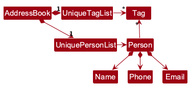

* Table of Contents
{:toc}

--------------------------------------------------------------------------------------------------------------------

## **Acknowledgements**

* _{List the sources of reused or adapted ideas, code, documentation, and third-party libraries here, with links to the originals.}_

--------------------------------------------------------------------------------------------------------------------

## **Setting up, getting started**

Refer to the guide [_Setting up and getting started_](SettingUp.md).

--------------------------------------------------------------------------------------------------------------------

## **Design**

:bulb: **Tip:** The `.puml` files used to create diagrams are in `docs/diagrams`. Refer to the [_PlantUML Tutorial_ at se-edu/guides](https://se-education.org/guides/tutorials/plantUml.html) to learn how to create and edit diagrams.

### Architecture

The ***Architecture Diagram*** given above explains the high-level design of the App.

The following provides a quick overview of the main components and their interactions.

**Main components of the architecture**

**`Main`** (consisting of classes [`Main`](https://github.com/se-edu/addressbook-level3/tree/master/src/main/java/seedu/address/Main.java) and [`MainApp`](https://github.com/se-edu/addressbook-level3/tree/master/src/main/java/seedu/address/MainApp.java)) is in charge of the app launch and shut down.
* At app launch, it initializes the other components in the correct sequence, and connects them up with each other.
* At shut down, it shuts down the other components and invokes cleanup methods where necessary.

The bulk of the app's work is done by the following four components:

* [**`UI`**](#ui-component): The UI of the App.
* [**`Logic`**](#logic-component): The command executor.
* [**`Model`**](#model-component): Holds the data of the App in memory.
* [**`Storage`**](#storage-component): Reads data from, and writes data to, the hard disk.

[**`Commons`**](#common-classes) represents a collection of classes used by multiple other components.

**How the architecture components interact with each other**

The *Sequence Diagram* below shows how the components interact with each other for the scenario where the user issues the command `delete 1`.

Each of the four main components (also shown in the diagram above),

* defines its *API* in an `interface` with the same name as the Component.
* provides its functionality through a concrete `{Component Name}Manager` class that implements the corresponding API interface.

For example, the `Logic` component defines its API in `Logic.java` and implements it in `LogicManager.java`. Other components interact with a component through its interface rather than its concrete class, preventing them from coupling to that component's implementation, as illustrated in the following partial class diagram.

The sections below give more details of each component.

### UI component

The **API** of this component is specified in [`Ui.java`](https://github.com/se-edu/addressbook-level3/tree/master/src/main/java/seedu/address/ui/Ui.java)

The UI consists of a `MainWindow` and its parts, such as `CommandBox`, `ResultDisplay`, `PersonListPanel`, and `StatusBarFooter`. All of these, including `MainWindow`, inherit from the abstract `UiPart` class, which captures common behavior among classes that represent visible GUI parts.

The `UI` component uses the JavaFX UI framework. The layouts of these UI parts are defined in matching `.fxml` files in `src/main/resources/view`. For example, [`MainWindow.fxml`](https://github.com/se-edu/addressbook-level3/tree/master/src/main/resources/view/MainWindow.fxml) specifies the layout of [`MainWindow`](https://github.com/se-edu/addressbook-level3/tree/master/src/main/java/seedu/address/ui/MainWindow.java).

The `UI` component,

* executes user commands using the `Logic` component.
* listens for changes to `Model` data so that the UI can be updated with the modified data.
* keeps a reference to the `Logic` component, because the `UI` relies on the `Logic` to execute commands.
* depends on some classes in the `Model` component because it displays `Person` objects from the model.

### Logic component

**API** : [`Logic.java`](https://github.com/se-edu/addressbook-level3/tree/master/src/main/java/seedu/address/logic/Logic.java)

Here's a (partial) class diagram of the `Logic` component:

The sequence diagram below illustrates the interactions within the `Logic` component, taking `execute("delete 1")` API call as an example.

:information_source: **Note:** The lifeline for `DeleteCommandParser` should end at the destroy marker (X), but due to a limitation of PlantUML, it continues to the end of the diagram.

How the `Logic` component works:

1. When `Logic` is called upon to execute a command, the command is passed to an `AddressBookParser` object, which in turn creates a parser that matches the command (e.g., `DeleteCommandParser`) and uses it to parse the command.
1. This results in a `Command` object (more precisely, an object of one of its subclasses e.g., `DeleteCommand`) which is executed by the `LogicManager`.
1. The command can communicate with the `Model` when it is executed (e.g. to delete a person). 
   Note that although this is shown as a single step in the diagram above for simplicity, the code can require several interactions between the command object and the `Model` to complete the operation.
1. The result of the command execution is encapsulated as a `CommandResult` object which is returned from `Logic`.

Here are the other classes in `Logic` (omitted from the class diagram above) that are used for parsing a user command:

How the parsing works:
* When called upon to parse a user command, the `AddressBookParser` class creates an `XYZCommandParser` (`XYZ` is a placeholder for the specific command name, e.g., `AddCommandParser`). The parser uses the other classes shown above to parse the user command and create an `XYZCommand` object (e.g., `AddCommand`). The `AddressBookParser` returns that object as a `Command` object.
* All `XYZCommandParser` classes, such as `AddCommandParser` and `DeleteCommandParser`, implement the `Parser` interface so they can be treated similarly where appropriate, for example during testing.

### Model component
**API** : [`Model.java`](https://github.com/se-edu/addressbook-level3/tree/master/src/main/java/seedu/address/model/Model.java)

The `Model` component,

* stores the address book data i.e., all `Person` objects (which are contained in a `UniquePersonList` object).
* stores the `Person` objects selected by the current filter, such as search results, in a separate _filtered_ list. It exposes this list as an unmodifiable `ObservableList<Person>` that the UI can observe and bind to, so the UI updates when the list changes.
* stores a `UserPrefs` object that represents the user’s preferences (currently, just the GUI settings). This is exposed to the outside as a `ReadOnlyUserPrefs` object.
* does not depend on any of the other three components (as the `Model` represents data entities of the domain, they should make sense on their own without depending on other components)

:information_source: **Note:** The alternative, arguably more object-oriented, design below keeps a unique list of tags in `AddressBook`, and each `Person` references tags from that list. This lets `AddressBook` maintain one `Tag` object per unique tag instead of each `Person` holding its own `Tag` objects. 

### Storage component

**API** : [`Storage.java`](https://github.com/se-edu/addressbook-level3/tree/master/src/main/java/seedu/address/storage/Storage.java)

The `Storage` component,
* can save both address book data and user preference data in JSON format, and read them back into corresponding objects.
* is implemented by `StorageManager`, which delegates the actual JSON file access to `JsonAddressBookStorage` and `JsonUserPrefsStorage` (one class per data file).
* depends on some classes in the `Model` component (because the `Storage` component's job is to save/retrieve objects that belong to the `Model`)

### Common classes

Classes used by multiple components are in the `seedu.address.commons` package.

--------------------------------------------------------------------------------------------------------------------

## **Implementation**

This section describes some noteworthy details on how certain features are implemented.

### \[Proposed\] Undo/redo feature

#### Proposed Implementation

The proposed undo/redo mechanism is facilitated by `VersionedAddressBook`. It extends `AddressBook` with an undo/redo history, stored internally as an `addressBookStateList` and `currentStatePointer`. Additionally, it implements the following operations:

* `VersionedAddressBook#commit()` — Saves the current address book state in its history.
* `VersionedAddressBook#undo()` — Restores the previous address book state from its history.
* `VersionedAddressBook#redo()` — Restores a previously undone address book state from its history.

These operations are exposed in the `Model` interface as `Model#commitAddressBook()`, `Model#undoAddressBook()` and `Model#redoAddressBook()` respectively.

Given below is an example usage scenario and how the undo/redo mechanism behaves at each step.

Step 1. The user launches the application for the first time. The `VersionedAddressBook` will be initialized with the initial address book state, and the `currentStatePointer` pointing to that single address book state.

Step 2. The user executes `delete 5` command to delete the 5th person in the address book. The `delete` command calls `Model#commitAddressBook()`, causing the modified state of the address book after the `delete 5` command executes to be saved in the `addressBookStateList`, and the `currentStatePointer` is shifted to the newly inserted address book state.

Step 3. The user executes `add n/David …​` to add a new person. The `add` command also calls `Model#commitAddressBook()`, causing another modified address book state to be saved into the `addressBookStateList`.

:information_source: **Note:** If a command fails its execution, it will not call `Model#commitAddressBook()`, so the address book state will not be saved into the `addressBookStateList`.

Step 4. The user now decides that adding the person was a mistake, and decides to undo that action by executing the `undo` command. The `undo` command will call `Model#undoAddressBook()`, which will shift the `currentStatePointer` once to the left, pointing it to the previous address book state, and restores the address book to that state.

:information_source: **Note:** If the `currentStatePointer` is at index 0, pointing to the initial AddressBook state, then there are no previous AddressBook states to restore. The `undo` command uses `Model#canUndoAddressBook()` to check if this is the case. If so, it will return an error to the user rather
than attempting to perform the undo.

The following sequence diagram shows how an undo operation goes through the `Logic` component:

:information_source: **Note:** The lifeline for `UndoCommand` should end at the destroy marker (X), but due to a limitation of PlantUML, it continues to the end of the diagram.

Similarly, how an undo operation goes through the `Model` component is shown below:

The `redo` command does the opposite — it calls `Model#redoAddressBook()`, which shifts the `currentStatePointer` once to the right, pointing to the previously undone state, and restores the address book to that state.

:information_source: **Note:** If the `currentStatePointer` is at index `addressBookStateList.size() - 1`, pointing to the latest address book state, then there are no undone AddressBook states to restore. The `redo` command uses `Model#canRedoAddressBook()` to check if this is the case. If so, it will return an error to the user rather than attempting to perform the redo.

Step 5. The user then decides to execute the command `list`. Commands that do not modify the address book, such as `list`, will usually not call `Model#commitAddressBook()`, `Model#undoAddressBook()` or `Model#redoAddressBook()`. Thus, the `addressBookStateList` remains unchanged.

Step 6. The user executes `clear`, which calls `Model#commitAddressBook()`. Since the `currentStatePointer` is not pointing at the end of the `addressBookStateList`, all address book states after the `currentStatePointer` will be purged. Reason: It no longer makes sense to redo the `add n/David …​` command. This is the behavior that most modern desktop applications follow.

The following activity diagram summarizes what happens when a user executes a new command:

#### Design considerations:

**Aspect: How undo & redo execute:**

* **Alternative 1 (current choice):** Saves the entire address book.
  * Pros: Easy to implement.
  * Cons: May have performance issues in terms of memory usage.

* **Alternative 2:** Individual command knows how to undo/redo by
  itself.
  * Pros: Will use less memory (e.g. for `delete`, just save the person being deleted).
  * Cons: We must ensure that the implementation of each individual command is correct.

_{more aspects and alternatives to be added}_

### \[Proposed\] Data archiving

_{Explain here how the data archiving feature will be implemented}_

--------------------------------------------------------------------------------------------------------------------

## **Documentation, logging, testing, dev-ops**

* [Documentation guide](Documentation.md)
* [Testing guide](Testing.md)
* [Logging guide](Logging.md)
* [DevOps guide](DevOps.md)

--------------------------------------------------------------------------------------------------------------------

## **Appendix: Requirements**

### Product scope

**Target user profile**:

Cyclique is designed for organisers of recreational cycling groups in Singapore who:
* have a need to manage a significant number of cyclists
* have a need to quickly access cyclists’ contact and emergency information
* organise group rides and needs to identify suitable cyclists based on factors such as preferred cycling location, FTP and experience level
* are comfortable with typing and using CLI apps

**Value proposition**:
Organisers of cycling groups often have rider contact and information scattered across chats, spreadsheets, and memory, making it hard to identify suitable participants. Cyclique keeps this information in one place and helps organisers find which riders suit a given ride, based on preferred cycling location, FTP and experience level.

### User stories

Priorities: High (must have) - `* * *`, Medium (nice to have) - `* *`, Low (unlikely to have) - `*`

| Priority | As a/an …                                    | I want to …                                                                                                  | So that I can …                                                                       |
| -------- | -------------------------------------------- | ------------------------------------------------------------------------------------------------------------ | ------------------------------------------------------------------------------------- |
| `* * *`  | proactive cycling organiser                  | add a new cyclist record with their name, phone number, and email                                            | keep basic contact details in one centralised directory                               |
| `* * *`  | community-focused cycling organiser          | view a complete list of all registered cyclists                                                              | see an overview of my entire cycling community at a glance                            |
| `* * *`  | attentive cycling organiser                  | edit an existing cyclist's contact details                                                                   | keep contact information up to date without recreating cyclist records                |
| `* * *`  | meticulous cycling organiser                 | delete a cyclist's record                                                                                    | keep my directory free of members who have permanently left the group                 |
| `* * *`  | safety-conscious cycling organiser           | store an emergency contact for each cyclist                                                                  | reach the appropriate person quickly when an emergency occurs                         |
| `* * *`  | logistics-minded cycling organiser           | record a cyclist's preferred cycling location                                                                | identify cyclists who prefer rides in different parts of Singapore                    |
| `* * *`  | attentive cycling organiser                  | record a cyclist's experience level                                                                          | identify riding groups that are appropriate for the cyclist                           |
| `* * *`  | pace-conscious cycling organiser             | record a cyclist's FTP                                                                                       | identify cyclists with a suitable fitness level for a planned ride                    |
| `* *`    | organised cycling organiser                  | create a record for a planned group ride                                                                     | keep track of the important details of an upcoming ride                               |
| `* *`    | selective cycling organiser                  | filter cyclists by multiple selected criteria, such as preferred location, experience level, and FTP range   | quickly shortlist suitable participants for a planned ride                            |
| `*`      | methodical cycling organiser                 | sort cyclist records by name or experience level in ascending or descending order                            | locate cyclists by name or compare their experience levels when forming riding groups |
| `*`      | busy cycling organiser with existing records | import cyclist records from a structured file                                                                | avoid entering every existing cyclist record manually                                 |

### Use cases

(For all use cases below, the **System** is `Cyclique` and the **Actor** is the `user`, unless specified otherwise)

**Shared precondition for UC01 – UC04**: Cyclique is running and ready to accept user requests.

**UC01 – Add Cyclist**

**Guarantees**

* On successful completion, exactly one new cyclist record containing the supplied details is added and displayed.
* Existing cyclist records remain unchanged.
* Invalid details are not added. If the supplied phone number or email address duplicates an existing record, the directory remains unchanged.

**MSS**

1.  User adds a new cyclist by providing the cyclist's name, phone number, email address, emergency number, FTP, experience level, and preferred cycling location(s).
2.  Cyclique adds the cyclist to the directory.
3.  Cyclique displays the newly-added cyclist.

    Use case ends.

**Extensions**

* 1a. User provides invalid cyclist details.
    * 1a1. Cyclique informs the user that the provided details are invalid.
    * 1a2. User provides revised cyclist details.

      Steps 1a1-1a2 are repeated until the details provided are valid.

      If the revised details duplicate an existing cyclist, extension 1b applies.

      Use case resumes from step 2.

* 1b. Cyclique detects that the provided phone number or email address matches an existing cyclist's record.
    * 1b1. Cyclique informs the user that the cyclist record would be a duplicate and leaves the directory unchanged.

      Use case ends.

**UC02 – List Cyclists**

**Guarantees**

* All cyclist records in the directory are displayed with their details.
* If the directory is empty, the user is informed that there are no cyclists.
* No cyclist records are changed.

**MSS**

1.  User requests to view all cyclists.
2.  Cyclique displays all cyclists currently registered in the directory together with their details.

    Use case ends.

**Extensions**

* 2a. The cyclist directory is empty.
    * 2a1. Cyclique informs the user that there are no cyclists in the directory.

      Use case ends.

**UC03 – Edit Cyclist**

**Guarantees**

* On successful completion, only the specified fields of the selected cyclist are updated, and the updated record is displayed.
* Unspecified fields and other cyclist records remain unchanged.
* Requests referring to a nonexistent cyclist, containing invalid details, or creating a duplicate phone number or email address do not change the directory.

**MSS**

1.  User <u>views the cyclist list (UC02).</u>
2.  User requests to edit a specified cyclist and provides the revised details.
3.  Cyclique updates the specified details of the cyclist.
4.  Cyclique displays the updated cyclist information.

    Use case ends.

**Extensions**

* 1a. UC02 reports that the cyclist directory is empty.

    Use case ends.

* 2a. The specified cyclist does not exist.
    * 2a1. Cyclique informs the user that the cyclist cannot be found.

      Use case ends.

* 2b. User provides invalid cyclist details.
    * 2b1. Cyclique informs the user that the provided details are invalid.
    * 2b2. User provides revised cyclist details.

      Steps 2b1-2b2 are repeated until the details provided are valid.

      If the revised details duplicate another cyclist, extension 2c applies.

      Use case resumes from step 3.

* 2c. Cyclique detects that the revised phone number or email address matches another cyclist's record.
    * 2c1. Cyclique informs the user that the edit would create a duplicate cyclist record and leaves the directory unchanged.

      Use case ends.

**UC04 – Delete Cyclist**

**Guarantees**

* A cyclist record is permanently removed only after the user confirms its deletion.
* On successful completion, only the specified cyclist record is removed, and the updated cyclist directory is displayed.
* If the specified cyclist does not exist or the user declines confirmation, the directory remains unchanged.

**MSS**

1.  User <u>views the cyclist list (UC02).</u>
2.  User requests to delete a specified cyclist.
3.  Cyclique requests confirmation from the user to delete the cyclist.
4.  User confirms the deletion.
5.  Cyclique permanently removes the cyclist from the directory.
6.  Cyclique displays the updated cyclist directory.

    Use case ends.

**Extensions**

* 1a. UC02 reports that the cyclist directory is empty.

    Use case ends.

* 2a. The specified cyclist does not exist.
    * 2a1. Cyclique informs the user that the cyclist cannot be found.

      Use case ends.

* 4a. User declines the deletion.
    * 4a1. Cyclique cancels the deletion.

      Use case ends.

### Non-Functional Requirements

**Testing conditions**

* Response-time requirements apply on a reference computer with a processor with at least two physical cores, 8 GB of RAM, SSD storage, and Java 25, with no other resource-intensive applications running. Record the processor model, operating system and version, and Java version with the test results.
* Test with Cyclique already running, its main screen ready for input, and up to 500 valid cyclist records loaded. Include a dataset of 500 records when checking the upper capacity limit.
* Measure response time from submission of a command or activation of a control until the requested information is visible and the application is ready for the next input. Exclude application startup and time spent entering input.

**Performance**

* Cyclique should display search or shortlist results within 2 seconds when storing up to 500 cyclists.
* Cyclique should display the cyclist list within 2 seconds when storing up to 500 cyclists.

**Usability**

* Adding or editing a cyclist should be completable using a single command entered from the main screen.
* Deleting a cyclist should require no more than one command and one confirmation entered from the main screen.
* Error messages should identify the invalid field, explain the violated constraint, and state the expected input format.

**Data requirements**

* Cyclist contact and emergency information must persist reliably across sessions (no data loss on app close/reopen).
* Cyclique should support storing records for at least 500 cyclists while meeting the stated performance requirements.
* Starting from the main screen with no cyclist selected or filter applied, a user who knows the target cyclist's name should be able to display that cyclist's emergency contact information within 2 user actions. Submitting one complete command (including typing it) or activating one GUI control counts as one action; each scrolling gesture also counts as one action. If names are shared, the user may use the cyclist's known phone number or email address to distinguish the target. The information should be displayed within 2 seconds of the final action under the testing conditions above.

**Environment/Compatibility**

* Cyclique should run on Windows, Linux, Unix, and macOS with Java 25 installed on computers meeting the reference hardware specification above. Only a keyboard and display should be required as input/output peripherals. Record the operating system version used for each compatibility test.

**Security/Privacy**

* Cyclique should store cyclist data only on the user's local computer.
* Cyclique should not transmit cyclist data to third parties.

**Reliability/Availability**

* Data saved by the last successfully executed command should remain available after Cyclique is unexpectedly terminated and restarted.

### Glossary

* **Auto-save**: Automatic saving of changes to persistent storage without requiring a separate save command.
* **CLI**: *Command-Line Interface*. An interface through which the user operates Cyclique primarily by typing text commands.
* **Cyclist**: A person whose contact and cycling-related information is stored and managed in Cyclique. The terms *rider* and *member* refer to the same concept; this documentation uses *cyclist* consistently.
* **Cyclist directory**: The collection of cyclist records stored in Cyclique.
* **Cycling organiser**: The primary user of Cyclique who manages cyclist records and organises recreational group rides.
* **Duplicate cyclist**: A cyclist entry considered to represent an existing cyclist according to Cyclique's duplicate-detection rules, currently based on matching phone number or email address.
* **Experience level**: A categorical indication of a cyclist's riding experience. Cyclique uses three experience levels: **Beginner**, **Intermediate**, and **Advanced**.
* **Functional Threshold Power (FTP)**: A cyclist's cycling performance metric, measured in watts (W), representing the highest power they can approximately sustain for an extended period. In Cyclique, FTP is recorded as a whole number from 1 to 600 W.
* **Group ride**: An organised cycling session involving one or more cyclists. The term *ride meetup* refers to the same concept; this documentation uses *group ride* unless a feature specifically uses the term *ride meetup*.
* **GUI**: *Graphical User Interface*. The visual interface through which Cyclique displays cyclist information and command results.
* **JAR file**: A Java Archive file used to package and distribute the Cyclique application.
* **Java 25**: The minimum Java platform version required to run Cyclique, based on the project constraints.
* **Local storage**: Data stored on the user's own computer rather than on a remote server.
* **Mainstream OS**: Windows, Linux, Unix, or macOS
* **Parameter prefix**: A command prefix that identifies the type of value being supplied, such as `n/` for name, `p/` for phone number, or `f/` for FTP.
* **Persistent data**: Data that remains available after Cyclique is closed and reopened.
* **Preferred cycling location**: A location where a cyclist prefers to ride or participate in group rides. A cyclist may have more than one preferred cycling location. The special value `any`, supplied as `l/any`, indicates that the cyclist has no location restriction and is considered to match every ride location.
* **Private contact detail**: A contact detail that is not meant to be shared with others
* **Ride roster**: The list of cyclists registered or confirmed to participate in a particular group ride.
* **Validation**: The process of checking whether user input satisfies Cyclique's specified input rules before accepting it.

--------------------------------------------------------------------------------------------------------------------

## **Appendix: Instructions for manual testing**

Use JDK 25 and a disposable folder containing the release JAR. Run
`java -version` to confirm the selected JDK, then `java -jar addressbook.jar`
from that folder. All commands below operate on test contacts; do not use real contact data.
Repeat the checks on each operating system supported by the release.

### Launch and shutdown

1. Launch in a folder without `preferences.json` or `data/addressbook.json`.
   Expected: The opening artwork is followed by the main window and sample contacts.
   Contact cards show labelled phone, email, address, FTP, experience and location fields.
1. Resize and move the window, then enter `exit`.
   Expected: The closing artwork appears and the application closes.
1. Launch again. Expected: The window size and position are retained.
1. Enter `help`, close its window, then press F1. Expected: Both actions open readable
   usage instructions for all eight commands. Closing help leaves the main window usable.
1. Close the main window using its close button. Expected: The application shuts down.

### Adding and editing people

1. Enter `clear`, then
   `add n/John Doe p/+65 98765432 e/johnd@example.com f/300 x/Beginner l/any t/friends t/owesMoney`.
   Expected: One contact appears with both tags and address `Not specified`.
1. Enter `add n/Alice Tan p/+65 91234567 e/alice@example.com f/1 x/Beginner l/East Coast l/Punggol`.
   Expected: A second contact appears with both locations and no tags.
1. Repeat John's add command. Expected: A duplicate-person error and no changes.
1. Enter `edit +65 98765432 p/+65 96742165 e/johndoe@example.com f/600 x/Advanced l/Punggol a/10 Test Road`.
   Expected: John's supplied fields change; his name and tags remain unchanged. His location
   set is replaced with Punggol. Both contacts are displayed.
1. Enter `edit +65 96742165 t/`. Expected: John's tags are cleared and other fields are retained.
1. Try `edit +65 96742165`, `edit +65 96742165 n/John Updated f/601`,
   `edit +65 96742165 l/`, and `edit +65 96742165 p/+65 111 p/+65 222`.
   Expected: Each command shows an error and leaves every contact field unchanged.
1. Try add commands with missing required fields, `f/0`, `f/601`, `f/abc`, blank `l/`,
   invalid email, invalid experience and phone numbers without a country code.
   Expected: Each command shows an error and adds no contact. FTP values 1 and 600 are accepted.

### Finding and listing people

Use John and Alice from the previous section.

1. Enter `find n/jOHn n/alice`. Expected: Both contacts appear, ignoring name keyword case.
1. Enter `find p/+65 96742165 p/+65 91234567`. Expected: Both contacts appear.
1. Enter `find n/john p/+65 96742165`. Expected: Only John appears.
1. Enter `find n/john p/+65 91234567`. Expected: No contacts appear; both fields must match.
1. Enter `find n/Jo` and `find p/+65 967`. Expected: No contacts appear; matches are exact
   phone numbers or full name words, rather than substrings.
1. Try `find`, `find john alice`, `find n/John Doe`, and `find p/`.
   Expected: Each shows an error without changing the current displayed list.
1. Enter `find n/john`, then `edit +65 91234567 n/Alice Updated`.
   Expected: The edit is rejected because Alice is outside the displayed list.
1. Enter `edit +65 96742165 n/John Updated`. Expected: John's name changes and both contacts appear.
1. Enter `list`. Expected: All stored contacts appear.

### Deleting and clearing people

1. Enter `find n/john`, then `delete +65 91234567`.
   Expected: Alice is deleted even though she is outside the displayed list; John remains.
   The success message identifies Alice.
1. Enter `delete +65 96742165`. Expected: John is deleted and the list is empty.
1. Try `delete +65 99999999`, `delete`, `delete 1`, `delete +65 12`, and `delete x`.
   Expected: An error appears and no contact is deleted.
1. Enter `clear` twice. Expected: The list remains empty and each command succeeds.

### Saving data and recovering from invalid files

1. Add John again, edit a field, and exit. Launch again.
   Expected: All saved fields, tags and locations match the last successful command.
1. Delete John, exit, and relaunch. Expected: John stays deleted.
1. Add John, enter `clear`, exit, and relaunch. Expected: The book stays empty.
1. With the application closed, back up the disposable `data/addressbook.json`, then remove it.
   Launch again. Expected: Sample contacts are loaded.
1. Close the application and replace the disposable data file contents with `{invalid json`.
   Launch again. Expected: An empty book is loaded without crashing; the log records the loading error.
   A successful add creates valid saved data. Restore the backup after the check if needed.
1. With the application closed, replace disposable `preferences.json` with `{invalid json`.
   Launch again. Expected: Default window preferences are used without crashing.

### Release regression: duplicate phone numbers

1. Add John with `+65 98765432`, then try adding Jane with the same number and a different name.
   Expected: The second add is rejected and John remains unchanged, even if hidden by a filter.
1. Add Jane with `+65 91111111`, enter `find n/Jane`, then
   `edit +65 91111111 p/+65 98765432`.
   Expected: The edit is rejected; contacts, filtering and saved data are unchanged.
1. Enter `edit +65 91111111 p/+65 91111111 e/jane.updated@example.com`.
   Expected: Updating a contact while retaining its own unique number succeeds.
1. Close the application and back up the disposable JSON file. Change Jane's stored phone
   to John's number, then relaunch.
   Expected: Both contacts are preserved. No number is automatically changed.
1. With both displayed, enter `edit +65 98765432 p/+65 92222222` and `delete +65 98765432`.
   Expected: Both are rejected with instructions for repairing the ambiguity; no contact changes.
1. Enter `find n/Jane`, then `delete +65 98765432`.
   Expected: Deletion is still rejected because it searches the entire book.
1. Enter `edit +65 98765432 e/jane.updated@example.com`.
   Expected: The edit is rejected because the resulting number is still shared.
1. Enter `edit +65 98765432 p/+65 92222222`, using an otherwise unused number.
   Expected: Only Jane's number changes, all contacts are displayed, and the repair is saved.
1. Exit and relaunch, then delete John using his original number.
   Expected: Both contacts had been preserved on reload, and only John is now deleted.
