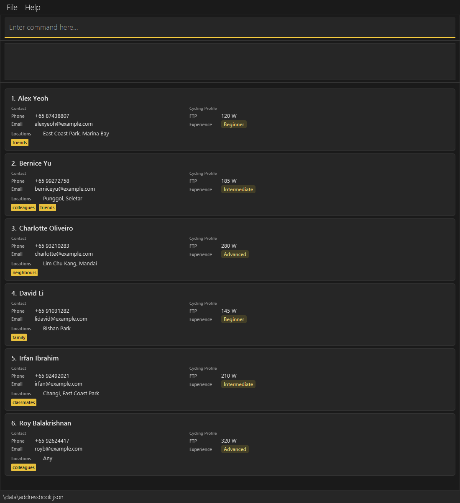

AddressBook Level 3 (AB3) is a **desktop application for managing contacts, optimized for use through a Command Line Interface (CLI)** while retaining the benefits of a Graphical User Interface (GUI). If you type quickly, AB3 can help you manage contacts faster than traditional GUI applications.

* Table of Contents
{:toc}

--------------------------------------------------------------------------------------------------------------------

## Quick start

1. Ensure that Java `25` or later is installed on your computer. 
   **Mac users:** Ensure you have the precise JDK version prescribed [here](https://se-education.org/guides/tutorials/javaInstallationMac.html).

1. Download the latest `.jar` file from [here](https://github.com/se-edu/addressbook-level3/releases).

1. Copy the file to the folder you want to use as the _home folder_ for your AddressBook.

1. Open a terminal, `cd` to the folder containing the JAR file, and run `java -jar cyclique.jar`. 
   A GUI similar to the one below should appear in a few seconds. Note how the app contains some sample data. 
   

1. Type a command in the command box and press Enter to execute it. For example, type **`help`** and press Enter to open the help window. 
   Some example commands you can try:

   * `list` : Lists all contacts.

   * `add n/John Doe p/+65 98765432 sos/+65 99999999 e/johnd@example.com f/300 x/Beginner l/any` : Adds a contact named `John Doe` to the Address Book.

   * `delete +65 98765432` : Requests deletion of the contact with this phone number. Enter `yes` to confirm or `no` to cancel.

   * `clear` : Deletes all contacts.

   * `exit` : Exits the app.

1. Refer to the [Features](#features) section below for details of each command.

--------------------------------------------------------------------------------------------------------------------

## Features

Cyclists are displayed alphabetically by their full name, ignoring letter case, on startup
and after `list` or `find`. Adding a cyclist places them in the correct alphabetical position;
editing their name updates their position. Names that are identical ignoring case retain
their relative stored order. The visible indexes run consecutively from 1 within the current
display, including filtered results. Use phone numbers to target `edit` and `delete` as usual.

**:information_source: Notes about the command format:** 

* Words in `UPPER_CASE` are the parameters to be supplied by the user. 
  For example, in `add n/NAME`, replace `NAME` with a value such as `John Doe`.

* Items in square brackets are optional. 
  For example, `edit PHONE [n/NAME] [f/FTP]` can be used as `edit +65 91234567 n/John Doe` or `edit +65 91234567 f/300`.

* Items followed by `…`​ can appear zero or more times. 
  For example, `[l/LOCATION]…` in `edit` may be omitted, or written as `l/Punggol` or `l/Punggol l/Marina Bay`.

* Parameters can be in any order. 
  For example, if the command specifies `n/NAME p/PHONE_NUMBER`, `p/PHONE_NUMBER n/NAME` is also acceptable.

* Extraneous parameters for commands that take no parameters, such as `help`, `list`, `exit`, and `clear`, are ignored. 
  For example, `help 123` is interpreted as `help`.

* If you are using a PDF version of this document, be careful when copying and pasting commands that span multiple lines as space characters surrounding line-breaks may be omitted when copied over to the application.

### Viewing help: `help`

Shows a message explaining how to access the help page.

Format: `help`

### Adding a person: `add`

Adds a person to the address book.

Format: `add n/NAME p/PHONE sos/EMERGENCY_PHONE e/EMAIL f/FTP_LEVEL x/EXPERIENCE_LEVEL l/LOCATION [l/LOCATION]…`

The emergency contact number (`sos/`) is required for new cyclists and follows the same validation as `p/`: a `+`, a country code of 1–3 digits, exactly one space, and a number of at least 3 digits. Blank values, parentheses and hyphens are rejected. Emergency numbers may be shared and do not determine duplicate cyclists.

The phone number must include a country code and one separating space, for example `+65 98765432`.
It must not belong to another contact, including contacts hidden by a filter.
FTP must be a whole number from 1 to 600.
At least one preferred location is required. Repeat `l/` for multiple locations, or use `l/any` alone.

`EXPERIENCE_LEVEL` must be one of `Beginner`, `Intermediate` or `Advanced` (case-insensitive).

Examples:
* `add n/John Doe p/+65 98765432 sos/+65 99999999 e/johnd@example.com f/300 x/Beginner l/any`
* `add n/Betsy Crowe sos/+65 99999999 e/betsycrowe@example.com p/+65 91234567 f/250 x/Advanced l/Punggol`

### Listing all persons: `list`

Shows a list of all persons in the address book.

Format: `list`

### Editing a person: `edit`

Edits an existing person in the address book.

Format: `edit PHONE [n/NAME] [p/PHONE] [sos/EMERGENCY_PHONE] [e/EMAIL] [f/FTP] [x/EXPERIENCE] [l/LOCATION]…`

* Edits the person with the specified phone number in the displayed list. Exactly one displayed contact must match.
* The resulting phone number must not belong to another contact anywhere in the book. An unchanged phone number is allowed when it is already unique.
* At least one of the optional fields must be provided.
* Existing values will be updated to the input values.

Examples:
* `edit +65 98765432 p/+65 91111111 e/johndoe@example.com` updates the identified contact's phone and email.
* `edit +65 91234567 n/Betsy Crower` updates Betsy's name.

* `edit +65 98765432 sos/+65 98888888` updates only the emergency number. Omitting `sos/` retains its current value; blank `sos/` is rejected.

Cyclist cards label emergency contact numbers as **SOS**. Older saved records without an emergency number load normally and show **Not provided**. Use `edit PHONE sos/EMERGENCY_PHONE` to supply one; other edits preserve its absence. Numbers are saved automatically and retained after restarting.

### Locating persons by name, phone or emergency number: `find`

Finds persons by name keywords, phone numbers and emergency contact numbers.

Format: `find [n/NAME_KEYWORD]… [p/PHONE]… [sos/EMERGENCY_PHONE]…` (at least one field is required)

* Each `n/` takes one name keyword. Name matching is case-insensitive and requires a full word; for example, `n/hans` matches `Hans` but `n/Han` does not.
* Each `p/` takes one complete phone number. Phone matching is exact; `p/+65 963` does not match `+65 96320842`.
* Multiple values for the same field use `OR`: `find n/Hans n/Bo` returns people named `Hans Gruber` or `Bo Yang`.
* Each `sos/` takes one complete emergency contact number and uses the same phone validation and exact matching as `p/`. Repeated `sos/` values match any of those numbers.
* When multiple fields are supplied, a person must match every supplied field. Prefix order does not matter.
* Name keywords, phone numbers and emergency contact numbers search only their respective fields.
* `find sos/+65 99999999` lists cyclists with that emergency number.

Examples:
* `find n/John` returns `john` and `John Doe`
* `find n/alex n/david` returns `Alex Yeoh`, `David Li` 
  
* `find n/alex p/+65 96320842` returns only people whose name contains `alex` and whose phone number is `+65 96320842`.

### Deleting a person: `delete`

Requests confirmation before deleting the specified cyclist from the address book.

Format: `delete PHONE`, followed by a confirmation reply in the command box.

* Shows the details of the cyclist with the specified `PHONE` number in the result panel. No cyclist is removed until you confirm.
* Enter `y` or `yes` to confirm, or `n` or `no` to cancel. Replies ignore letter case, so `Y`, `YES`, `yEs`, `N` and `NO` are accepted. Leading and trailing spaces are ignored.
* Cancellation displays `Deletion cancelled.` and leaves cyclist records, the current filter and saved data unchanged.
* An unrecognised reply, such as `maybe` or `yes please`, shows an error and keeps waiting for a valid reply.
* Entering another supported command cancels the pending deletion and executes that command. The result panel shows `Deletion cancelled.` followed by the command’s usual output or error. Another `delete PHONE` starts a fresh confirmation for its target. Commands retain their usual case-sensitive spelling.
* Closing or restarting Cyclique discards any pending confirmation. A confirmation reply has no effect when no deletion is pending.
* A cyclist hidden by a filter cannot be deleted. Use `list` or change the `find` criteria to display the intended cyclist first.
* If more than one displayed contact has that number, deletion is rejected.
* Use a complete number with country code and one space, for example `+65 96742165`;
  the number after the space must contain at least three digits.

Examples:
* Enter `delete +65 96742165`, check the displayed cyclist details, then enter `yes` to delete that cyclist.
* Enter `delete +65 96742165`, then `no` to keep the cyclist.
* Enter `delete +65 96742165`, then `list` to cancel the deletion and list all cyclists. Both messages appear in the result panel.

Both `edit` and `delete` report the same error when the target is absent from the displayed list:
`Cyclist with phone number PHONE cannot be found in the displayed list. Use list to show all cyclists.`
Here, `PHONE` is replaced with the number you entered. Error sentences end with full stops;
command syntax and usage examples retain their original format so you can copy them directly.

### Adding a group ride: `rideadd`

Adds a group ride that an organiser plans to lead.

Format: `rideadd n/NAME from/FROM to/TO l/LOCATION d/DISTANCE f/MINIMUM_POWER s/MAX_GROUP_SIZE [notes/NOTES]`

Field | Meaning and rules
------|------------------
`n/NAME` | The name of the ride. Letters, numbers and spaces only; it must not be blank.
`from/FROM` | When the ride starts, written as `DD-MM-YYYY TTTT`. `TTTT` is the time on a 24-hour clock from `0000` to `2359`, for example `18-10-2026 0630`. The date must be a real date.
`to/TO` | When the ride ends, in the same format as `from/`. It must not be earlier than `from/` (the same time is allowed).
`l/LOCATION` | One location. Letters, numbers, spaces, hyphens and apostrophes only.
`d/DISTANCE` | The distance in kilometres. A positive number with at most 2 decimal places, such as `45` or `45.5`.
`f/MINIMUM_POWER` | The minimum power a cyclist needs to join, in watts. A whole number from 1 to 600, the same range as a cyclist's FTP.
`s/MAX_GROUP_SIZE` | The most cyclists that can join. A positive whole number.
`notes/NOTES` | Optional. At most 10 words.

Every field except `notes/` is required, and each prefix can be used only once. You can give the fields in any order.

Each new ride gets an ID automatically: 1 for the first ride, 2 for the next and so on. IDs follow the order in which rides are created, are never reused, and carry on from where they stopped after you restart the app. A new ride has no cyclists on its roster yet. Two rides may have the same name, because rides are told apart by their IDs.

The ride is shown in the result box when it is added, and it is saved with your other data. The window also has a **Rides** panel in a column on the right (about 30% of the window width), next to the command box, result box and cyclist list. Each ride is shown as a card, like the cyclist cards. The card shows the ride's ID and name in a yellow-tinted heading, then its start and end, then labelled lines for the location, distance, minimum power and maximum group size, and a **Notes** line if the ride has notes. Long names, locations and notes wrap onto more lines, so the panel never needs a horizontal scrollbar. Click a ride to highlight its card. If there are no rides, the panel says `No rides yet. Use rideadd to create one.`

Examples:
* `rideadd n/Sunday Sunrise Ride from/18-10-2026 0630 to/18-10-2026 0930 l/East Coast d/45 f/180 s/12 notes/Bring lights and a spare tube`
* `rideadd n/Evening Spin from/20-10-2026 1800 to/20-10-2026 1930 l/Punggol d/30.5 f/150 s/8`

### Adding and removing cyclists from a ride

Use `rideaddcyclist ID PHONE` to add a saved cyclist to a ride.
Use `ridedeletecyclist ID PHONE` to remove them from that ride only.
For example: `rideaddcyclist 1 +65 91234567`, then `ridedeletecyclist 1 +65 91234567`.

* `ID` is the positive ride ID shown on the card, rather than a position in the list.
  Use a whole number from 1 to 2147483647. Command names are case-sensitive.
* `PHONE` includes the country code and one space, as in cyclist commands. Do not add `p/`.
* Cyclists can be added even when hidden by `find`. They must exist in the address book,
  meet the ride's minimum power and fit within its maximum group size.
* A cyclist cannot join the same ride twice. Removing a cyclist who is absent reports an error.
* Removing a cyclist from a ride keeps their contact record and other ride memberships.
* Ride cards show roster phone numbers, or `No cyclists` when empty. Changes are saved automatically.
* Editing a cyclist's phone updates all their ride memberships. Confirming deletion of their
  contact removes them from all ride rosters; cancelling deletion preserves those memberships.
* Both commands appear in Help. Entering either while a contact deletion is pending cancels
  that pending deletion and runs the roster command.

### Clearing all entries: `clear`

Clears all entries from the address book.

Format: `clear`

### Exiting the program: `exit`

Exits the program.

Format: `exit`

### Saving the data

AddressBook automatically saves data after every command. You do not need to save manually.

### Repairing duplicate phone numbers in an existing book

Saved books containing duplicate phone numbers or email addresses (ignoring email case)
are rejected during loading. Cyclique starts with an empty directory and logs the error.
Before entering commands that could overwrite the file, close the application and back up
`data/addressbook.json`. Correct conflicting phone numbers and email addresses in a copy
of the file, then relaunch. Identical cyclist names are allowed when phone numbers and
email addresses are unique.

### Editing the data file

AddressBook data is saved automatically as a JSON file `[JAR file location]/data/addressbook.json`. Older data files may contain `address` or `tags` fields; Cyclique ignores them and omits them when saving, while retaining all supported cyclist details. Group rides are saved in the same file under `rides`, together with a `nextRideId` number that stops ride IDs from being reused; data files saved before rides existed still load, with no rides. Advanced users are welcome to update data directly by editing that data file.

:exclamation: **Caution:**
If your changes make the data file invalid, AddressBook starts with an empty address book at the next run. The invalid file remains on disk until you run a command (AddressBook saves after every command). Still, we recommend backing up the file before editing it. 
Furthermore, certain edits can cause the AddressBook to behave in unexpected ways (e.g., if a value entered is outside of the acceptable range). Therefore, edit the data file only if you are confident that you can update it correctly.

### Archiving data files `[coming in v2.0]`

_Details coming soon ..._

--------------------------------------------------------------------------------------------------------------------

## FAQ

**Q**: How do I transfer my data to another computer? 
**A**: Install the app on the other computer and overwrite the data file it creates with the data file from your previous AddressBook home folder.

--------------------------------------------------------------------------------------------------------------------

## Known issues

1. **When using multiple screens**, if you move the application to a secondary screen, and later switch to using only the primary screen, the GUI will open off-screen. The remedy is to delete the `preferences.json` file created by the application before running the application again.
2. **If you minimize the Help Window** and then run the `help` command (or use the `Help` menu, or the keyboard shortcut `F1`) again, the original Help Window will remain minimized, and no new Help Window will appear. The remedy is to manually restore the minimized Help Window.

--------------------------------------------------------------------------------------------------------------------

## Command summary

Action | Format, Examples
--------|------------------
**Add** | `add n/NAME p/PHONE sos/EMERGENCY_PHONE e/EMAIL f/FTP_LEVEL x/EXPERIENCE_LEVEL l/LOCATION [l/LOCATION]…`   e.g., `add n/James Ho p/+65 22224444 sos/+65 99999999 e/jamesho@example.com f/300 x/Intermediate l/any`
**Clear** | `clear`
**Delete** | `delete PHONE`, then `y`/`yes` to confirm or `n`/`no` to cancel (case-insensitive)  e.g., `delete +65 22224444`, then `yes`
**Edit** | `edit PHONE [n/NAME] [p/PHONE] [sos/EMERGENCY_PHONE] [e/EMAIL] [f/FTP] [x/EXPERIENCE] [l/LOCATION]…`  e.g., `edit +65 22224444 n/James Lee e/jameslee@example.com`
**Find** | `find [n/NAME_KEYWORD]… [p/PHONE]… [sos/EMERGENCY_PHONE]…`  e.g., `find n/James n/Jake`, `find n/James p/+65 96320842`
**List** | `list`
**Help** | `help`
**Rideadd** | `rideadd n/NAME from/FROM to/TO l/LOCATION d/DISTANCE f/MINIMUM_POWER s/MAX_GROUP_SIZE [notes/NOTES]`  e.g., `rideadd n/Sunday Sunrise Ride from/18-10-2026 0630 to/18-10-2026 0930 l/East Coast d/45 f/180 s/12 notes/Bring lights`
**Add cyclist to ride** | `rideaddcyclist ID PHONE`
**Remove cyclist from ride** | `ridedeletecyclist ID PHONE`
