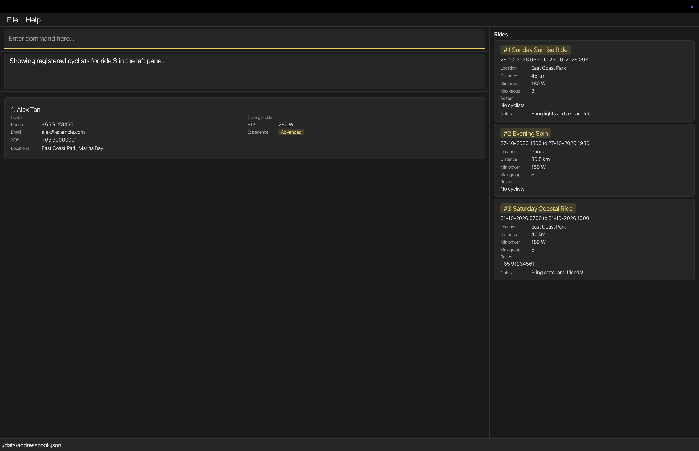

Cyclique helps **organisers of recreational cycling groups in Singapore** keep track of cyclists,
emergency contacts and group rides. You type commands to update your records and see the results in the main window.

This guide takes you from opening Cyclique to planning a ride and managing its participants.
You do not need programming experience. Start with [Quick start](#quick-start), or use the
[command summary](#command-summary) if you already know your way around.

**Contents**

{::options toc_levels="2..3" /}

* Table of Contents
{:toc}

## Quick start

### Install and open Cyclique

1. Install **JDK 25** (Java Development Kit), which Cyclique needs to run.
   Open a terminal and enter `java -version` to check that the active version is `25`.
   On macOS, use Azul Zulu JDK 25 with JavaFX included, following the
   [SE-EDU Mac Java installation guide](https://se-education.org/guides/tutorials/javaInstallationMac.html).

1. Download `cyclique.jar` from the [Cyclique releases page](https://github.com/AY2627S1-CS2103T-W11-1/tp/releases).

1. Place the file in a folder you want to keep using for Cyclique. This guide calls it your **home folder**.

1. In a terminal, enter `cd` followed by that folder's path. For a path containing spaces, use double quotes,
   for example `cd "C:/Users/YourName/My Cyclique"` on Windows or `cd "/Users/YourName/My Cyclique"` on macOS.
   Then enter:

   ```text
   java -jar cyclique.jar
   ```

   The main window opens after the opening artwork. On your first launch, you see three sample cyclists
   (Alex Tan, Bernice Lee and Chloe Lim) and two sample rides with empty rosters.
   If you already have saved data, Cyclique loads that instead.

   

   *Cyclists appear on the left and group rides on the right. Enter commands in the command box;
   the result box reports what happened or explains what to correct.*

### Try your first commands

Type each command in the command box and press **Enter**.

1. Enter `list`. All saved cyclists appear in alphabetical order.
1. Enter `find n/Alex`. With the sample data, only Alex Tan appears. This hides other cyclists; it does not delete them.
1. Enter `list` again to bring everyone back.
1. Enter `help` to open the Full help window. Close that window to return to the main window.

Your changes are saved automatically. Enter `exit` when you want to close Cyclique.
For your first ride, follow [Plan a ride and register a cyclist](#plan-a-ride-and-register-a-cyclist).

## Before you enter commands

### Read the command format

The guide shows a **format** with placeholders, then examples with values you can type.

| Notation | What you type |
| --- | --- |
| `UPPER_CASE` | Replace the placeholder with your own value. For `n/NAME`, type something like `n/John Doe`. |
| `[field]` | The field is optional. Do not type the square brackets. |
| `…` | Repeat the preceding field if needed. `[l/LOCATION]…` allows `l/Punggol l/Seletar`. Do not type the ellipsis. |
| A prefix such as `n/` | Keep the prefix and put its value immediately after it. Put a space before the next prefix. |
| An unprefixed value such as `ID` or `PHONE` | Put it in the position shown, before any prefixed fields. |

Command names and prefixes are **case-sensitive**: use `list`, not `LIST`.
You can put prefixed fields in any order. For example, `n/John Doe p/+65 98765432` and
`p/+65 98765432 n/John Doe` supply the same details.

In `rideadd` and `rideedit`, you can quote notes containing text such as `f/2` so that it is stored as
notes rather than read as another field. See [Writing ride notes](#writing-ride-notes).

Commands with no parameters, such as `help`, `list` and `exit`, ignore extra text.
**`clear` is the exception:** it rejects extra text because it deletes all your data.
If you copy a command from a PDF, check that spaces have not been lost at line breaks.

Examples in different sections are separate tasks unless stated otherwise. The screenshots show the
state described in their captions; running extra examples may give you a different list. Use your own saved
phone numbers and assigned ride IDs where needed. You can use the fixed example dates even after
they have passed; Cyclique allows past rides.

### Understand the two lists

| To work with… | Use… | To show everything again… |
| --- | --- | --- |
| Cyclists in the left panel | `find` to search, or `ridelist ID` to view a ride's participants | `list` |
| Rides in the right panel | `ridefind` to search | `ridefind all` |

A **filter** hides records that do not match your search. It does not remove them from Cyclique.
The two panels have separate filters: `list` does not reset a ride search.

Cyclists are sorted alphabetically by full name, ignoring case. Names that are identical ignoring case
keep their stored order. Card indexes change with the displayed list; use the cyclist's **own phone number**
for `edit` and `delete`. These two commands can target only a cyclist currently displayed.

A **ride ID** is the number shown on a ride card. It stays with that ride even when the display changes.
Use it for ride commands, including commands for rides hidden by a search. IDs are never reused,
even after deleting rides, clearing data or restarting Cyclique.

A **roster** is a ride's list of registered cyclists. It shows their own phone numbers.
**SOS** on a cyclist card means their emergency contact number. **FTP** (Functional Threshold Power)
is the cyclist's power level in watts; Cyclique compares it with a ride's minimum power before registration.

## Plan a ride and register a cyclist

This short walkthrough uses the sample cyclist Alex Tan, whose phone number is `+65 91234561`
and FTP is 280 W. If you are using your own data, choose a saved cyclist with FTP of at least 180 W
and use their phone number instead. These steps add a ride and a membership to your saved data.

If Alex is missing and you want to follow this example exactly, add him first (his phone number and
email must not already belong to another cyclist):

```text
add n/Alex Tan p/+65 91234561 sos/+65 90000001 e/alex@example.com f/280 x/Advanced l/East Coast Park l/Marina Bay
```

1. Create a ride:

   ```text
   rideadd n/Saturday Coastal Ride from/31-10-2026 0700 to/31-10-2026 1000 l/East Coast Park d/40 f/180 s/5 notes/Bring water and friends!
   ```

   The Rides panel shows the new ride with an empty roster. Check its assigned ID in the result box
   or ride card. It is **3** in a fresh sample book; it may differ in your data.

1. Register Alex using `rideaddcyclist 3 +65 91234561`. Replace `3` with the assigned ride ID if different.
   Alex's number appears on the ride roster. If Cyclique warns about another ride at the same time,
   check the conflict before entering `yes` to continue or `no` to cancel.

1. Enter `ridelist 3`, using the same ride ID. Alex's card appears in the left panel, so you can check
   his contact details alongside the ride. If you cancelled registration, the roster remains empty.

   **Cyclist details in the left panel**

   <a class="roster-detail roster-detail-contact" href="images/ug-first-ride-roster.png"></a>

   **The same phone number on Ride 3's roster**

   <a class="roster-detail roster-detail-ride" href="images/ug-first-ride-roster.png"></a>

   *These close-ups show two parts of the same screen after `ridelist 3`.
   [View the full window](images/ug-first-ride-roster.png) to see both panels and the two original sample rides.*

1. Enter `list` to show all cyclists again. The ride and its roster stay saved.

To change the plan later, use [`rideedit`](#editing-a-group-ride-rideedit).
To remove a participant while keeping their cyclist record, use
[`ridedeletecyclist`](#removing-a-cyclist-from-a-ride-ridedeletecyclist).

## Features

Use this reference when you need a command's fields, examples or error messages.
The [command summary](#command-summary) gives you the formats at a glance.

### Short forms for ride commands

Use these aliases with exactly the same arguments as the full command names. Commands and aliases are case-sensitive.

| Command | Alias |
| --- | --- |
| `rideadd` | `ra` |
| `rideedit` | `re` |
| `ridedelete` | `rd` |
| `ridefind` | `rf` |
| `ridelist` | `rl` |
| `rideaddcyclist` | `rac` |
| `ridedeletecyclist` | `rdc` |

For example, `re 1 notes/Bring lights` edits ride 1 and `rf all` shows all rides.
The Help menu and Full help window show each alias in parentheses beside its full command name,
for example `rideadd (ra)`. Selecting a Help menu entry inserts the full command name; do not type the parentheses.

### Viewing help: `help`

Open the command reference without leaving Cyclique.

**Format:** `help`

Enter `help`, press **F1**, or choose **Help → Full help...**. The Full help window lists each
command's format, fields and an example. The result box shows `Opened help window.`
If the window is already open, Cyclique brings it into focus.

<a href="images/helpMessage.png"></a>

*Use **Copy URL** at the bottom of the window to copy the link to this guide.
Select the screenshot to view it at full resolution.*

You can also choose a command from the **Help** menu to start filling it in.


*Selecting a menu entry puts the command in the command box; it does not run it.*

For `add` and `rideadd`, the required prefixes are filled in too. Type your values after them,
add any optional fields you need, then press **Enter**. For roster commands, type the ride ID
and phone number directly after the command name, without `p/`.

### Adding a cyclist: `add`

Adds a cyclist to Cyclique.

**Format:** `add n/NAME p/PHONE sos/EMERGENCY_PHONE e/EMAIL f/FTP_LEVEL x/EXPERIENCE_LEVEL l/LOCATION [l/LOCATION]…`

Field | Meaning and rules
------|------------------
`n/NAME` | The cyclist's name. It may contain Unicode letters (including accented letters), digits and spaces, with combining marks attached to letters or digits. It must start with a letter or digit; blank names and punctuation are rejected. For example, `José Tan` is accepted.
`p/PHONE` | A unique phone number using a `+`, a 1–3 digit country code, one space and at least 3 digits, such as `+65 98765432`. Parentheses, hyphens and blank values are rejected. Leading zeros in the country code are ignored and removed when the number is saved, so `+065 98765432` is the same number as `+65 98765432`. The country code must contain a non-zero digit, so `+0 000` and `+00 98765432` are rejected. Leading zeros in the number are kept, because they can be significant: `+39 0612345678` is saved as typed and is a different number from `+39 612345678`. The number must not belong to another cyclist, including cyclists hidden by a filter.
`sos/EMERGENCY_PHONE` | The cyclist's emergency contact phone number, displayed as **SOS** on their card. Required for new cyclists. It follows the same format as `p/` but may be shared by multiple cyclists and does not determine duplicate cyclists.
`e/EMAIL` | A valid email address, such as `johnd@example.com`. It must be unique across all cyclists, including those hidden by a filter; comparisons ignore letter case.
`f/FTP_LEVEL` | Functional Threshold Power (FTP): a whole number from 1 to 600, in watts.
`x/EXPERIENCE_LEVEL` | `Beginner`, `Intermediate` or `Advanced`, ignoring case.
`l/LOCATION` | A non-blank preferred cycling location containing only English letters (`A–Z`, `a–z`), digits, spaces, hyphens or apostrophes. At least one is required. Repeat `l/` for multiple locations, or use `l/any` alone to indicate no location preference. `any` ignores case and cannot be combined with another location.

All fields are required. Only `l/` may be repeated; repeating any other prefix is rejected.
Prefixes can be entered in any order. Cyclists may share a name or emergency contact number,
but their own phone numbers and email addresses must be unique.

**Result:** The result box shows `New person added:` followed by the cyclist's details, including
`Emergency phone:`. The new card shows the number as **SOS**. Cyclique restores the full cyclist
list, places the new card in alphabetical order and saves the data automatically.

**Examples** (use phone numbers and email addresses that are not already stored)

* `add n/John Doe p/+65 98765432 sos/+65 99999999 e/johnd@example.com f/300 x/Beginner l/any` adds John with an FTP of 300 W, Beginner experience and no location preference.
* `add n/Betsy Crowe sos/+65 99999999 e/betsycrowe@example.com p/+65 91234567 f/250 x/Advanced l/Punggol l/Seletar` adds Betsy with two preferred locations. Sharing John's emergency contact number is allowed.


*After the first example, John appears after Chloe in the alphabetical list. The two existing rides are unchanged.*

Missing required fields, blank values, invalid values and repeated single-valued prefixes are rejected.
A phone or email conflict reports `Another cyclist already has this phone number or email.`
These rejected commands leave existing records unchanged and do not add a cyclist.

### Listing all cyclists: `list`

Shows every saved cyclist.

**Format:** `list`

* Removes any active `find` or [`ridelist`](#listing-cyclists-registered-for-a-ride-ridelist) filter and restores all cyclists. The result box shows `Listed all persons.`
* Affects only the cyclist panel. It does not change the Rides panel; use `ridefind all` to show every ride again.
* Displays cyclist cards alphabetically by full name, ignoring case. Names that are identical ignoring case retain their stored order.
* Each card shows the cyclist's name, phone number, SOS number, email, FTP, experience level and preferred locations. A missing SOS number is shown as **Not provided**.
* If there are no cyclists, the cyclist panel is empty and the result still shows `Listed all persons.`

### Editing a cyclist: `edit`

Updates an existing cyclist's contact details or cycling profile.

**Format:** `edit PHONE [n/NAME] [p/PHONE] [sos/EMERGENCY_PHONE] [e/EMAIL] [f/FTP_LEVEL] [x/EXPERIENCE_LEVEL] [l/LOCATION]…`

**Before you start:** Enter `list` if the cyclist is hidden by a search.

1. Type `edit` followed by the cyclist's current **own phone number**, including the country code
   and one space, for example `edit +65 98765432`. Do not use the card index.
1. Add at least one field to change. For example, append `sos/+65 98888888` to change the emergency number.
1. Press **Enter**. Cyclique applies the whole edit only if all supplied values are valid.

Fields follow the [`add` rules](#adding-a-cyclist-add). Omitted fields stay unchanged.
Phone numbers and email addresses must remain unique across all saved cyclists;
keeping the cyclist's own current phone or email is allowed.

* **Changing their phone:** Use `p/` for the replacement number. For example,
  `edit +65 98765432 p/+65 91111111` targets the old number and replaces it with the new one.
* **Changing locations:** Supplying `l/` replaces the entire preferred location set.
  Use `l/Punggol l/Seletar` for two locations, or `l/any` alone for no preference.
  Only this prefix may be repeated; blank `l/` is invalid.
* **Changing SOS:** Omit `sos/` to keep the current number. Blank `sos/` cannot remove it.
* **Lowering FTP:** The new value must still meet the minimum power of every ride the cyclist has joined,
  including hidden rides. If it is too low, Cyclique rejects the entire edit and identifies the conflicting ride.
  Remove the cyclist from that ride first if they should no longer participate, or adjust the ride requirements.

**Result:** The result box shows `Edited person:` followed by the updated details and saves the changes.
Any active `find` or `ridelist` filter remains applied. A cyclist who no longer matches the search disappears
from the displayed results; use `list` to show all cyclists again. Matching cyclists remain in alphabetical
order, so a name edit may move a card to a different position. Changing the cyclist's own phone number also
updates that number in every ride roster they belong to, preserving their memberships and visibility in
the active `ridelist` view.

**Examples** (starting with John from the Add example)

* `edit +65 98765432 sos/+65 98888888 f/350 x/Intermediate l/East Coast Park l/Punggol` updates John's emergency number, FTP and experience, and replaces `any` with two preferred locations. His name, own phone number and email remain unchanged.
* `edit +65 98765432 sos/+65 98888888` updates only the emergency number; all other fields remain unchanged. This can also be used independently of the previous example.
* `edit +65 98765432 p/+65 91111111 e/johndoe@example.com` changes John's own phone and email. Subsequent edits or deletion must target `+65 91111111`.


*After the first example, John's updated card remains after Chloe. The deletion examples below continue from this state, without changing John's own phone number.*

Older saved records without an emergency contact number load normally and show **Not provided**
in the SOS field. Use `edit PHONE sos/EMERGENCY_PHONE` to supply one; edits to other fields preserve
its absence. Emergency numbers are retained after restarting.

Invalid edits, duplicate phone numbers or emails, and targets hidden by a filter are rejected without
changing cyclist records, ride rosters or the current filter. Phone or email conflicts report
`Another cyclist already has this phone number or email.`

### Finding cyclists: `find`

Find cyclists by name, phone number, emergency contact number or cycling profile.

**Format:** `find [n/NAME_KEYWORD]… [p/PHONE]… [sos/EMERGENCY_PHONE]… [f/MIN_FTP] [x/EXPERIENCE]… [l/LOCATION]…`
(at least one field is required)

Field | Meaning and rules
------|------------------
`n/NAME_KEYWORD` | A single name word or multiple complete name words. Matching is case-insensitive and each supplied word must appear as a complete word in the same order; `n/hans` matches `Hans` but `n/Han` does not. A multi-word value such as `n/John Doe` matches names containing `John` followed by `Doe`, even when other words appear between them.
`p/PHONE` | A complete phone number using a `+`, a 1–3 digit country code, one space and at least 3 digits. Matching is exact, ignoring leading zeros in the country code; `p/+65 963` does not match `+65 96320842`, but `p/+065 96320842` does.
`sos/EMERGENCY_PHONE` | A complete emergency contact number using the same validation and exact matching as `p/`. Only cyclists with an emergency number matching the supplied value are shown. Cyclists whose emergency number is missing or different are not shown.
`f/MIN_FTP` | A whole number from 1 to 600, inclusive. Matches cyclists whose FTP is greater than or equal to the supplied value in watts; both `f/1` and `f/600` are valid.
`x/EXPERIENCE` | `Beginner`, `Intermediate` or `Advanced`, ignoring case. Repeat `x/` to match any of the supplied experience levels.
`l/LOCATION` | A preferred location, ignoring case. Complete words within the supplied location are matched in order, so `l/Coast` and `l/East Coast` match `East Coast Park` but `l/Coas` does not. Repeat `l/` to match any supplied location. A cyclist with `l/any` matches every location criterion.

At least one criterion is required. Each prefix may be repeated except `f/`, which accepts only one value. Values
within the same field use `OR`, while different fields use `AND`; for example, `find n/Hans n/Bo f/250` matches
cyclists named `Hans` or `Bo` whose FTP is at least 250 W. Prefix order does not matter. Text after a prefix belongs
to that field until the next recognised prefix, so full names and locations containing spaces can be entered normally.

The command filters only the displayed cyclist list and does not change saved records. Matching cyclists remain in
alphabetical order, ignoring case. The result message reports how many cyclists match; an empty result is valid and
leaves the cyclist panel empty. Use `list` to remove the current filter and display all cyclists again.

Invalid phone numbers, FTP values, experience levels, preferred locations, name values and duplicate `f/` prefixes
are rejected without changing the current displayed list. A name or phone criterion searches only the corresponding
field; emergency contact numbers are not treated as the cyclist's own phone number.

**Examples**

| Your goal | Command and result |
| --- | --- |
| Find a cyclist by name | `find n/Alex` shows cyclists with the complete name word `Alex`, including the sample Alex Tan. `find n/Al` does not match him. |
| Find either of two names | `find n/Alex n/Bernice` shows Alex Tan and Bernice Lee in the sample data. |
| Combine a name and phone number | `find n/Alex p/+65 91234561` shows only cyclists matching both fields. |
| Find suitable cyclists for a Punggol ride | `find l/Punggol x/Intermediate f/200` shows the sample Bernice Lee. Cyclists with no location preference also match the location criterion. |
| Look up an emergency contact | `find sos/+65 90000001` shows Alex Tan in the sample data. |
| Include two experience levels | `find x/Beginner x/Intermediate` shows cyclists at either level. |

Enter `list` to show all cyclists again.

**If something goes wrong**

* `find` with no criteria is rejected with the command usage instructions.
* `find f/0` is rejected because FTP must be a whole number from 1 to 600.
* A phone number, FTP value, experience level or location that does not follow the constraints above is rejected
  without changing the current filter.

### Deleting a cyclist: `delete`

Deletes a cyclist only after you check their details and confirm in the command box.

**Format:** `delete PHONE`, then enter a separate confirmation or cancellation reply.

* Use the cyclist's own complete phone number, including country code and exactly one space, for example `+65 98765432`. The country code contains 1–3 digits; the number after the space contains at least 3 digits. Leading zeros in the country code are ignored, so `+065 98765432` identifies the same cyclist as `+65 98765432`; leading zeros in the number are part of the number. Do not use a card index or the `p/` prefix.
* A malformed target reports the specific phone-validation error; omitting the target reports the command usage.
* The number must identify exactly one cyclist in the **displayed list**. A cyclist hidden by a filter cannot be deleted; use `list` to show all cyclists first. Multiple displayed matches are rejected.
* The result box shows `Delete this cyclist?` followed by the target's details, including their emergency number, and warns `This also removes them from all ride rosters.` No cyclist, roster or saved data changes at this stage.
* Enter `y` or `yes` to confirm, or `n` or `no` to cancel. Replies ignore letter case and surrounding spaces, so `YeS` and ` NO ` are accepted.
* Cancellation shows `Deletion cancelled.` and preserves cyclist records, ride rosters, the current filter and saved data.
* An invalid reply, such as `maybe`, `yes please` or an unknown command, reports `Invalid confirmation.` and keeps waiting for a valid reply. It does not cancel the request or change data.
* A recognised command cancels the pending deletion and then runs. The result shows `Deletion cancelled.` followed by that command's usual output or error, even if its arguments are invalid. Another valid `delete PHONE` starts a fresh request. Command names remain case-sensitive: `list` cancels, but `LIST` is an invalid reply.
* Closing or restarting Cyclique discards any pending request. Without a pending request, `yes` and `no` report `Unknown command.`

Confirmation shows `Deleted person:` followed by the deleted cyclist's details. Their card disappears,
and their phone number is removed from **all ride rosters**. The rides themselves, other cyclists and
their memberships remain. The change is saved automatically. There is no undo command.

**Example: check, cancel, then confirm John's deletion**

These screenshots continue from the first Edit example: John has SOS `+65 98888888`, FTP 350 W,
Intermediate experience and two preferred locations. Before the deletion request, Alex and John
have been registered for Sunday Sunrise Ride using `rideaddcyclist 1 +65 91234561` and
`rideaddcyclist 1 +65 98765432` (where `1` is that ride's ID).

1. Enter `delete +65 98765432`. Check that the result box identifies John. His card and both roster numbers remain visible while confirmation is pending.

   

   *The request shows John's identity, the roster-removal warning and the accepted replies. Scroll horizontally in the result box if needed to read the remaining details.*

1. Enter `no`. The result shows `Deletion cancelled.` John remains in the cyclist list and on the ride roster.

   

   *Cancellation keeps John's record and ride membership.*

1. Enter `delete +65 98765432` again, then enter `yes`. The result starts `Deleted person: John Doe; Phone: +65 98765432`. John disappears, and only Alex's number remains on Sunday Sunrise Ride's roster. Evening Spin remains unchanged.

   

   *Confirmation removes John and his roster memberships while keeping both rides.*

Alternatively, enter `delete +65 98765432`, then `list` before confirming. The result shows
`Deletion cancelled.` followed by `Listed all persons.` John is retained and all cyclists are displayed.

Both `edit` and `delete` report the same error when the target is absent from the displayed list:
`Cyclist with phone number PHONE cannot be found in the displayed list. Use list to show all cyclists.`
Here, `PHONE` is the number you entered. If you leave out the phone number, Cyclique shows you
how to write the command. If the number is in the wrong format, Cyclique explains what to correct.
For example, use `delete +65 98765432`, rather than `delete 1`. Neither mistake changes your records.

### Adding a group ride: `rideadd`

Adds a group ride that an organiser plans to lead.

**Format:** `rideadd n/NAME from/FROM to/TO l/LOCATION d/DISTANCE f/MIN_POWER s/MAX_GROUP_SIZE [notes/NOTES]`

Field | Meaning and rules
------|------------------
`n/NAME` | The name of the ride. Unicode letters (including accented letters), digits and spaces, with combining marks attached to letters or digits. It must start with a letter or digit; blank names and punctuation are rejected.
`from/FROM` | When the ride starts, written as `DD-MM-YYYY TTTT` (day-month-year, followed by exactly one space and the time). `TTTT` uses the 24-hour clock from `0000` to `2359`, for example `25-10-2026 0630`. Both the date and time are required. The date must be a real calendar date, including the correct leap-year rules.
`to/TO` | When the ride ends, in the same format as `from/`. It must not be earlier than `from/` (the same time is allowed).
`l/LOCATION` | One non-blank location. English letters (`A–Z`, `a–z`), digits (`0–9`), spaces, hyphens and apostrophes only.
`d/DISTANCE` | The distance in kilometres, from `0.01` to `999999.99`. Use 1–6 digits before the decimal point and, optionally, 1–2 digits after it, such as `45` or `45.5`.
`f/MIN_POWER` | The minimum power a cyclist needs to join, in watts. Use 1–3 digits representing a whole number from 1 to 600, the same range as a cyclist's FTP.
`s/MAX_GROUP_SIZE` | The most cyclists that can join. Use 1–9 digits representing a whole number from 1 to 999999999.
`notes/NOTES` | Optional notes of 1–10 words. Omit this field for no notes; a blank value is rejected when adding a ride. Extra spaces are trimmed or reduced to single spaces. See [Writing ride notes](#writing-ride-notes) for notes containing prefixes such as `f/2`.

**Before you start**

* Supply every field except `notes/`. Use each prefix only once, with a space before it.
* Enter numeric values without units, signs, commas or scientific notation.
  Leading zeroes count towards the digit limits; they are removed from stored numbers.
* For an overnight ride, enter the later date in `to/` as well as the time.
  Past rides, multi-day rides and equal start and end times are allowed.

**Result:** The result box shows `New ride added:` with the assigned ID and ride details.
The new ride has an empty roster and is saved automatically. Check its ID on the card;
this stays with the ride and is never reused. Identical ride details are allowed because each ride has its own ID.

The Rides panel updates immediately. If your current `ridefind` filter would hide the new ride,
Cyclique resets that filter so you can see it. Otherwise, the filter stays active.
Your cyclist list is unchanged.

**Examples**

* `rideadd n/Sunday Sunrise Ride from/25-10-2026 0630 to/25-10-2026 0930 l/East Coast Park d/45 f/180 s/3 notes/Bring lights and a spare tube`
* `rideadd n/Evening Spin from/27-10-2026 1800 to/27-10-2026 1930 l/Punggol d/30.5 f/150 s/8`
* `rideadd n/Camera Ride from/29-10-2026 1600 to/29-10-2026 1800 l/East Coast d/20 f/180 s/2 notes/"Bring camera with aperture f/2"`

The first example adds a 45 km ride with minimum power 180 W and room for three cyclists. The second adds a ride without notes; its feedback includes `Notes: None`. If the sample rides already exist, these commands add separate rides with new IDs.
The Camera Ride example stores `Bring camera with aperture f/2` as its notes, without the quotes,
and has minimum power 180 W.

**Example walkthrough: add, edit and delete Ride 3**

The ride screenshots use a **separate fresh sample book**, with Sunday Sunrise Ride as ID 1 and
Evening Spin as ID 2. The command below adds Saturday Coastal Ride as ID 3. In your own book,
use the ID Cyclique assigns for the later edit and delete steps.
Select a ride screenshot to view it at full resolution.

`rideadd n/Saturday Coastal Ride from/31-10-2026 0700 to/31-10-2026 1000 l/East Coast Park d/40 f/180 s/5 notes/Bring water and friends!`

<a href="images/ug-rideadd-success.png"></a>

*Saturday Coastal Ride is added as Ride 3, with notes `Bring water and friends!`; sample Rides 1 and 2 remain.*

#### Writing ride notes

Use plain text for ordinary notes: `notes/Bring water`. Notes can contain **1–10 words**.
Whitespace between words is stored as single spaces, including when pasted text contains Unicode spaces.
When adding a ride, omit `notes/` if you have no notes; an empty value is rejected.

If your notes contain a recognised prefix (`n/`, `from/`, `to/`, `l/`, `d/`, `f/`, `s/` or `notes/`),
put double quotes immediately around the whole value:

```text
notes/"Bring camera with aperture f/2"
```

Cyclique stores `Bring camera with aperture f/2` without the outer quotes. Without those quotes,
it reads `f/2` as a minimum power of 2 W and stores only `Bring camera with aperture` as the notes.
You can put other fields before or after quoted notes; use an ordinary space before each prefix.

Close the quote before the next field or the end of the command. Empty quoted notes, a missing closing
quote or extra text after the closing quote are rejected. For example, `notes/"Bring water"extra` is invalid.
The first closing quote ends the value; there is no way to escape a quote inside quoted notes.
Quotes elsewhere in unquoted notes, as in `notes/Bring a "camera"`, are stored literally.

These quoting rules apply only to **`rideadd` and `rideedit`**, including their aliases.
For `ridefind`, search with an unquoted word such as `notes/camera`.
To clear existing notes, use `rideedit ID notes/` without quotes.

**If something goes wrong**

* Missing required prefixes or text before the first prefix produces `Invalid command format.` followed by the command usage.
* Repeating a prefix is rejected. For example, repeating `d/` reports `Multiple values specified for the following single-valued field(s): d/.`
* Invalid field values report the relevant constraint. For example, `d/1000000` reports the distance constraint, including the six-digit limit before the decimal point. Empty `notes/` reports `Notes should not be blank and should contain at most 10 words.`
* An end before the start reports `The end date and time (to/) cannot be earlier than the start date and time (from/).`
* If the ID counter is exhausted, Cyclique reports `No more ride IDs are available.`

These rejected commands add no ride and consume no ID. In unquoted values, unsupported prefix-like text is not checked separately and becomes part of the preceding value (or the text before the first prefix). For example, `notes/Bring lights q/test` can be accepted as notes containing `q/test`; it is not a separate parameter. Unquoted text after a recognised prefix belongs to that value until the next recognised prefix.

### Finding group rides: `ridefind`

Finds rides matching one or more supplied criteria and displays the matching rides in the Rides panel.

**Format:** `ridefind [n/NAME] [from/DATE [TIME]] [to/DATE [TIME]] [l/LOCATION] [d/DISTANCE] [f/MIN_POWER] [s/MAX_GROUP_SIZE] [notes/NOTES]`

To list every ride, use `ridefind all`.

At least one criterion is required unless the special `all` argument is used. Different fields use AND matching, so a ride must satisfy every field supplied. `ridefind all` clears the current ride filter and displays every saved ride in the Rides panel.
The fields are matched as follows:

* `n/NAME` matches complete words in the ride name in the supplied order, ignoring case. For example,
  `ridefind n/Sunday` matches `Sunday Sunrise Ride`, but `ridefind n/Ride Sunday` does not.
* `from/` matches rides starting at or after the supplied date and time.
* `to/` matches rides ending at or before the supplied date and time.
* `l/LOCATION` matches complete words in the ride location in the supplied order, ignoring case.
* `d/DISTANCE` and `s/MAX_GROUP_SIZE` use exact numeric matching.
* `f/MIN_POWER` matches rides whose minimum power is greater than or equal to the supplied value.
* `notes/NOTES` matches complete words or phrases in the ride's notes, ignoring case. For example,
  `notes/lights` matches `Bring lights`, but `notes/lig` does not. Rides without notes do not match a notes criterion.

`ridefind` does not support the quoted-notes syntax of `rideadd` and `rideedit`. Quotes in search values are
ordinary characters and do not protect recognised prefixes. Use an unquoted criterion such as `notes/camera`
to find a complete word in notes containing literal `f/2`; whole-word and phrase matching are unchanged.

The date and time format is `DD-MM-YYYY TTTT`, using the 24-hour clock. A date-only `from/` value means `0000`,
while a date-only `to/` value means `2359`. When both bounds are supplied, `to/` cannot be earlier than `from/`.
Both bounds are inclusive. Each prefix can be used only once. Distances are positive numbers with at most two decimal places, minimum power is a whole number from 1 to 600, and maximum group size is a positive whole number. Dates must be real calendar dates and times must be between `0000` and `2359`.

The command updates only the displayed ride list; it does not change or delete saved rides. If no ride matches, the Rides panel is empty and the result message reports `0 ride(s) listed!`. Invalid criteria are rejected without changing the current ride filter.

**Examples** (using the sample rides)

| Your goal | Command and result |
| --- | --- |
| Find a ride by its full name | `ridefind n/Sunday Sunrise Ride` shows Sunday Sunrise Ride. |
| Look for a reminder | `ridefind notes/lights` shows rides whose notes contain the complete word `lights`, including Sunday Sunrise Ride. |
| Find rides within one day | `ridefind from/25-10-2026 to/25-10-2026` shows rides starting and ending on 25 October, including Sunday Sunrise Ride. |
| Combine location and minimum power | `ridefind l/Punggol f/150` shows the sample Evening Spin. A ride must meet both criteria. |
| Show all rides again | `ridefind all` removes the ride filter. |

**If something goes wrong**

* `ridefind` with no criteria is rejected with the command usage instructions; use `ridefind all` to show all rides.
* A `to/` value earlier than `from/`, an invalid date or time, or a value outside the numeric constraints is rejected without changing the displayed rides.
* Each `ridefind` prefix may be used only once. For example, `ridefind f/200 f/300` is rejected because `f/` is repeated; use one `f/` value only.

### Editing a group ride: `rideedit`

Edits an existing group ride identified by its ride ID.

**Format:** `rideedit ID [n/NAME] [from/START] [to/END] [l/LOCATION] [d/DISTANCE] [f/MIN_POWER] [s/MAX_GROUP_SIZE] [notes/NOTES]`

**Before you start:** Find the ride's ID on its card. You can edit rides hidden by a `ridefind` filter.

1. Type `rideedit` followed by the ID, for example `rideedit 1`.
1. Add at least one field to change, following the [`rideadd` field rules](#adding-a-group-ride-rideadd).
   For example, append `l/Marina Bay` to change the location.
1. Press **Enter**. If an overlap warning appears, check it before confirming the edit.

Omitted fields stay unchanged. The ID and roster membership cannot be changed through `rideedit`.
To replace notes, use `notes/` followed by 1–10 words. To clear them, use bare `notes/` without quotes
(a whitespace-only value also clears them). Other supplied fields must not be blank.

To keep a prefix such as `f/2` inside the notes, use `rideedit 1 notes/"Bring camera with aperture f/2"`.
See [Writing ride notes](#writing-ride-notes) for the full quoting rules.

**Dates and roster constraints**

* `from/START` and `to/END` require `DD-MM-YYYY TTTT`, just as for `rideadd`. Cyclique checks the complete resulting period, including any preserved endpoint. The end cannot be earlier than the start; equal date/times are allowed.
* When `s/` is supplied, the proposed maximum group size must be at least the current roster count. Equality is allowed.
* When `f/` is supplied, the proposed minimum power must be no greater than every registered cyclist's FTP. Equality is allowed. Cyclique looks up registered cyclists among all saved cyclists, including those hidden from the left panel. If a registered phone number cannot be matched to a saved cyclist, that minimum-power edit is rejected with `Cyclist with this phone number cannot be found.`
* Cyclique checks the resulting dates first, then a supplied group size, then a supplied minimum power. If several values are invalid, correct the first reported error and try again.

If the resulting start or end changes and a registered cyclist has another ride with overlapping times, Cyclique warns before applying any part of the edit. The warning lists every affected cyclist's phone number and conflicting ride IDs, names and times. Enter `y`/`yes` to apply the whole edit anyway or `n`/`no` to cancel it, ignoring letter case. Adjacent periods and zero-duration rides do not overlap; travel time is not checked. Rides hidden by filters are included. Edits that preserve both endpoints do not warn about existing overlaps.

While an overlap warning is pending, an invalid reply repeats the warning. Entering another recognised command cancels the pending change and processes the new command, including reporting errors in its arguments. Restarting discards pending confirmation. No data is changed or saved until confirmation; if cyclist or ride data changes before confirmation, enter the original command again to review it. These confirmation rules also apply to `rideaddcyclist` overlap warnings.

**Result:** Cyclique displays `Edited ride:` with the updated details and saves the whole change.
The Rides panel refreshes. If its current search would hide the edited ride, Cyclique resets the ride filter
so you can see it. The ID, roster and other records stay unchanged. A rejected edit applies none of your changes.

**Examples**

These examples use the existing sample Sunday Sunrise Ride, which has ID `1` in a new data file and initially runs from `25-10-2026 0630` to `25-10-2026 0930`. Substitute the actual ride ID if different.

* `rideedit 1 l/Marina Bay notes/Meet at the waterfront` changes the location and replaces the notes. The result starts with `Edited ride: Ride 1: Sunday Sunrise Ride`.
* `rideedit 1 notes/` clears the notes. Feedback includes `Notes: None`, and the card's Notes line disappears.
* `rideedit 1 from/25-10-2026 1000` is rejected because the preserved end is `0930`. Similarly, `rideedit 1 to/25-10-2026 0600` is rejected because the preserved start is `0630`. To move both endpoints, supply both, for example `rideedit 1 from/25-10-2026 1000 to/25-10-2026 1200`.
* Register the sample cyclists Alex Tan (280 W) and Bernice Lee (220 W) for this ride using `rideaddcyclist 1 +65 91234561` and `rideaddcyclist 1 +65 91234562`, respectively, only if they are not already registered for it. With these two cyclists on the roster, `rideedit 1 s/1` is rejected because there are two members, and `rideedit 1 f/221` is rejected because one member's FTP is 220 W. `rideedit 1 f/220 s/2` succeeds with that roster. No member is removed to make an edit succeed.

Continuing the separate Ride 3 screenshot walkthrough from [`rideadd`](#adding-a-group-ride-rideadd), enter `rideedit 3 l/Marina Bay notes/Meet at the waterfront`.

<a href="images/ug-rideedit-success.png"></a>

*Ride 3 retains its persistent ID while its location changes to Marina Bay and its notes to `Meet at the waterfront`. Its other details and empty roster are unchanged.*

**If something goes wrong**

* A missing, zero, negative, malformed, overflowing or extra ID argument: `Invalid command format.` followed by the command usage.
* An unknown ID, for example `rideedit 999999 n/Morning Ride` when that ID is absent: `Ride with ID 999999 cannot be found.`
* No editable field after the ID: `At least one field to edit must be provided.`
* An invalid field value, which reports the same constraint as `rideadd`.
* An invalid resulting period: `The end date and time (to/) cannot be earlier than the start date and time (from/).`
* A proposed maximum below the roster count: `Cannot edit ride: maximum group size cannot be smaller than the current roster size.`
* A proposed minimum above a member's FTP: `Cannot edit ride: minimum FTP exceeds the FTP of an existing cyclist.`

### Deleting a group ride: `ridedelete`

Deletes one group ride using the persistent ID shown on its ride card.

<div markdown="block" class="alert alert-warning">

**Check the ride ID first.** Ride deletion is immediate, with no confirmation or undo.
It removes the ride and its roster, but keeps the cyclist records.

</div>

**Format:** `ridedelete ID`

Example: `ridedelete 1` (replace `1` with the actual ID of the ride you want to delete).

Use the ride's ID, rather than its position in the list. Enter a whole number from 1 to 2147483647
with no prefixes or extra arguments. A ride hidden by `ridefind` can still be deleted.

**Result:** The result box shows `Deleted ride:` with its details. Its card disappears and the deletion
is saved automatically. Other rides and all cyclist records remain.

To finish the separate Ride 3 screenshot walkthrough, enter `ridedelete 3` after the edit shown above.

<a href="images/ug-ridedelete-success.png"></a>

*Ride 3 has been removed. Sunday Sunrise Ride remains ID 1, Evening Spin remains ID 2, and Alex Tan, Bernice Lee and Chloe Lim remain visible.*

The deleted ride's roster associations are removed with the ride. Cyclist records, other rides and their rosters
remain unchanged. Remaining ride IDs are not renumbered, and deleted IDs are never reused.

The current `ridefind` filter is retained. If a [`ridelist`](#listing-cyclists-registered-for-a-ride-ridelist) selection is showing the deleted ride's cyclists, the left-hand panel becomes empty and does not switch to another ride. Enter `list` to display all saved cyclists again. Other cyclist filters are retained.

A missing, malformed, non-positive, overflowing or additional argument produces `Invalid command format.` followed by the command usage. For example, `ridedelete 1 extra` is invalid. An unknown ID of 1 reports `Ride with ID 1 cannot be found.` Input or missing-ride errors do not change ride or cyclist data, filters or the next ride ID.

### Adding a cyclist to a ride: `rideaddcyclist`

Adds one saved cyclist to an existing ride's roster.

**Format:** `rideaddcyclist ID PHONE`

Example: `rideaddcyclist 1 +65 91234561` registers the sample Alex Tan for Sunday Sunrise Ride
(use the actual ride ID in your data).

* `ID` is the persistent ride ID shown on its card, not its position in the Rides panel. Enter a positive whole number from 1 to 2147483647. Leading zeroes are accepted: `01` and `1` identify the same ride, consistently with `ridelist`, `rideedit` and `ridedelete`. It must identify an existing ride; filtering rides with `ridefind` does not prevent you from targeting a hidden ride.
* `PHONE` is the cyclist's own saved phone number, not their SOS number. Enter `+`, a 1–3 digit country code, exactly one space and at least three digits, for example `+65 91234561`. Do not add `p/`, brackets or hyphens. Put the ride ID before the phone number.
* The cyclist must already exist in Cyclique, but can be hidden by `find` or a `ridelist` selection.
* The cyclist must not already be on that ride's roster, the ride must have a free place, and the cyclist's FTP must be at least the ride's minimum power. FTP equal to the minimum is accepted.
* One cyclist may join several rides. If the cyclist is already registered for another ride with overlapping times, Cyclique shows a warning before changing the roster, with yellow confirmation instructions above the white conflict details. Enter `y`/`yes` to proceed anyway or `n`/`no` to cancel, ignoring letter case. The warning lists the proposed ride and the conflicting ride IDs, names and times.
* Rides ending exactly when another starts do not overlap. Zero-duration rides do not overlap other rides. All saved rides are checked, including rides hidden by a filter; travel time between rides is not included.
* This command changes only the selected ride's roster; it does not create or edit a cyclist record.

For the example above, successful addition reports `Cyclist +65 91234561 added to ride 1.` The ride card's roster includes the phone number and the change is saved automatically. If `ridelist 1` is active, the cyclist also appears in the left panel in alphabetical order. Otherwise, the current cyclist filter is retained.

**If something goes wrong**

Situation | Result message
----------|---------------
The ride ID does not exist | `Ride ID cannot be found.`
The phone number does not identify a saved cyclist | `Cyclist with this phone number cannot be found.`
The cyclist is already registered for that ride | `Cyclist is already on this ride's roster.`
The roster has reached the ride's maximum group size | `Ride has reached its maximum group size.`
The cyclist's FTP is below the ride's minimum power | `Cyclist's FTP is below the ride's minimum power.`

Checks run in the order shown; only the first failure is reported. These errors leave all cyclist records and ride rosters unchanged. See the shared input rules below for format errors.

### Removing a cyclist from a ride: `ridedeletecyclist`

Removes one cyclist from one ride's roster. The cyclist's contact record and memberships of other rides are retained.

**Format:** `ridedeletecyclist ID PHONE`

Example: `ridedeletecyclist 1 +65 91234561`

Use the same ID and phone format as [`rideaddcyclist`](#adding-a-cyclist-to-a-ride-rideaddcyclist), with the ID first and no `p/` prefix. The phone must be registered for that ride. Removal is immediate and does not ask for confirmation.

For the example above, successful removal reports `Cyclist +65 91234561 removed from ride 1.` The phone disappears from that ride card's roster; an empty roster shows `No cyclists`. The change is saved automatically. If `ridelist 1` is active, the cyclist disappears from the left panel too. Removing the last member leaves that panel empty. Other cyclist filters and the current `ridefind` filter are retained.

An unknown ride reports `Ride ID cannot be found.` A phone that is not on the selected ride's roster reports `Cyclist is not on this ride's roster.` These errors leave all cyclist records and ride rosters unchanged. Removal does not require a free place or check the cyclist's FTP.

#### Shared roster command input and behaviour

* Put the ride ID first, followed by the cyclist's complete own phone number, without `p/`.
  Missing arguments show `Invalid command format.` and the command usage.
* Use a ride ID from 1 to 2147483647. Invalid IDs show
  `Ride ID should be a positive whole number no larger than 2147483647.` when a phone is supplied.
* Invalid phone numbers or extra text produce a phone-format error. Correct the input and try again;
  the roster stays unchanged.
* Changing a cyclist's phone with `edit` updates it in every roster. Use the new number afterwards.
  Confirming `delete` removes the cyclist from all rosters; cancelling preserves their memberships.

To try registration step by step, follow [Plan a ride and register a cyclist](#plan-a-ride-and-register-a-cyclist).

### Listing cyclists registered for a ride: `ridelist`

Shows the cyclists registered for one ride in the left-hand cyclist panel, so that you can see who is on that ride. No ride or cyclist records are changed.

**Format:** `ridelist ID`

Example: `ridelist 1` (use your ride's actual ID)

* `ID` is the persistent ride ID shown on the ride card, not the ride's position in the Rides panel. Use a whole number from 1 to 2147483647.
* The cyclists appear on the usual cyclist cards, sorted alphabetically. The Rides panel on the right does not change.
* **Result:** Cyclique reports `Showing registered cyclists for ride 1 in the left panel.`
* If nobody is registered for the ride, Cyclique reports `Ride 1 has no registered cyclists.` and the cyclist panel is empty.

**How the selection behaves**

* `ridelist` replaces the current cyclist filter instead of combining with it. For example, if `find` was hiding some cyclists, `ridelist` still shows everyone registered for the ride.
* The panel refreshes by itself when `rideaddcyclist` or `ridedeletecyclist` changes the selected ride. Changes to other rides do not affect it.
* `list`, `find`, `clear` or a successful `add` ends the selection; another `ridelist` replaces it. A successful `edit` keeps the selection, including when you change a participant's phone number. Later roster changes do not restore a selection you have ended.
* If you delete the selected ride with `ridedelete`, the cyclist panel becomes empty and does not switch to another ride. Use `list`, `find` or another `ridelist` to show cyclists again.

**If something goes wrong**

* An unknown ride ID, such as `999999`, reports `Ride with ID 999999 cannot be found.`
* A missing, malformed, zero, negative, overflowing or extra argument produces the invalid-command-format message with the command usage.
* If a phone number on the roster no longer matches any cyclist, Cyclique reports `Cannot list ride: a registered cyclist cannot be found.`

After any of these errors, the previous filter and all ride and cyclist data stay unchanged.

### Clearing all entries: `clear`

Deletes **every cyclist and every ride** from Cyclique.

<div markdown="block" class="alert alert-warning">

**Before you clear:** There is no confirmation and no undo. The deletion is saved automatically.
[Back up your data](#backing-up-and-transferring-data) first if you might need it again.

</div>

**Format:** `clear`

* `clear` takes no parameters. If you type anything after it, for example `clear 3`, Cyclique rejects the command with `Invalid command format.` and the command usage, and nothing is deleted. To remove a single cyclist, use [`delete`](#deleting-a-cyclist-delete) instead.
* Ride IDs are never reused. After `clear`, the next ride you add receives the next unused ID instead of starting again from 1.
* Any cyclist filter, including a [`ridelist`](#listing-cyclists-registered-for-a-ride-ridelist) selection, is reset.
* **Result:** The result box shows `All cyclists and rides have been cleared. Ride IDs are never reused, so the next ride you add will be ride N.`, where `N` is the ID that the next new ride receives. For example, after rides 1 to 3 exist, it shows `ride 4`.
* If every ride ID has already been used (the counter has reached its limit), the result box instead shows `All cyclists and rides have been cleared. No more ride IDs are available. New rides cannot be added.`, because `rideadd` would be rejected with `No more ride IDs are available.`

### Exiting the program: `exit`

Exits the program.

**Format:** `exit`

## Keeping your data

### Saving the data

Cyclique saves data in **`data/addressbook.json`**, relative to the folder you launch it from.
If you follow Quick start, this is inside your chosen home folder. Keep launching Cyclique from that
folder to use the same records.

Successful changes are saved automatically. You do not need to run a save command.
Searches change only what you see; your cyclists and rides remain stored.
Rejected commands do not save changes. While a deletion request or overlap warning is waiting for
confirmation, the proposed change is not applied or saved. Confirm it to apply it, or cancel to keep
things as they were. Closing Cyclique discards a pending confirmation.

### Backing up and transferring data

**Make a backup**

1. Close Cyclique.
1. Copy `data/addressbook.json` from your home folder to a safe location.
1. Give the copy a date or another recognisable name so you can identify it later.

**Restore a backup**

1. Close Cyclique and keep a copy of the current data file.
1. Replace `data/addressbook.json` with your backup.
1. Launch Cyclique from the same home folder. The backed-up cyclists and rides appear.

To move to another computer, install JDK 25 and copy `cyclique.jar` there first. Close Cyclique on
both computers, then copy your data file into the new home folder's `data` directory, creating that
directory if needed. Back up any existing file before replacing it. Launch Cyclique from the new
home folder; your cyclists, rides and rosters load together.

### Using older data files

Older cyclist records without an emergency number load with **SOS: Not provided**.
Use `edit PHONE sos/EMERGENCY_PHONE` to add one. Editing another field keeps the number absent.
Data files from before rides were supported load with no rides.

Cyclique now treats a country code with leading zeros as the same country code, so `+065 91234561` and
`+65 91234561` are the same phone number. Most older files are unaffected, but a file will not load if it contains:

* a cyclist's phone or SOS number whose country code is all zeros, such as `+0 123` or `+00 98765432`; or
* two cyclists whose phone numbers differ only by zeros at the start of the country code, such as
  `+65 91234561` and `+065 91234561`.

Cyclique shows the fatal error dialog described in [Editing the data file](#editing-the-data-file) and does not
change the file. To fix it, back up the file, then edit a copy: replace each all-zero country code with the correct
one, and for two cyclists with the same number, correct the wrong number or delete the duplicate record, so that each
`phone` is unique. Leading zeros in the number itself, such as `+65 00000000` or `+39 0612345678`, still load
unchanged. Replace the original with the corrected copy and relaunch Cyclique.

### Editing the data file

Use Cyclique's commands for everyday changes. If you need to edit the file directly, close Cyclique
and back it up first. The file stores cyclist records, `rides` and a `nextRideId` counter that prevents
ride IDs being reused. Direct edits must follow the supported format and field constraints.

If the file cannot be loaded, Cyclique shows a fatal error dialog identifying it, then closes when you
dismiss the dialog. It does not open the command window or overwrite the original file.

To recover:

1. Back up the file named in the dialog, even if it appears damaged.
1. Restore a known working backup, or correct the reported problem in a copy before replacing the file.
1. Relaunch Cyclique from the same home folder.

For duplicate-record errors, check that each cyclist's own phone number is unique and that no two
email addresses match when ignoring case. Identical names and shared SOS numbers are allowed.
Blank notes or notes exceeding ten words also prevent loading, including notes with Unicode spaces;
Cyclique does not discard or shorten them for you.

## Troubleshooting and FAQ

| Problem | What to do |
| --- | --- |
| `edit` or `delete` cannot find a cyclist | Enter `list`, then use the cyclist's complete **own phone number**, including `+`, country code and one space. Do not use the card index or SOS number. |
| A search leaves a panel empty | Enter `list` for cyclists or `ridefind all` for rides. An empty result does not mean your records were deleted. |
| A roster command cannot find a ride | Check the ID on the ride card. IDs are permanent and may have gaps; they are not list positions. |
| A cyclist cannot join a ride | Check that they are saved, are not already registered, meet the minimum power and that the ride has a free place. See [roster errors](#adding-a-cyclist-to-a-ride-rideaddcyclist). |
| An overlap warning is waiting for a reply | Check the listed rides and times. Enter `yes` to proceed or `no` to cancel. Travel time between rides is not checked. |
| `yes` or `no` reports `Unknown command.` | There is no pending confirmation. Enter the original command again if you still want to make the change. |
| A fatal error dialog appears at startup | Follow [Editing the data file](#editing-the-data-file) to back up and repair or restore the file identified in the dialog. |
| The app opens with sample data instead of your records | Check that you launched it from the home folder containing your `data/addressbook.json`. See [Saving the data](#saving-the-data). |
| The main window opens off-screen after disconnecting a monitor | Close Cyclique, then delete `preferences.json` from the folder you launch it from. Reopen Cyclique to reset the window position. |
| The Help window stays minimised after `help` or **F1** | Restore the existing Help window manually. Cyclique does not open a second copy. |

**Can I undo a deletion?** There is no undo command. Cyclist deletion asks for confirmation;
ride deletion, roster removal and `clear` take effect immediately. To recover deleted data,
restore a backup made before the deletion.

**Can I transfer my data to another computer?** Yes. Follow
[Backing up and transferring data](#backing-up-and-transferring-data).

**Where can I report a problem or suggest an improvement?** Check the
[Cyclique issue tracker](https://github.com/AY2627S1-CS2103T-W11-1/tp/issues).
Include the command you entered, what you expected and what happened. Use fictional contact details
and remove personal information from screenshots or data files before sharing them.

## Command summary

Use a full command name **or** its alias, for example `ridefind all` or `rf all`.
Do not type aliases in parentheses. For `rideadd` and `rideedit`, quote notes to preserve prefixes literally:
`rideedit 1 notes/"Bring camera with aperture f/2"` (use the actual ride ID). Quotes are removed;
this quoting syntax does not apply to `ridefind`. See [Writing ride notes](#writing-ride-notes).

Task | Format and example
--------|------------------
[Add cyclist](#adding-a-cyclist-add) | `add n/NAME p/PHONE sos/EMERGENCY_PHONE e/EMAIL f/FTP_LEVEL x/EXPERIENCE_LEVEL l/LOCATION [l/LOCATION]…` <br> e.g., `add n/John Doe p/+65 98765432 sos/+65 99999999 e/johnd@example.com f/300 x/Beginner l/any`
[Clear all data](#clearing-all-entries-clear) | `clear`
[Delete cyclist](#deleting-a-cyclist-delete) | `delete PHONE`, then `y`/`yes` to confirm or `n`/`no` to cancel (case-insensitive)<br> e.g., `delete +65 98765432`, then `yes`
[Edit cyclist](#editing-a-cyclist-edit) | `edit PHONE [n/NAME] [p/PHONE] [sos/EMERGENCY_PHONE] [e/EMAIL] [f/FTP_LEVEL] [x/EXPERIENCE_LEVEL] [l/LOCATION]…`<br> e.g., `edit +65 98765432 sos/+65 98888888 f/350 x/Intermediate l/East Coast Park l/Punggol`
[Find cyclists](#finding-cyclists-find) | `find [n/NAME_KEYWORD]… [p/PHONE]… [sos/EMERGENCY_PHONE]… [f/MIN_FTP] [x/EXPERIENCE]… [l/LOCATION]…`<br> e.g., `find n/Alex n/Bernice`, `find n/Alex p/+65 91234561`
[List cyclists](#listing-all-cyclists-list) | `list`
[Help](#viewing-help-help) | `help`<br> or press `F1`, or choose **Help → Full help...**
[Exit](#exiting-the-program-exit) | `exit`
[Add ride](#adding-a-group-ride-rideadd) | `rideadd n/NAME from/FROM to/TO l/LOCATION d/DISTANCE f/MIN_POWER s/MAX_GROUP_SIZE [notes/NOTES]`<br> e.g., `rideadd n/Sunday Sunrise Ride from/25-10-2026 0630 to/25-10-2026 0930 l/East Coast Park d/45 f/180 s/3 notes/Bring lights and a spare tube`
[Find rides](#finding-group-rides-ridefind) | `ridefind all`<br>`ridefind [n/NAME] [from/DATE [TIME]] [to/DATE [TIME]] [l/LOCATION] [d/DISTANCE] [f/MIN_POWER] [s/MAX_GROUP_SIZE] [notes/NOTES]`<br> e.g., `ridefind all`, `ridefind from/25-10-2026 to/25-10-2026 f/180`
[Edit ride](#editing-a-group-ride-rideedit) | `rideedit ID [n/NAME] [from/START] [to/END] [l/LOCATION] [d/DISTANCE] [f/MIN_POWER] [s/MAX_GROUP_SIZE] [notes/NOTES]`<br> e.g., `rideedit 1 l/Marina Bay notes/Meet at the waterfront`, `rideedit 1 notes/` (use the actual ride ID)
[Delete ride](#deleting-a-group-ride-ridedelete) | `ridedelete ID`<br> e.g., `ridedelete 1` (use the actual ride ID; no confirmation)
[Register cyclist](#adding-a-cyclist-to-a-ride-rideaddcyclist) | `rideaddcyclist ID PHONE`<br> e.g., `rideaddcyclist 1 +65 91234561`
[Remove registration](#removing-a-cyclist-from-a-ride-ridedeletecyclist) | `ridedeletecyclist ID PHONE`<br> e.g., `ridedeletecyclist 1 +65 91234561`
[View roster](#listing-cyclists-registered-for-a-ride-ridelist) | `ridelist ID`<br> e.g., `ridelist 1` (use the actual ride ID)
