Cyclique is a **desktop application for organisers of recreational cycling groups in Singapore**, optimised for use through a Command Line Interface (CLI) while retaining the benefits of a Graphical User Interface (GUI). Manage cyclists, their emergency contact details and cycling profiles, and group rides by typing commands.

* Table of Contents
{:toc}

--------------------------------------------------------------------------------------------------------------------

## Quick start

1. Ensure that JDK `25` is installed on your computer. 
   Run `java -version` in a terminal to check that the active version is `25`.

1. Download `cyclique.jar` from the [Cyclique releases page](https://github.com/AY2627S1-CS2103T-W11-1/tp/releases).

1. Copy the file to the folder you want to use as the _home folder_ for Cyclique.

1. Open a terminal, `cd` to the folder containing the JAR file, and run `java -jar cyclique.jar`. 
   The main window should appear after the opening artwork. When no saved data file exists, Cyclique starts with Alex Tan, Bernice Lee and Chloe Lim, and two example group rides with empty rosters, as shown below. If you already have saved data, Cyclique loads it instead. 
   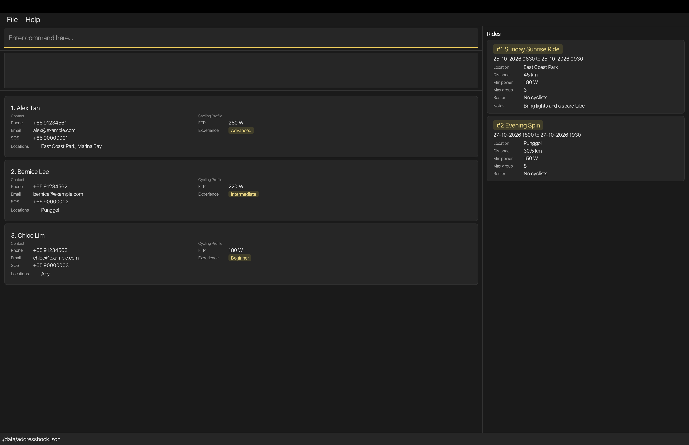

1. Type a command in the command box and press Enter to execute it. For example, type **`help`** and press Enter to open the help window. 
   Some example commands you can try:

   * `list` : Shows all cyclists.

   * `find n/John` : Shows cyclists whose name contains the complete word `John`.

   * `add n/John Doe p/+65 98765432 sos/+65 99999999 e/johnd@example.com f/300 x/Beginner l/any` : Adds a cyclist named `John Doe`, including an emergency contact number supplied using `sos/`.

   * `delete +65 98765432` : Requests deletion of the cyclist with this phone number. Enter `yes` to confirm or `no` to cancel.

   * `clear` : Deletes all cyclists and all rides.

   * `exit` : Exits the app.

1. Refer to the [Features](#features) section below for details of each command.

--------------------------------------------------------------------------------------------------------------------

## Features

Cyclists are displayed alphabetically by their full name, ignoring letter case, on startup and after `list`, `find` or `ridelist`. Adding a cyclist places them in the correct alphabetical position; editing their name updates their position. Names that are identical ignoring case retain their relative stored order. The visible indexes run consecutively from 1 within the current display, including filtered results. Use phone numbers to target `edit` and `delete` as usual.

**:information_source: Notes about the command format:** 

* Words in `UPPER_CASE` are the parameters to be supplied by the user. 
  For example, in `add n/NAME`, replace `NAME` with a value such as `John Doe`.

* Items in square brackets are optional. 
  For example, `edit PHONE [n/NAME] [f/FTP_LEVEL]` can be used as `edit +65 91234567 n/John Doe` or `edit +65 91234567 f/300`.

* Items followed by `…`​ can appear zero or more times. 
  For example, `[l/LOCATION]…` in `edit` may be omitted, or written as `l/Punggol` or `l/Punggol l/Marina Bay`.

* Parameters with prefixes can be in any order. Positional arguments must follow the order shown in the command format. 
  For example, if the command specifies `n/NAME p/PHONE_NUMBER`, `p/PHONE_NUMBER n/NAME` is also acceptable.

* In `rideadd` and `rideedit` only, use `notes/"NOTES"` to keep prefix-looking text inside notes literal.
  Ordinary notes need no quotes. See [Ride Add](#adding-a-group-ride-rideadd) for the quoting rules;
  this syntax does not apply to other fields or to `ridefind`.

* Extraneous parameters for commands that take no parameters, such as `help`, `list` and `exit`, are ignored. 
  For example, `help 123` is interpreted as `help`. The exception is [`clear`](#clearing-all-entries-clear), which rejects any extra text because it deletes all your data.

* If you are using a PDF version of this document, be careful when copying and pasting commands that span multiple lines as space characters surrounding line-breaks may be omitted when copied over to the application.

### Short forms for ride commands

Use these aliases with exactly the same arguments as the full command names. Commands and aliases are case-sensitive.

| Command | Alias |
| --- | --- |
| `rideadd` | `ra` |
| `rideedit` | `re` |
| `ridedelete` | `rd` |
| `ridefind` | `rf` |
| `ridelist` | `rl` |
| `rideaddcyclist` | `rac` |
| `ridedeletecyclist` | `rdc` |

For example, `re 1 notes/Bring lights` edits ride 1 and `rf all` shows all rides.
The Help menu and Full help window show each alias in parentheses beside its full command name,
for example `rideadd (ra)`. Selecting a Help menu entry inserts the full command name; do not type the parentheses.
Entering an alias while a cyclist deletion confirmation is pending cancels that request,
then processes the alias normally, even if its arguments are invalid.

### Viewing help: `help`

Cyclique gives you help in two places: the **Help** menu in the menu bar, and the **Full help** window.

**The Help menu**

Click **Help** in the menu bar to see every command with its format, followed by **Full help...** at the bottom. The commands are listed in this order: `add`, `edit`, `delete`, `find`, `rideadd`, `rideedit`, `ridedelete`, `rideaddcyclist`, `ridedeletecyclist`, `ridelist`, `ridefind`, `list`, `clear`, `help` and `exit`.

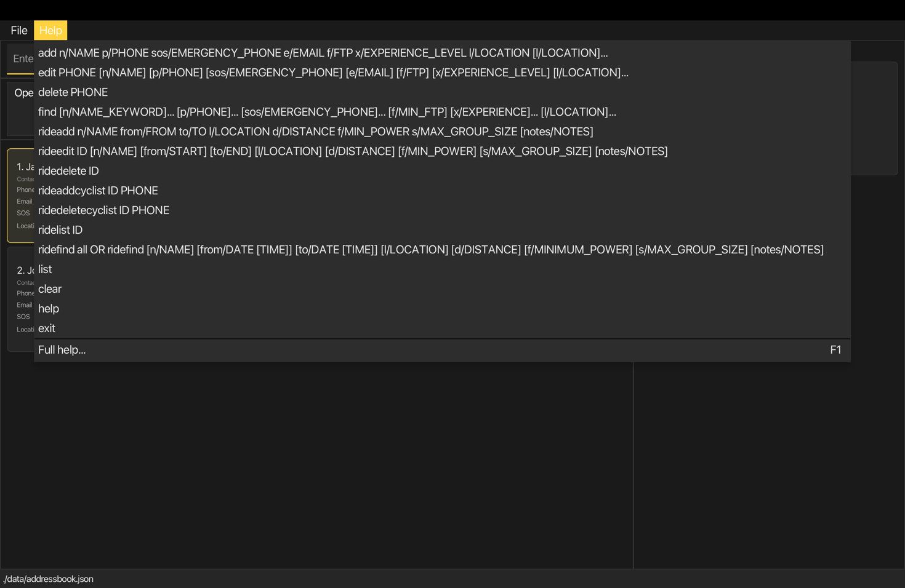

Choosing a command from the menu does **not** run it. It places the start of that command in the command box for you to complete, and then you press Enter as usual:

* For most commands, the command word followed by a space is inserted, for example `rideedit `.
* For `add` and `rideadd`, the command word is followed by every required prefix, for example `rideadd n/ from/ to/ l/ d/ f/ s/`. Type a value straight after each prefix. Optional parameters such as `notes/` are not inserted, so type them yourself if you need them.
* `ID` and `PHONE` in `rideaddcyclist ID PHONE` and `ridedeletecyclist ID PHONE` are typed after the command name without a prefix, so no `p/` is inserted.

**The Full help window**

Choose **Help → Full help...**, press `F1`, or enter `help` to open the Full help window. It lists the usage, parameters and an example for every command. At the bottom it shows a link to the user guide and a **Copy URL** button that copies the link to your clipboard. After you enter `help`, the result box shows `Opened help window.` If the window is already open, Cyclique focuses it instead of opening a second one.

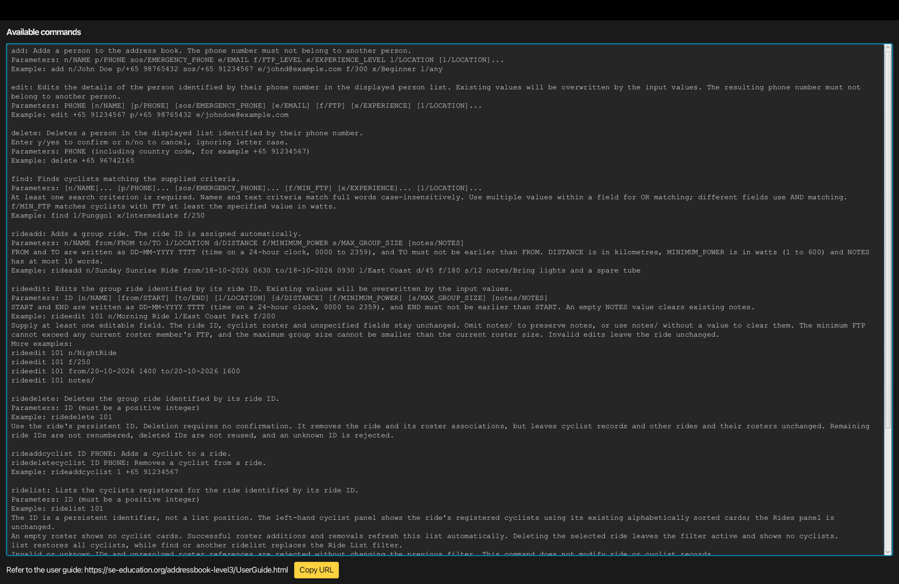

Format: `help`

### Adding a cyclist: `add`

Adds a cyclist to Cyclique.

Format: `add n/NAME p/PHONE sos/EMERGENCY_PHONE e/EMAIL f/FTP_LEVEL x/EXPERIENCE_LEVEL l/LOCATION [l/LOCATION]…`

Field | Meaning and rules
------|------------------
`n/NAME` | The cyclist's name. It may contain Unicode letters (including accented letters), digits and spaces, with combining marks attached to letters or digits. It must start with a letter or digit; blank names and punctuation are rejected. For example, `José Tan` is accepted.
`p/PHONE` | A unique phone number using a `+`, a 1–3 digit country code, one space and at least 3 digits, such as `+65 98765432`. Parentheses, hyphens and blank values are rejected. The number must not belong to another cyclist, including cyclists hidden by a filter.
`sos/EMERGENCY_PHONE` | The cyclist's emergency contact phone number, displayed as **SOS** on their card. Required for new cyclists. It follows the same format as `p/` but may be shared by multiple cyclists and does not determine duplicate cyclists.
`e/EMAIL` | A valid email address, such as `johnd@example.com`. It must be unique across all cyclists, including those hidden by a filter; comparisons ignore letter case.
`f/FTP_LEVEL` | Functional Threshold Power (FTP): a whole number from 1 to 600, in watts.
`x/EXPERIENCE_LEVEL` | `Beginner`, `Intermediate` or `Advanced`, ignoring case.
`l/LOCATION` | A non-blank preferred cycling location containing only letters, numbers, spaces, hyphens or apostrophes. At least one is required. Repeat `l/` for multiple locations, or use `l/any` alone to indicate no location preference. `any` ignores case and cannot be combined with another location.

All fields are required. Only `l/` may be repeated; repeating any other prefix is rejected.
Prefixes can be entered in any order. Cyclists may share a name or emergency contact number,
but their own phone numbers and email addresses must be unique.

On success, the result box shows `New person added:` followed by the cyclist's details, including
`Emergency phone:`. The new card shows the number as **SOS**. Cyclique restores the full cyclist
list, places the new card in alphabetical order and saves the data automatically.

Examples (use phone numbers and email addresses that are not already stored):

* `add n/John Doe p/+65 98765432 sos/+65 99999999 e/johnd@example.com f/300 x/Beginner l/any` adds John with an FTP of 300 W, Beginner experience and no location preference.
* `add n/Betsy Crowe sos/+65 99999999 e/betsycrowe@example.com p/+65 91234567 f/250 x/Advanced l/Punggol l/Seletar` adds Betsy with two preferred locations. Sharing John's emergency contact number is allowed.

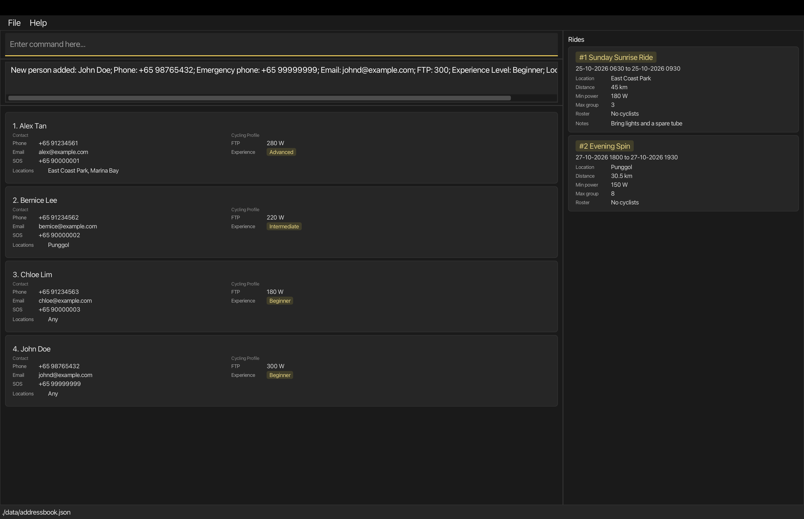

*After the first example, John appears after Chloe in the alphabetical list. The two existing rides are unchanged.*

Missing required fields, blank values, invalid values and repeated single-valued prefixes are rejected.
A phone or email conflict reports `Another cyclist already has this phone number or email.`
These rejected commands leave existing records unchanged and do not add a cyclist.

### Listing all persons: `list`

Shows every cyclist currently stored in the address book.

Format: `list`

* Removes any active `find` or [`ridelist`](#listing-cyclists-registered-for-a-ride-ridelist) filter and restores all cyclists. The result box shows `Listed all persons.`
* Affects only the cyclist panel. It does not change the Rides panel; use `ridefind all` to show every ride again.
* Displays cyclist cards alphabetically by full name, ignoring case. Names that are identical ignoring case retain their stored order.
* Each card shows the cyclist's name, phone number, SOS number, email, FTP, experience level and preferred locations. A missing SOS number is shown as **Not provided**.
* If there are no cyclists, the cyclist panel is empty and the result still shows `Listed all persons.`

### Editing a cyclist: `edit`

Updates an existing cyclist's contact details or cycling profile.

Format: `edit PHONE [n/NAME] [p/PHONE] [sos/EMERGENCY_PHONE] [e/EMAIL] [f/FTP_LEVEL] [x/EXPERIENCE_LEVEL] [l/LOCATION]…`

* The unprefixed `PHONE` identifies the cyclist to edit. It must match exactly one cyclist in the **displayed list**. Use `list` first if a filter hides the cyclist. Card indexes cannot be used as the target.
* Include `+`, the country code and one space in the target phone number, for example `+65 91234567`. A malformed target reports the specific phone-validation error; omitting the target reports the command usage.
* `p/PHONE`, if supplied, is the cyclist's **replacement** phone number. For example, `edit +65 98765432 p/+65 91111111` targets the old number and replaces it with the new number.
* Supply at least one optional field. Otherwise, Cyclique reports `At least one field to edit must be provided.`
* Supplied fields follow the [Add field rules](#adding-a-cyclist-add). Only `l/` may be repeated. Phone numbers and email addresses must remain unique across all cyclists, including hidden records; email comparisons ignore case. Keeping the cyclist's own current phone or email is allowed.
* Omitted fields remain unchanged. Supplying one or more `l/` fields replaces the **entire** preferred location set; it does not append locations. Blank `l/` is invalid. Use `l/any` alone for no location preference.
* Omitting `sos/` preserves the existing emergency contact number. Blank `sos/` is invalid and cannot remove the number.

On success, the result box shows `Edited person:` followed by the updated details. Cyclique restores
all cyclists in alphabetical order and saves the changes. A name edit may move a card to a different
position. Changing the cyclist's own phone number also updates that number in every ride roster
they belong to, preserving their memberships.

Examples, starting with John from the Add example:

* `edit +65 98765432 sos/+65 98888888 f/350 x/Intermediate l/East Coast Park l/Punggol` updates John's emergency number, FTP and experience, and replaces `any` with two preferred locations. His name, own phone number and email remain unchanged.
* `edit +65 98765432 sos/+65 98888888` updates only the emergency number; all other fields remain unchanged. This can also be used independently of the previous example.
* `edit +65 98765432 p/+65 91111111 e/johndoe@example.com` changes John's own phone and email. Subsequent edits or deletion must target `+65 91111111`.

*After the first example, John's updated card remains after Chloe. The deletion examples below continue from this state, without changing John's own phone number.*

Older saved records without an emergency contact number load normally and show **Not provided**
in the SOS field. Use `edit PHONE sos/EMERGENCY_PHONE` to supply one; edits to other fields preserve
its absence. Emergency numbers are retained after restarting.

Invalid edits, duplicate phone numbers or emails, and targets hidden by a filter are rejected without
changing cyclist records, ride rosters or the current filter. Phone or email conflicts report
`Another cyclist already has this phone number or email.`

### Locating persons by name, phone or emergency number: `find`

Finds persons by name keywords, phone numbers, emergency contact numbers, FTP, experience level and preferred location.

Format: `find [n/NAME_KEYWORD]… [p/PHONE]… [sos/EMERGENCY_PHONE]… [f/MIN_FTP] [x/EXPERIENCE]… [l/LOCATION]…`
(at least one field is required)

Field | Meaning and rules
------|------------------
`n/NAME_KEYWORD` | A single name word or a complete full name. Single-word matching is case-insensitive and requires a full word; `n/hans` matches `Hans` but `n/Han` does not. A multi-word value such as `n/John Doe` matches the complete full name, ignoring case.
`p/PHONE` | A complete phone number using a `+`, a 1–3 digit country code, one space and at least 3 digits. Matching is exact; `p/+65 963` does not match `+65 96320842`.
`sos/EMERGENCY_PHONE` | A complete emergency contact number using the same validation and exact matching as `p/`. Only cyclists with an emergency number matching the supplied value are shown. Cyclists whose emergency number is missing or different are not shown.
`f/MIN_FTP` | A whole number from 1 to 600, inclusive. Matches cyclists whose FTP is greater than or equal to the supplied value in watts; both `f/1` and `f/600` are valid.
`x/EXPERIENCE` | `Beginner`, `Intermediate` or `Advanced`, ignoring case. Repeat `x/` to match any of the supplied experience levels.
`l/LOCATION` | A preferred location, ignoring case. Repeat `l/` to match any supplied location. A cyclist with `l/any` matches every location criterion.

At least one criterion is required. Each prefix may be repeated except `f/`, which accepts only one value. Values
within the same field use `OR`, while different fields use `AND`; for example, `find n/Hans n/Bo f/250` matches
cyclists named `Hans` or `Bo` whose FTP is at least 250 W. Prefix order does not matter. Text after a prefix belongs
to that field until the next recognised prefix, so full names and locations containing spaces can be entered normally.

The command filters only the displayed cyclist list and does not change saved records. Matching cyclists remain in
alphabetical order, ignoring case. The result message reports how many cyclists match; an empty result is valid and
leaves the cyclist panel empty. Use `list` to remove the current filter and display all cyclists again.

Invalid phone numbers, FTP values, experience levels, preferred locations, name values and duplicate `f/` prefixes
are rejected without changing the current displayed list. A name or phone criterion searches only the corresponding
field; emergency contact numbers are not treated as the cyclist's own phone number.

Examples:
* `find n/John` returns `john` and `John Doe`
* `find n/John Doe` returns only the cyclist with the complete full name `John Doe`, ignoring case.
* `find n/alex n/david` returns `Alex Yeoh`, `David Li` 
  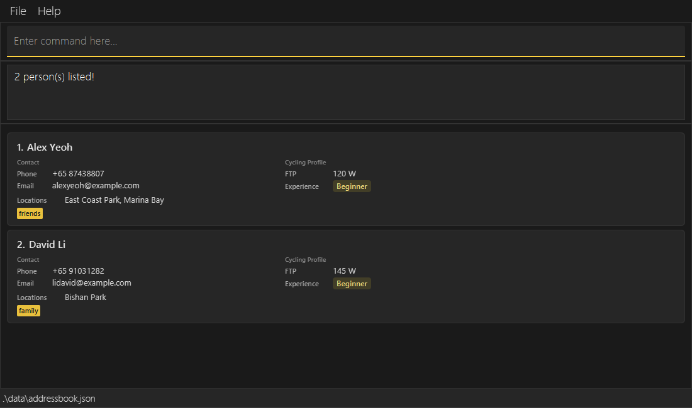
* `find n/alex p/+65 96320842` returns only people whose name contains `alex` and whose phone number is `+65 96320842`.
* `find l/Punggol x/Intermediate f/250` returns cyclists whose preferred location is Punggol, experience level is Intermediate,
  and FTP is at least 250 W.
* `find sos/+65 99999999` returns cyclists with that emergency contact number.
* `find x/Beginner x/Intermediate` returns cyclists with either experience level.

Common failures include:

* `find` with no criteria is rejected with the command usage instructions.
* `find f/0` is rejected because FTP must be a whole number from 1 to 600.
* A phone number, FTP value, experience level or location that does not follow the constraints above is rejected
  without changing the current filter.

### Deleting a cyclist: `delete`

Deletes a cyclist only after you check their details and confirm in the command box.

Format: `delete PHONE`, then enter a separate confirmation or cancellation reply.

* Use the cyclist's own complete phone number, including country code and exactly one space, for example `+65 98765432`. The country code contains 1–3 digits; the number after the space contains at least 3 digits. Do not use a card index or the `p/` prefix.
* A malformed target reports the specific phone-validation error; omitting the target reports the command usage.
* The number must identify exactly one cyclist in the **displayed list**. A cyclist hidden by a filter cannot be deleted; use `list` to show all cyclists first. Multiple displayed matches are rejected.
* The result panel shows `Delete this cyclist?` followed by the target's details, including their emergency number, and warns `This also removes them from all ride rosters.` No cyclist, roster or saved data changes at this stage.
* Enter `y` or `yes` to confirm, or `n` or `no` to cancel. Replies ignore letter case and surrounding spaces, so `YeS` and ` NO ` are accepted.
* Cancellation shows `Deletion cancelled.` and preserves cyclist records, ride rosters, the current filter and saved data.
* An invalid reply, such as `maybe`, `yes please` or an unknown command, reports `Invalid confirmation.` and keeps waiting for a valid reply. It does not cancel the request or change data.
* A recognised command cancels the pending deletion and then runs. The result shows `Deletion cancelled.` followed by that command's usual output or error, even if its arguments are invalid. Another valid `delete PHONE` starts a fresh request. Command names remain case-sensitive: `list` cancels, but `LIST` is an invalid reply.
* Closing or restarting Cyclique discards any pending request. Without a pending request, `yes` and `no` report `Unknown command.`

Confirmation shows `Deleted person:` followed by the deleted cyclist's details. Their card disappears,
and their phone number is removed from **all ride rosters**. The rides themselves, other cyclists and
their memberships remain. The change is saved automatically. There is no undo command.

**Example: check, cancel, then confirm John's deletion**

These screenshots continue from the first Edit example: John has SOS `+65 98888888`, FTP 350 W,
Intermediate experience and two preferred locations. Before the deletion request, Alex and John
have been registered for Sunday Sunrise Ride using `rideaddcyclist 1 +65 91234561` and
`rideaddcyclist 1 +65 98765432` (where `1` is that ride's ID).

1. Enter `delete +65 98765432`. Check that the result panel identifies John. His card and both roster numbers remain visible while confirmation is pending.

   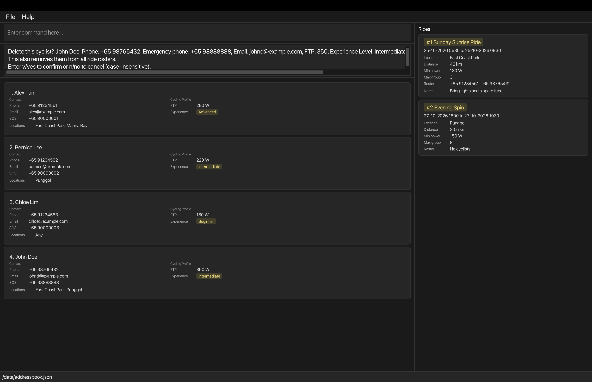

   *The request shows John's identity, the roster-removal warning and the accepted replies. Scroll horizontally in the result box if needed to read the remaining details.*

1. Enter `no`. The result shows `Deletion cancelled.` John remains in the cyclist list and on the ride roster.

   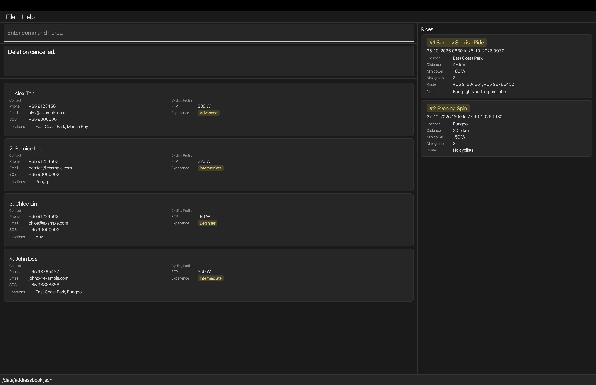

   *Cancellation keeps John's record and ride membership.*

1. Enter `delete +65 98765432` again, then enter `yes`. The result starts `Deleted person: John Doe; Phone: +65 98765432`. John disappears, and only Alex's number remains on Sunday Sunrise Ride's roster. Evening Spin remains unchanged.

   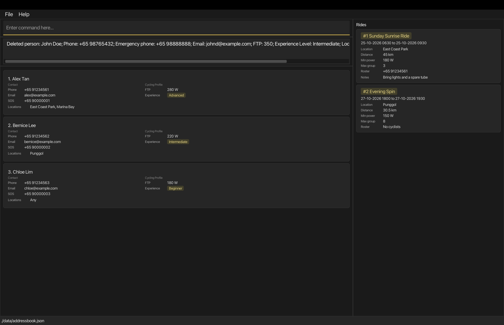

   *Confirmation removes John and his roster memberships while keeping both rides.*

Alternatively, enter `delete +65 98765432`, then `list` before confirming. The result shows
`Deletion cancelled.` followed by `Listed all persons.` John is retained and all cyclists are displayed.

Both `edit` and `delete` report the same error when the target is absent from the displayed list:
`Cyclist with phone number PHONE cannot be found in the displayed list. Use list to show all cyclists.`
Here, `PHONE` is replaced with the number entered. Invalid or missing phone arguments show the
command usage without changing records.

### Adding a group ride: `rideadd`

Adds a group ride that an organiser plans to lead.

Format: `rideadd n/NAME from/FROM to/TO l/LOCATION d/DISTANCE f/MIN_POWER s/MAX_GROUP_SIZE [notes/NOTES]`

Field | Meaning and rules
------|------------------
`n/NAME` | The name of the ride. Unicode letters (including accented letters), digits and spaces, with combining marks attached to letters or digits. It must start with a letter or digit; blank names and punctuation are rejected.
`from/FROM` | When the ride starts, written as `DD-MM-YYYY TTTT` (day-month-year, followed by exactly one space and the time). `TTTT` uses the 24-hour clock from `0000` to `2359`, for example `25-10-2026 0630`. Both the date and time are required. The date must be a real calendar date, including the correct leap-year rules.
`to/TO` | When the ride ends, in the same format as `from/`. It must not be earlier than `from/` (the same time is allowed).
`l/LOCATION` | One non-blank location. English letters (`A–Z`, `a–z`), digits (`0–9`), spaces, hyphens and apostrophes only.
`d/DISTANCE` | The distance in kilometres, from `0.01` to `999999.99`. Use 1–6 digits before the decimal point and, optionally, 1–2 digits after it, such as `45` or `45.5`.
`f/MIN_POWER` | The minimum power a cyclist needs to join, in watts. Use 1–3 digits representing a whole number from 1 to 600, the same range as a cyclist's FTP.
`s/MAX_GROUP_SIZE` | The most cyclists that can join. Use 1–9 digits representing a whole number from 1 to 999999999.
`notes/NOTES` | Optional. If supplied, it must contain 1–10 words separated by whitespace. Repeated whitespace is stored as single spaces. Omit the prefix for no notes; empty `notes/` is rejected when adding a ride.

Every field except `notes/` is required and must have a value. Each prefix can be used only once, in any order. Put whitespace before each prefix; spaces around values are trimmed. Command words and prefixes are case-sensitive: use `rideadd` and `from/`, for example. Names, locations and notes retain the capitalisation you enter. Enter numeric values without units, signs, commas or scientific notation; zero and negative values are rejected. Leading zeroes count towards the digit limits and are removed from stored numeric values.

**Optional quoted notes**

Ordinary notes such as `notes/Bring water` do not need quotation marks. To include recognised ride prefixes
(`n/`, `from/`, `to/`, `l/`, `d/`, `f/`, `s/` or `notes/`) literally, put a double quote immediately after
`notes/` and another at the end of the notes: `notes/"Bring camera with aperture f/2"`.
The surrounding quotes are not stored, and recognised prefixes inside them do not create or change other fields.
Other parameters may appear before or after quoted notes; put whitespace between the closing quote and the next prefix.
The same 1–10-word limit and whitespace rules apply.

The first double quote after the opening quote closes the value. Missing closing quotes, empty or whitespace-only
quoted notes, and extra text after the closing quote before the next recognised parameter are rejected.
For example, `notes/"Bring water"extra` and `notes/"Bring water" q/test` are invalid.
In unquoted notes, double quotes away from the beginning are literal, as in `notes/Bring a "camera"`.
A double quote immediately after `notes/` always starts quoted-notes syntax; it is not stored as a literal quote.
Quoted notes cannot contain literal double quotes, and escaping is unsupported: backslashes are literal and do
not escape quotes. These quoting rules apply only to `rideadd` and `rideedit`, including their aliases.

Rides may be in the past, cross midnight or span multiple days. The end must be on or after the start: for an overnight ride, enter the later date in `to/` as well as the time. Equal start and end date/times are allowed.

Each new ride gets a persistent ID automatically. A new empty book starts at 1; an existing book continues from its saved counter. IDs increase in creation order and are never reused, including after deletion, `clear` or restarting. Check the assigned ID in the result or ride card; it is not the card's list position. A new ride has no cyclists on its roster yet. Even rides with identical details are allowed, because their IDs differ.

On success, the result box shows `New ride added:` followed by the assigned ID and complete ride details, and the change is saved automatically. The right-hand **Rides** panel updates immediately, with the new ride after existing rides. An active `ridefind` filter is retained and may hide the new card; use `ridefind all` to show every ride. Cyclist records and the current cyclist filter are unchanged. Each ride card shows its ID and name, period, location, distance, minimum power, maximum group size and roster, plus a **Notes** line if notes are present.

Examples:

* `rideadd n/Sunday Sunrise Ride from/25-10-2026 0630 to/25-10-2026 0930 l/East Coast Park d/45 f/180 s/3 notes/Bring lights and a spare tube`
* `rideadd n/Evening Spin from/27-10-2026 1800 to/27-10-2026 1930 l/Punggol d/30.5 f/150 s/8`
* `rideadd n/Camera Ride from/29-10-2026 1600 to/29-10-2026 1800 l/East Coast d/20 f/180 s/2 notes/"Bring camera with aperture f/2"`

The first example adds a 45 km ride with minimum power 180 W and room for three cyclists. The second adds a ride without notes; its feedback includes `Notes: None`. If the sample rides already exist, these commands add separate rides with new IDs.
The Camera Ride example stores `Bring camera with aperture f/2` as its notes, without the quotes,
and has minimum power 180 W.

**Screenshot walkthrough: add, edit and delete Ride 3**

The three screenshots in these sections show a separate walkthrough starting with a new data file's sample rides, before running the examples above. Sunday Sunrise Ride is ID 1 and Evening Spin is ID 2; the next command adds Saturday Coastal Ride as ID 3. In an existing file, substitute the actual assigned ID in the later edit and delete commands. Select any walkthrough screenshot to open it at full resolution and read the smaller card text.

`rideadd n/Saturday Coastal Ride from/31-10-2026 0700 to/31-10-2026 1000 l/East Coast Park d/40 f/180 s/5 notes/Bring water and friends!`

<a href="images/ug-rideadd-success.png">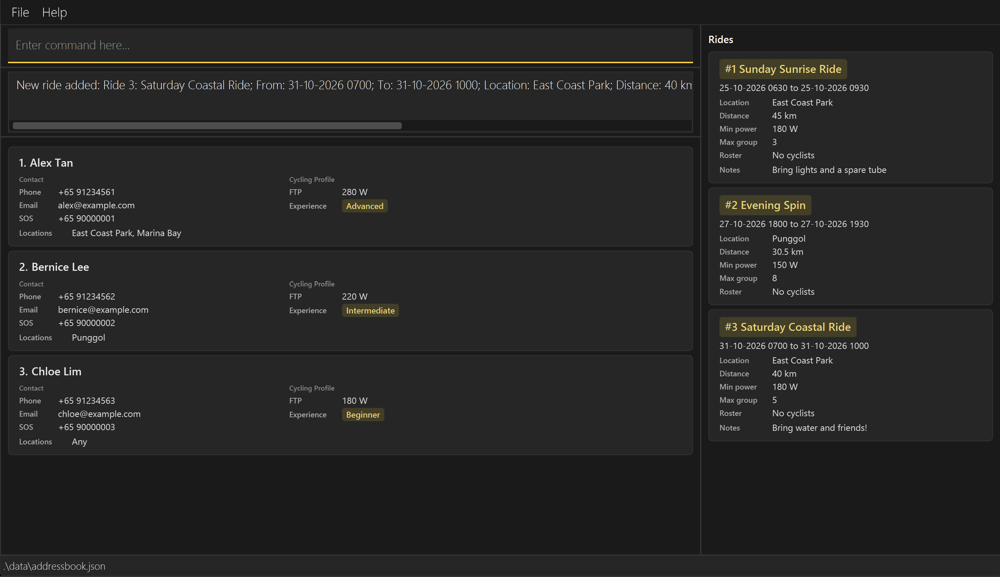</a>

*Saturday Coastal Ride is added as Ride 3, with notes `Bring water and friends!`; sample Rides 1 and 2 remain.*

**If something goes wrong**

* Missing required prefixes or text before the first prefix produces `Invalid command format.` followed by the command usage.
* Repeating a prefix is rejected. For example, repeating `d/` reports `Multiple values specified for the following single-valued field(s): d/.`
* Invalid field values report the relevant constraint. For example, `d/0` reports `Distance should be a positive number of kilometres with at most 2 decimal places, for example 45 or 45.5.` Empty `notes/` reports `Notes should not be blank and should contain at most 10 words.`
* An end before the start reports `The end date and time (to/) cannot be earlier than the start date and time (from/).`
* If the ID counter is exhausted, Cyclique reports `No more ride IDs are available.`

These rejected commands add no ride and consume no ID. In unquoted values, unsupported prefix-like text is not checked separately and becomes part of the preceding value (or the text before the first prefix). For example, `notes/Bring lights q/test` can be accepted as notes containing `q/test`; it is not a separate parameter. Unquoted text after a recognised prefix belongs to that value until the next recognised prefix.

### Finding group rides: `ridefind`

Finds rides matching one or more supplied criteria and displays the matching rides in the Rides panel.

Format: `ridefind [n/NAME] [from/DATE [TIME]] [to/DATE [TIME]] [l/LOCATION] [d/DISTANCE] [f/MIN_POWER] [s/MAX_GROUP_SIZE] [notes/NOTES]`

To list every ride, use `ridefind all`.

At least one criterion is required unless the special `all` argument is used. Different fields use AND matching, so a ride must satisfy every field supplied. `ridefind all` clears the current ride filter and displays every saved ride in the Rides panel.
The fields are matched as follows:

* `n/NAME` matches the complete ride name, ignoring case.
* `from/` matches rides starting at or after the supplied date and time.
* `to/` matches rides ending at or before the supplied date and time.
* `l/LOCATION` matches the ride location, ignoring case.
* `d/DISTANCE` and `s/MAX_GROUP_SIZE` use exact numeric matching.
* `f/MIN_POWER` matches rides whose minimum power is greater than or equal to the supplied value.
* `notes/NOTES` matches complete words or phrases in the ride's notes, ignoring case. For example,
  `notes/lights` matches `Bring lights`, but `notes/lig` does not. Rides without notes do not match a notes criterion.

`ridefind` does not support the quoted-notes syntax of `rideadd` and `rideedit`. Quotes in search values are
ordinary characters and do not protect recognised prefixes. Use an unquoted criterion such as `notes/camera`
to find a complete word in notes containing literal `f/2`; whole-word and phrase matching are unchanged.

The date and time format is `DD-MM-YYYY TTTT`, using the 24-hour clock. A date-only `from/` value means `0000`,
while a date-only `to/` value means `2359`. When both bounds are supplied, `to/` cannot be earlier than `from/`.
Both bounds are inclusive. Each prefix can be used only once. Distances are positive numbers with at most two decimal places, minimum power is a whole number from 1 to 600, and maximum group size is a positive whole number. Dates must be real calendar dates and times must be between `0000` and `2359`.

The command updates only the displayed ride list; it does not change or delete saved rides. If no ride matches, the Rides panel is empty and the result message reports `0 ride(s) listed!`. Invalid criteria are rejected without changing the current ride filter.

Examples:
* `ridefind n/Sunday Sunrise Ride`
* `ridefind notes/lights` finds rides whose notes contain the complete word `lights`, such as `Bring lights and a spare tube`.
* `ridefind from/18-10-2026 to/18-10-2026`
* `ridefind l/Tampines f/200`
* `ridefind from/18-10-2026 0630 to/18-10-2026 2000 l/East Coast d/45 f/180 s/12`
* `ridefind all` displays all rides, including rides hidden by an earlier search.

Common failures include:

* `ridefind` with no criteria is rejected with the command usage instructions; use `ridefind all` to show all rides.
* Date-only values are valid: `from/18-10-2026` means `18-10-2026 0000`, while `to/18-10-2026` means `18-10-2026 2359`.
* A `to/` value earlier than `from/`, an invalid date or time, or a value outside the numeric constraints is rejected without changing the displayed rides.
* Each `ridefind` prefix may be used only once. For example, `ridefind f/200 f/300` is rejected because `f/` is repeated; use one `f/` value only.

### Editing a group ride: `rideedit`

Edits an existing group ride identified by its ride ID.

Format: `rideedit ID [n/NAME] [from/START] [to/END] [l/LOCATION] [d/DISTANCE] [f/MIN_POWER] [s/MAX_GROUP_SIZE] [notes/NOTES]`

`ID` is the persistent number assigned when the ride is created and displayed on its card, not its position in the Rides panel. Enter a whole number from 1 to 2147483647 without a sign or decimal point, before any prefixed fields. It must identify a saved ride; rides hidden by `ridefind` can still be edited. The ID itself cannot be edited.

Supply at least one field after the ID. All eight fields shown in the format are editable. Fields follow the [`rideadd` rules](#adding-a-group-ride-rideadd), including case-sensitive command words and prefixes, digit limits, whitespace handling and duplicate-prefix rejection. Prefixed fields can be in any order after the ID. Only supplied fields are replaced; all unspecified fields are preserved. Supplied values must not be empty, except that `notes/` with no value clears existing notes. Non-empty `notes/NOTES` replaces the notes with 1–10 words; omitting it preserves them.

For literal prefixes, use `rideedit 1 notes/"Bring camera with aperture f/2"` (substitute the actual ride ID).
This stores `Bring camera with aperture f/2` and preserves minimum power, ID, roster and all other fields.
The [optional quoting rules](#adding-a-group-ride-rideadd), including malformed-input rejection, also apply here;
use bare `notes/` to clear notes.

Parameters remain valid on either side: `rideedit 1 notes/"Bring camera with aperture f/2" s/5` also sets
the maximum group size to 5, subject to roster capacity. `rideedit 1 f/200 notes/"Bring camera with aperture f/2"`
intentionally sets minimum power to 200 W, subject to roster eligibility.
Without quotes, `rideedit 1 notes/Bring camera with aperture f/2` still sets minimum power to 2 W and stores
only `Bring camera with aperture` as notes. Cyclique cannot infer whether an unquoted prefix was intended literally.

**Dates and roster constraints**

* `from/START` and `to/END` require `DD-MM-YYYY TTTT`, just as for `rideadd`. Cyclique checks the complete resulting period, including any preserved endpoint. The end cannot be earlier than the start; equal date/times are allowed.
* When `s/` is supplied, the proposed maximum group size must be at least the current roster count. Equality is allowed.
* When `f/` is supplied, the proposed minimum power must be no greater than every registered cyclist's FTP. Equality is allowed. Cyclique looks up registered cyclists among all saved cyclists, including those hidden from the left panel. If a registered phone number cannot be matched to a saved cyclist, that minimum-power edit is rejected with `Cyclist with this phone number cannot be found.`
* The roster count check runs only when `s/` is supplied. Cyclist lookup and FTP checks run only when `f/` is supplied, even if the value is unchanged. Unrelated edits do not revalidate roster phones or FTP. After the fields are parsed and the ride is found, checks run in this order: resulting period, supplied maximum group size, then supplied minimum power. Only the first failure is reported.

If the resulting start or end changes and a registered cyclist has another ride with overlapping times, Cyclique warns before applying any part of the edit. The warning lists every affected cyclist's phone number and conflicting ride IDs, names and times. Enter `y`/`yes` to apply the whole edit anyway or `n`/`no` to cancel it, ignoring letter case. Adjacent periods and zero-duration rides do not overlap; travel time is not checked. Rides hidden by filters are included. Edits that preserve both endpoints do not warn about existing overlaps.

While an overlap warning is pending, an invalid reply repeats the warning. Entering another recognised command cancels the pending change and processes the new command, including reporting errors in its arguments. Restarting discards pending confirmation. No data is changed or saved until confirmation; if cyclist or ride data changes before confirmation, enter the original command again to review it. These confirmation rules also apply to `rideaddcyclist` overlap warnings.

Quoted notes follow the same confirmation rules. For example,
`rideedit 3 notes/"Bring camera with aperture f/2" from/29-10-2026 1700 to/29-10-2026 1900`
preserves literal `f/2`. If the new period creates a roster conflict, both the notes and times remain unchanged
until `y`/`yes`; `n`/`no` cancels the whole edit. Substitute the actual ride ID.

On success, Cyclique displays `Edited ride:` followed by the complete updated ride and saves the change automatically. The ride ID, roster membership, stored ride order, other rides, cyclist records and next ride ID are unchanged. The Rides panel refreshes immediately using the existing `ridefind` filter: an edited ride may disappear if it no longer matches, or appear if it now matches. Use `ridefind all` to see all rides. If input or ride validation fails, none of the supplied changes is applied.

Examples:

These examples use the existing sample Sunday Sunrise Ride, which has ID `1` in a new data file and initially runs from `25-10-2026 0630` to `25-10-2026 0930`. Substitute the actual ride ID if different.

* `rideedit 1 l/Marina Bay notes/Meet at the waterfront` changes the location and replaces the notes. The result starts with `Edited ride: Ride 1: Sunday Sunrise Ride`.
* `rideedit 1 notes/` clears the notes. Feedback includes `Notes: None`, and the card's Notes line disappears.
* `rideedit 1 from/25-10-2026 1000` is rejected because the preserved end is `0930`. Similarly, `rideedit 1 to/25-10-2026 0600` is rejected because the preserved start is `0630`. To move both endpoints, supply both, for example `rideedit 1 from/25-10-2026 1000 to/25-10-2026 1200`.
* Register the sample cyclists Alex Tan (280 W) and Bernice Lee (220 W) for this ride using `rideaddcyclist 1 +65 91234561` and `rideaddcyclist 1 +65 91234562`, respectively, only if they are not already registered for it. With these two cyclists on the roster, `rideedit 1 s/1` is rejected because there are two members, and `rideedit 1 f/221` is rejected because one member's FTP is 220 W. `rideedit 1 f/220 s/2` succeeds with that roster. No member is removed to make an edit succeed.

Continuing the separate Ride 3 screenshot walkthrough from [Ride Add](#adding-a-group-ride-rideadd), enter `rideedit 3 l/Marina Bay notes/Meet at the waterfront`.

<a href="images/ug-rideedit-success.png">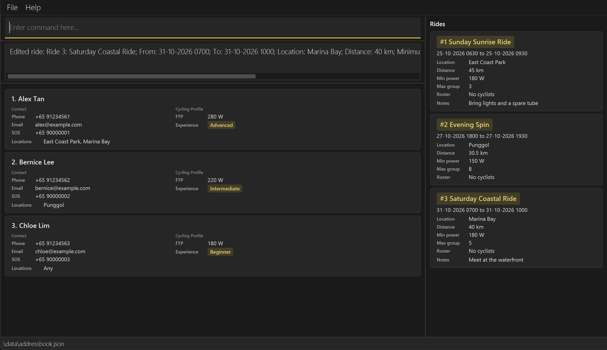</a>

*Ride 3 retains its persistent ID while its location changes to Marina Bay and its notes to `Meet at the waterfront`. Its other details and empty roster are unchanged.*

Common failures include:

* A missing, zero, negative, malformed, overflowing or extra ID argument: `Invalid command format.` followed by the command usage.
* An unknown ID, for example `rideedit 999999 n/Morning Ride` when that ID is absent: `Ride with ID 999999 cannot be found.`
* No editable field after the ID: `At least one field to edit must be provided.`
* An invalid field value, which reports the same constraint as `rideadd`.
* An invalid resulting period: `The end date and time (to/) cannot be earlier than the start date and time (from/).`
* A proposed maximum below the roster count: `Cannot edit ride: maximum group size cannot be smaller than the current roster size.`
* A proposed minimum above a member's FTP: `Cannot edit ride: minimum FTP exceeds the FTP of an existing cyclist.`

### Deleting a group ride: `ridedelete`

Deletes one group ride using the persistent ID shown on its ride card.

Format: `ridedelete ID`

Example: `ridedelete 1` (replace `1` with the actual ID of the ride you want to delete).

Supply exactly one whole number from 1 to 2147483647 without a sign or decimal point, and no prefixes or extra arguments. It identifies the saved ride rather than its position in the Rides panel. A ride hidden by `ridefind` can still be deleted. Command words are case-sensitive: use `ridedelete`.

Deletion is immediate and does not require confirmation. On success, Cyclique displays `Deleted ride:` followed by the deleted ride's complete details, removes its card from the Rides panel if visible and saves the change automatically. For Sunday Sunrise Ride with ID 1, the feedback starts with `Deleted ride: Ride 1: Sunday Sunrise Ride`.

To finish the separate Ride 3 screenshot walkthrough, enter `ridedelete 3` after the edit shown above.

<a href="images/ug-ridedelete-success.png">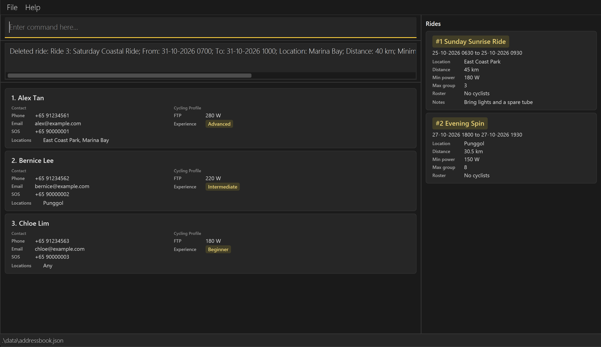</a>

*Ride 3 has been removed. Sunday Sunrise Ride remains ID 1, Evening Spin remains ID 2, and Alex Tan, Bernice Lee and Chloe Lim remain visible.*

The deleted ride's roster associations are removed with the ride. Cyclist records, other rides and their rosters
remain unchanged. Remaining ride IDs are not renumbered, and deleted IDs are never reused.

The current `ridefind` filter is retained. If a [`ridelist`](#listing-cyclists-registered-for-a-ride-ridelist) selection is showing the deleted ride's cyclists, the left-hand panel becomes empty and does not switch to another ride. Enter `list` to display all saved cyclists again. Other cyclist filters are retained.

A missing, malformed, non-positive, overflowing or additional argument produces `Invalid command format.` followed by the command usage. For example, `ridedelete 1 extra` is invalid. An unknown ID of 1 reports `Ride with ID 1 cannot be found.` Input or missing-ride errors do not change ride or cyclist data, filters or the next ride ID.

### Adding a cyclist to a ride: `rideaddcyclist`

Adds one saved cyclist to an existing ride's roster.

Format: `rideaddcyclist ID PHONE`

Example: `rideaddcyclist 1 +65 91234567`

* `ID` is the persistent ride ID shown on its card, not its position in the Rides panel. Enter a positive whole number from 1 to 2147483647. Leading zeroes are accepted: `01` and `1` identify the same ride, consistently with `ridelist`, `rideedit` and `ridedelete`. It must identify an existing ride; filtering rides with `ridefind` does not prevent you from targeting a hidden ride.
* `PHONE` is the cyclist's own saved phone number, not their SOS number. Enter `+`, a 1–3 digit country code, exactly one space and at least three digits, for example `+65 91234567`. Do not add `p/`, brackets or hyphens. Put the ride ID before the phone number.
* The cyclist must already exist in Cyclique, but can be hidden by `find` or a `ridelist` selection.
* The cyclist must not already be on that ride's roster, the ride must have a free place, and the cyclist's FTP must be at least the ride's minimum power. FTP equal to the minimum is accepted.
* One cyclist may join several rides. If the cyclist is already registered for another ride with overlapping times, Cyclique shows a warning before changing the roster, with yellow confirmation instructions above the white conflict details. Enter `y`/`yes` to proceed anyway or `n`/`no` to cancel, ignoring letter case. The warning lists the proposed ride and the conflicting ride IDs, names and times.
* Rides ending exactly when another starts do not overlap. Zero-duration rides do not overlap other rides. All saved rides are checked, including rides hidden by a filter; travel time between rides is not included.
* This command changes only the selected ride's roster; it does not create or edit a cyclist record.

For the example above, successful addition reports `Cyclist +65 91234567 added to ride 1.` The ride card's roster includes the phone number and the change is saved automatically. If `ridelist 1` is active, the cyclist also appears in the left panel in alphabetical order. Otherwise, the current cyclist filter is retained.

**If something goes wrong**

Situation | Result message
----------|---------------
The ride ID does not exist | `Ride ID cannot be found.`
The phone number does not identify a saved cyclist | `Cyclist with this phone number cannot be found.`
The cyclist is already registered for that ride | `Cyclist is already on this ride's roster.`
The roster has reached the ride's maximum group size | `Ride has reached its maximum group size.`
The cyclist's FTP is below the ride's minimum power | `Cyclist's FTP is below the ride's minimum power.`

Checks run in the order shown; only the first failure is reported. These errors leave all cyclist records and ride rosters unchanged. See the shared input rules below for format errors.

### Removing a cyclist from a ride: `ridedeletecyclist`

Removes one cyclist from one ride's roster. The cyclist's contact record and memberships of other rides are retained.

Format: `ridedeletecyclist ID PHONE`

Example: `ridedeletecyclist 1 +65 91234567`

Use the same ID and phone format as [`rideaddcyclist`](#adding-a-cyclist-to-a-ride-rideaddcyclist), with the ID first and no `p/` prefix. The phone must be registered for that ride. Removal is immediate and does not ask for confirmation.

For the example above, successful removal reports `Cyclist +65 91234567 removed from ride 1.` The phone disappears from that ride card's roster; an empty roster shows `No cyclists`. The change is saved automatically. If `ridelist 1` is active, the cyclist disappears from the left panel too. Removing the last member leaves that panel empty. Other cyclist filters and the current `ridefind` filter are retained.

An unknown ride reports `Ride ID cannot be found.` A phone that is not on the selected ride's roster reports `Cyclist is not on this ride's roster.` These errors leave all cyclist records and ride rosters unchanged. Removal does not require a free place or check the cyclist's FTP.

#### Shared roster command input and behaviour

* Both commands require an ID followed by a complete phone number. Missing arguments report `Invalid command format.` followed by the entered command's syntax and example. For example, `ridedeletecyclist 1` shows `Example: ridedeletecyclist 1 +65 91234567`; `rideaddcyclist 1` shows `Example: rideaddcyclist 1 +65 91234567`. The **Full help** window includes both commands and their examples.
* An invalid ID, such as `0`, `00`, `-1`, `+1`, `abc` or `2147483648`, reports `Ride ID should be a positive whole number no larger than 2147483647.` when a phone argument is supplied.
* An invalid phone, including a `p/` prefix or extra text after the phone, reports a phone-format error. Enter the complete phone number exactly as saved. Invalid inputs do not change rosters.
* Command names are case-sensitive. Both commands appear in the **Help** menu; choosing one inserts the command word and a space for you to complete, without running it.
* Entering either supported command while cyclist deletion is awaiting confirmation cancels that pending deletion, then processes the roster command. Cancellation is reported even if its input is invalid.
* Editing a cyclist's phone updates their memberships in every ride. Use the new phone for later roster commands. Confirming deletion of their cyclist record removes them from every roster; requesting or cancelling deletion preserves those memberships.

To try both commands, first save a cyclist with phone `+65 91234567` and FTP of at least 180, then create a ride with minimum power 180 and a free place. Use that ride's assigned ID in `rideaddcyclist ID +65 91234567`, followed by `ridelist ID` to see its cyclists. Enter `ridedeletecyclist ID +65 91234567` to remove the membership, and `list` to see that the cyclist record is still saved. Replace each `ID` with the actual number; do not type the placeholder.

### Listing cyclists registered for a ride: `ridelist`

Shows the cyclists registered for one ride in the left-hand cyclist panel, so that you can see who is on that ride. No ride or cyclist records are changed.

Format: `ridelist ID`

Example: `ridelist 101`

* `ID` is the persistent ride ID shown on the ride card, not the ride's position in the Rides panel. Use a whole number from 1 to 2147483647.
* The cyclists appear on the usual cyclist cards, sorted alphabetically. The Rides panel on the right does not change.
* On success, Cyclique reports `Showing registered cyclists for ride 101 in the left panel.`
* If nobody is registered for the ride, Cyclique reports `Ride 101 has no registered cyclists.` and the cyclist panel is empty.

**How the selection behaves**

* `ridelist` replaces the current cyclist filter instead of combining with it. For example, if `find` was hiding some cyclists, `ridelist` still shows everyone registered for the ride.
* The panel refreshes by itself when `rideaddcyclist` or `ridedeletecyclist` changes the selected ride. Changes to other rides do not affect it.
* The selection ends when you run `list`, `find`, `clear`, another `ridelist`, or a successful `edit`, because each of these replaces the cyclist filter. Later roster changes do not bring the old selection back.
* If you delete the selected ride with `ridedelete`, the cyclist panel becomes empty and does not switch to another ride. Use `list`, `find` or another `ridelist` to show cyclists again.

**If something goes wrong**

* An unknown ride ID, such as `999999`, reports `Ride with ID 999999 cannot be found.`
* A missing, malformed, zero, negative, overflowing or extra argument produces the invalid-command-format message with the command usage.
* If a phone number on the roster no longer matches any cyclist, Cyclique reports `Cannot list ride: a registered cyclist cannot be found.`

After any of these errors, the previous filter and all ride and cyclist data stay unchanged.

### Clearing all entries: `clear`

Deletes **every cyclist and every ride** from Cyclique.

Format: `clear`

* `clear` takes no parameters. If you type anything after it, for example `clear 3`, Cyclique rejects the command with `Invalid command format.` and the command usage, and nothing is deleted. To remove a single cyclist, use [`delete`](#deleting-a-person-delete) instead.
* Cyclique does **not** ask you to confirm, and there is no undo. The change is saved automatically, so the data file is emptied as well. Keep a copy of your data file first if you might need the data again (see [Saving the data](#saving-the-data)).
* Ride IDs are never reused. After `clear`, the next ride you add receives the next unused ID instead of starting again from 1.
* Any cyclist filter, including a [`ridelist`](#listing-cyclists-registered-for-a-ride-ridelist) selection, is reset.
* On success, the result box shows `Address book has been cleared!`

### Exiting the program: `exit`

Exits the program.

Format: `exit`

### Saving the data

Cyclique saves successful additions, edits and confirmed deletions automatically; you do not need to save manually. It also saves after other successfully executed commands, including commands that only change the display. A deletion request, an explicit cancellation reply (`n`/`no`) or an invalid confirmation reply does not write the data file. When another recognised command cancels a pending deletion, that command follows its normal saving behaviour. Rejected commands do not save changes.

An overlap warning likewise leaves the pending ride change unsaved. Confirmation applies and saves the whole
change; cancellation preserves the saved data. A new recognised command cancels the request and follows its own
normal saving behaviour.

### Repairing duplicate phone numbers in an existing book

Saved books containing duplicate phone numbers or email addresses (ignoring email case)
are rejected during loading. Cyclique starts with an empty directory and logs the error.
Before entering commands that could overwrite the file, close the application and back up
`data/addressbook.json`. Correct conflicting phone numbers and email addresses in a copy
of the file, then relaunch. Identical cyclist names are allowed when phone numbers and
email addresses are unique.

### Editing the data file

Cyclique stores data in `data/addressbook.json`, relative to the folder from which you launch the application. Following the Quick start steps places it in your chosen home folder. Older cyclist records without an `emergencyPhone` field load with **SOS: Not provided**; adding an emergency number through `edit` saves it for future sessions. Group rides are saved in the same file under `rides`, together with a `nextRideId` number that stops ride IDs from being reused; data files saved before rides existed still load, with no rides. Advanced users are welcome to update data directly by editing that data file.

:exclamation: **Caution:**
Close Cyclique and back up the file before editing it. If your changes make the file invalid, Cyclique starts with an empty directory at the next launch. A subsequent successful command that saves data can overwrite the invalid file with that empty directory. Restore or repair your backup before entering commands. Direct edits must follow the supported data format and field constraints.

### Archiving data files `[coming in v2.0]`

_Details coming soon ..._

--------------------------------------------------------------------------------------------------------------------

## FAQ

**Q**: How do I transfer my data to another computer? 
**A**: Install JDK 25 and Cyclique on the other computer. Close Cyclique on both computers, then copy `data/addressbook.json` from the original home folder into the new home folder's `data` directory, backing up any existing file first. Launch Cyclique from the new home folder to load the cyclists and rides.

--------------------------------------------------------------------------------------------------------------------

## Known issues

1. **When using multiple screens**, if you move the application to a secondary screen, and later switch to using only the primary screen, the GUI will open off-screen. The remedy is to delete the `preferences.json` file created by the application before running the application again.
2. **If you minimise the Help Window** and then run the `help` command (or use the `Help` menu, or the keyboard shortcut `F1`) again, the original Help Window will remain minimised, and no new Help Window will appear. The remedy is to manually restore the minimised Help Window.

--------------------------------------------------------------------------------------------------------------------

## Command summary

For **Rideadd** and **Rideedit**, notes may optionally be quoted to preserve prefixes literally:
`rideedit 1 notes/"Bring camera with aperture f/2"` (use the actual ride ID). Quotes are removed;
this quoting syntax does not apply to **Ridefind**. See the [Ride Add rules](#adding-a-group-ride-rideadd).

Action | Format, Examples
--------|------------------
**Add** | `add n/NAME p/PHONE sos/EMERGENCY_PHONE e/EMAIL f/FTP_LEVEL x/EXPERIENCE_LEVEL l/LOCATION [l/LOCATION]…`   e.g., `add n/John Doe p/+65 98765432 sos/+65 99999999 e/johnd@example.com f/300 x/Beginner l/any`
**Clear** | `clear`
**Delete** | `delete PHONE`, then `y`/`yes` to confirm or `n`/`no` to cancel (case-insensitive)  e.g., `delete +65 98765432`, then `yes`
**Edit** | `edit PHONE [n/NAME] [p/PHONE] [sos/EMERGENCY_PHONE] [e/EMAIL] [f/FTP_LEVEL] [x/EXPERIENCE_LEVEL] [l/LOCATION]…`  e.g., `edit +65 98765432 sos/+65 98888888 f/350 x/Intermediate l/East Coast Park l/Punggol`
**Find** | `find [n/NAME_KEYWORD]… [p/PHONE]… [sos/EMERGENCY_PHONE]… [f/MIN_FTP] [x/EXPERIENCE]… [l/LOCATION]…`  e.g., `find n/James n/Jake`, `find n/James p/+65 96320842`
**List** | `list`
**Help** | `help`  or press `F1`, or choose **Help → Full help...**
**Rideadd** | `rideadd n/NAME from/FROM to/TO l/LOCATION d/DISTANCE f/MIN_POWER s/MAX_GROUP_SIZE [notes/NOTES]`  e.g., `rideadd n/Sunday Sunrise Ride from/25-10-2026 0630 to/25-10-2026 0930 l/East Coast Park d/45 f/180 s/3 notes/Bring lights and a spare tube`
**Ridefind** | `ridefind all` or `ridefind [n/NAME] [from/DATE [TIME]] [to/DATE [TIME]] [l/LOCATION] [d/DISTANCE] [f/MIN_POWER] [s/MAX_GROUP_SIZE] [notes/NOTES]`  e.g., `ridefind all`, `ridefind from/18-10-2026 to/18-10-2026 f/180`
**Rideedit** | `rideedit ID [n/NAME] [from/START] [to/END] [l/LOCATION] [d/DISTANCE] [f/MIN_POWER] [s/MAX_GROUP_SIZE] [notes/NOTES]`  e.g., `rideedit 1 l/Marina Bay notes/Meet at the waterfront`, `rideedit 1 notes/` (use the actual ride ID)
**Ridedelete** | `ridedelete ID`  e.g., `ridedelete 1` (use the actual ride ID; no confirmation)
**Add cyclist to ride** | `rideaddcyclist ID PHONE`  e.g., `rideaddcyclist 1 +65 91234567`
**Remove cyclist from ride** | `ridedeletecyclist ID PHONE`  e.g., `ridedeletecyclist 1 +65 91234567`
**List cyclists in ride** | `ridelist ID`  e.g., `ridelist 101`
