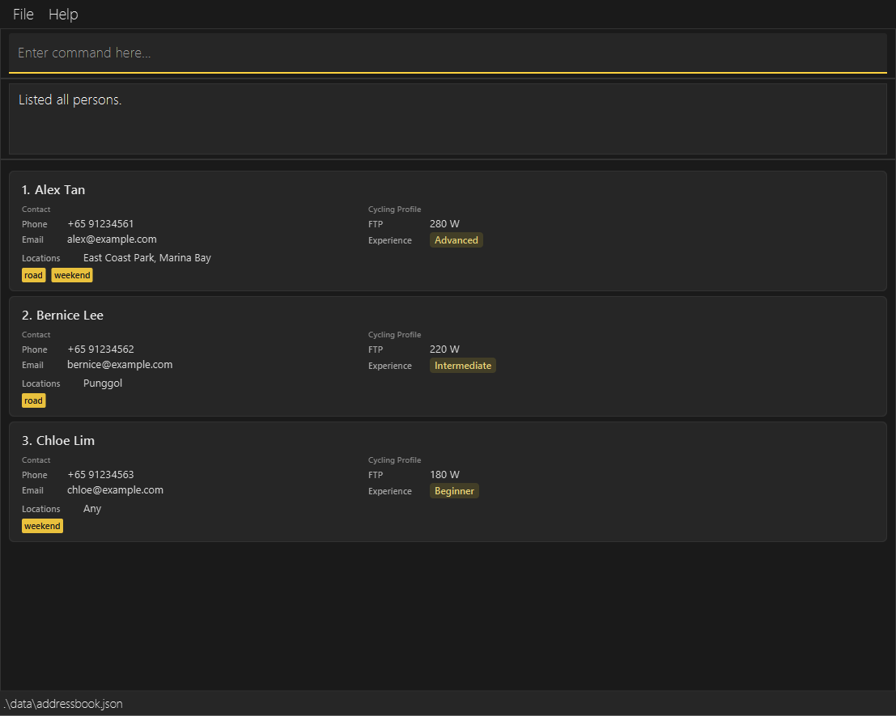
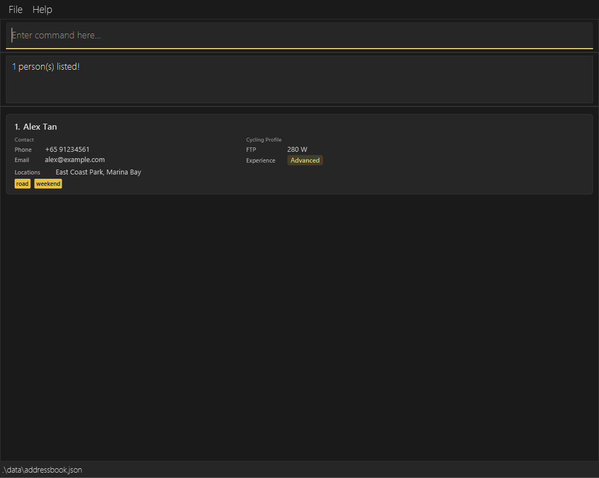
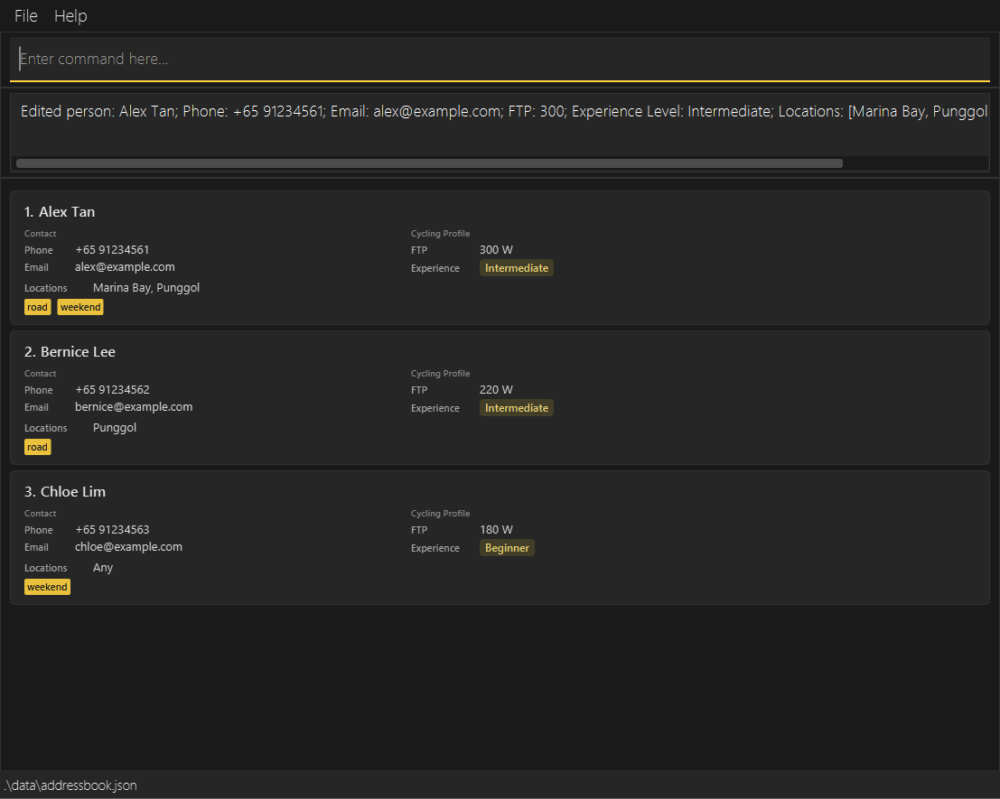
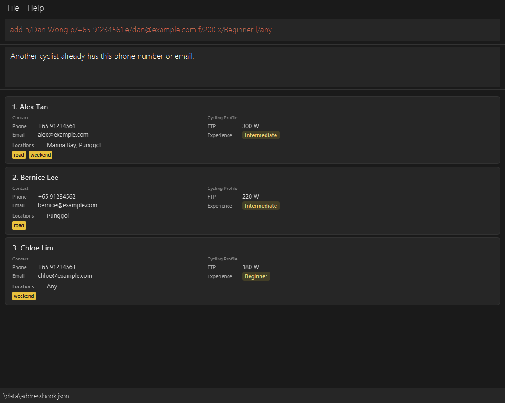
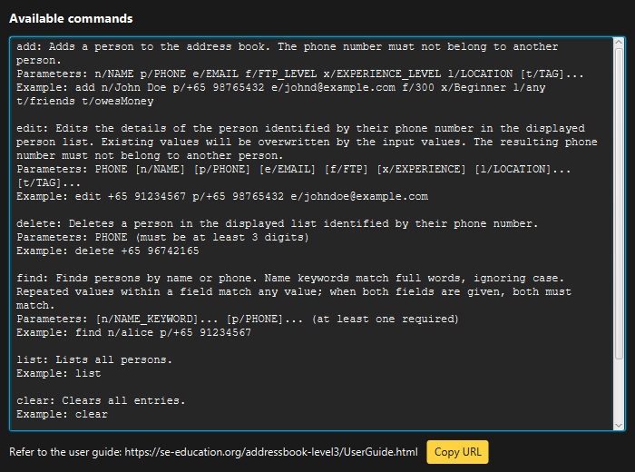

# Cyclique v1.3 Release Notes

Cyclique adapts AddressBook Level 3 (AB3) for organisers of recreational cycling
groups in Singapore. This MVP supports adding, finding, editing and deleting cyclists
with cycling profiles. The following changes are new compared with AB3.

## What's New

* **Cycling profiles:** Cyclist records now include Functional Threshold Power (FTP)
  in watts, experience level and preferred cycling locations alongside name, phone,
  email and tags. Adding a cyclist requires FTP, experience level and at least one
  preferred location. FTP accepts whole numbers from 1 to 600 W; experience levels
  are Beginner, Intermediate or Advanced, ignoring case. Organisers can supply
  multiple `l/LOCATION` fields or use `l/any` alone for no preference.
  Blank or invalid locations are rejected,
  duplicate locations are ignored regardless of case, and `any` cannot be mixed
  with specific locations.
  ([FTP: #68](https://github.com/AY2627S1-CS2103T-W11-1/tp/pull/68),
  [locations: #70](https://github.com/AY2627S1-CS2103T-W11-1/tp/pull/70))
* **Cycling fields throughout the workflow:** FTP and locations are included in
  add, edit and delete confirmations and in the cards shown by `list` and `find`.
  They are saved to JSON and loaded again on restart. Sample cyclists and command
  examples use phone numbers in the required international-style format and
  cycling profiles.
* **Complete cyclist cards:** A compact layout separates contact details from the
  cycling profile. Cards display all seven fields, show FTP with the `W` unit and
  display `l/any` as `Any`. Locations and tags appear in a consistent order in the
  initial list, `list` results and `find` results.
  ([#72](https://github.com/AY2627S1-CS2103T-W11-1/tp/pull/72),
  [#83](https://github.com/AY2627S1-CS2103T-W11-1/tp/pull/83))
* **Alphabetical lists:** Cyclists are displayed alphabetically by full name,
  ignoring letter case. The order updates after additions, name edits and searches,
  making cyclists easier to locate without changing their saved order. Names that
  compare equally retain their relative order, and displayed indexes remain consecutive.
  ([#79](https://github.com/AY2627S1-CS2103T-W11-1/tp/pull/79))
* **Phone-based editing and deletion:** `edit` and `delete` identify cyclists by
  their phone number instead of AB3's list index. Both commands act on the displayed
  list, and ambiguous matches are rejected. This keeps targeting consistent when
  the list is sorted or filtered. A cyclist hidden by a filter cannot be edited or
  deleted until displayed, preventing commands from acting on an unseen record.
* **Editable cycling details:** Organisers can update FTP, experience level and
  preferred locations using `edit`, alongside existing contact fields and tags.
  Omitted fields retain their values; supplied locations replace the previous set.
  ([#76](https://github.com/AY2627S1-CS2103T-W11-1/tp/pull/76))
* **Name and phone searches:** `find` now requires prefixed criteria: each `n/`
  supplies one complete name word, and each `p/` supplies one exact phone number.
  Repeat the prefix for multiple values, such as `find n/Alex n/Bernice`. Values
  within a field use OR (either value can match); combining name and phone criteria
  uses AND (both fields must match). Name matching ignores case.
* **Stronger duplicate checks:** `add` and `edit` reject cyclists who share a phone
  number or email with another record, including records hidden by a filter. Email
  comparison ignores case. Cyclists with the same name remain allowed when their
  phone numbers and emails are unique. An edit can retain the cyclist's own unique
  phone number, and rejected duplicate operations leave existing records unchanged.
  ([#78](https://github.com/AY2627S1-CS2103T-W11-1/tp/pull/78),
  [#80](https://github.com/AY2627S1-CS2103T-W11-1/tp/pull/80))
* **International phone format:** Phone numbers must contain `+`, one to three
  country-code digits, exactly one separating space and at least three number
  digits, for example `+65 91234567`. Hyphens and parentheses are rejected with
  explanatory errors.
  ([#73](https://github.com/AY2627S1-CS2103T-W11-1/tp/pull/73))
* **Updated appearance and command help:** Cyclique has a dark theme with yellow
  accents, rounded cyclist cards and cycling artwork on startup and exit. A taller
  command input makes commands easier to read and edit. The Help dropdown shows all
  eight commands and inserts starter text into the command box. Its edit format now
  includes `[f/FTP]`, `[x/EXPERIENCE_LEVEL]` and repeatable `[l/LOCATION]` fields.
  The full Help window lists command formats and examples and opens through
  `help`, `F1` or **Full help...**.
  ([#74](https://github.com/AY2627S1-CS2103T-W11-1/tp/pull/74),
  [#85](https://github.com/AY2627S1-CS2103T-W11-1/tp/pull/85))
* **Residential addresses removed:** Cyclique focuses on preferred cycling
  locations rather than residential addresses. The `a/` field has been removed from
  commands, cyclist records and saved output. Older files containing an `address`
  field can still be loaded: it is ignored and omitted on the next save. These files
  must still contain valid names, emails and experience levels, phone numbers in the
  current format, and unique phone numbers and emails. Missing FTP defaults to 1 W,
  and missing or empty locations default to `any`; supplied FTP and location values
  must pass validation. Unmodified AB3 data files are not directly compatible.
  ([#82](https://github.com/AY2627S1-CS2103T-W11-1/tp/pull/82))

## Cyclique in Action

### Cyclist profiles and alphabetical display

Three demonstration cyclists appear in alphabetical order, although they were added
in the order Chloe, Alex, Bernice. The cards show different FTP values, experience
levels, preferred locations and tags.

### Combined name and phone search

Running `find n/Alex p/+65 91234561` returns only Alex Tan, who matches both criteria.

### Editing a cycling profile

Running `edit +65 91234561 f/300 x/Intermediate l/Punggol l/Marina Bay` changes Alex's
FTP from 280 W to 300 W, updates the experience level and replaces the preferred
locations. The contact details and tags remain unchanged.

### Duplicate prevention

Adding Dan with Alex's phone number is rejected with an explanatory message. The
three existing cyclist records remain unchanged.

### Command help

The Help window lists the current command formats, including phone-based targeting,
cycling fields and prefixed searches.

