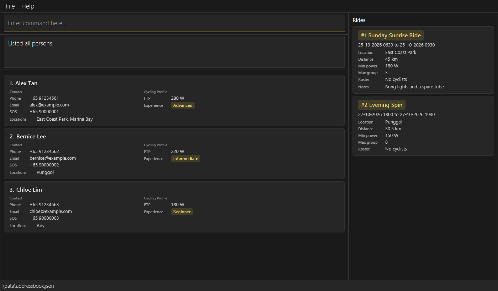
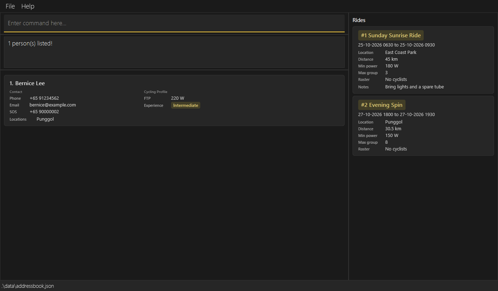
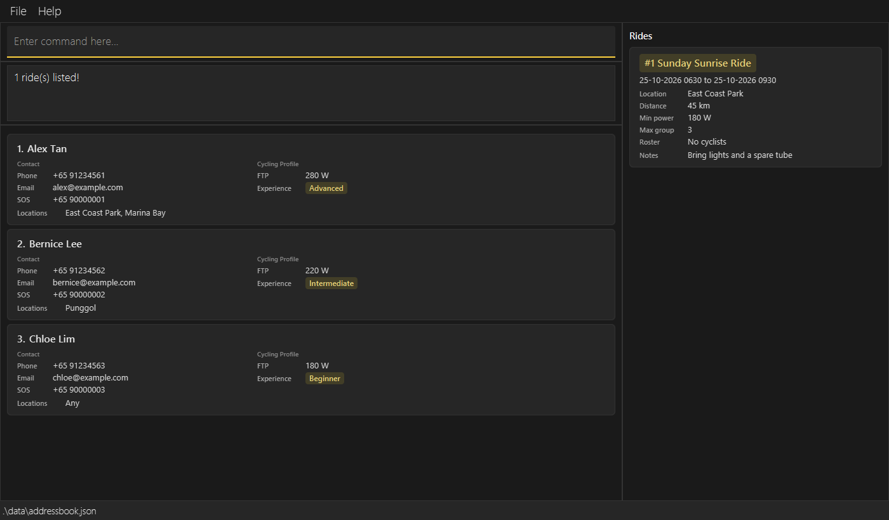
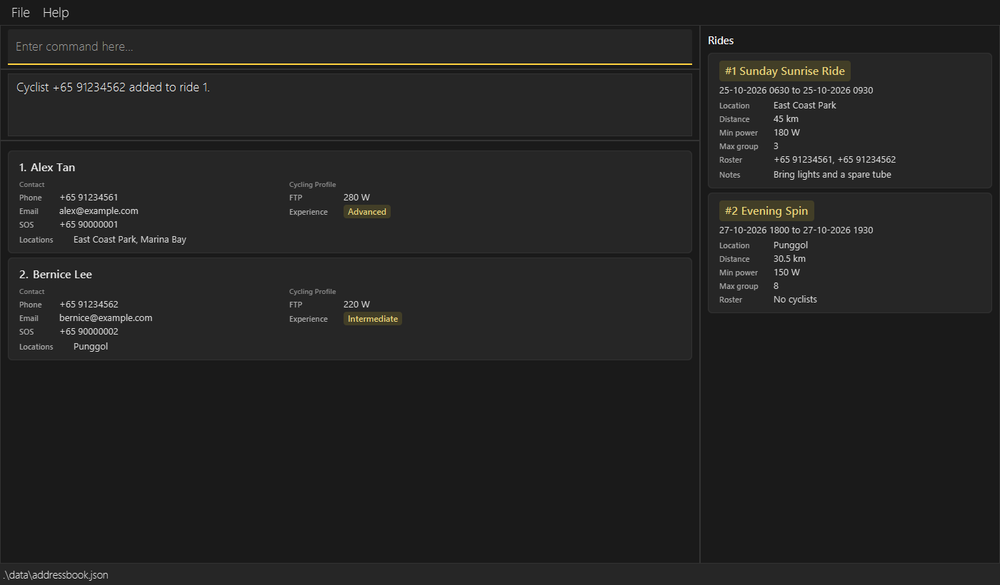
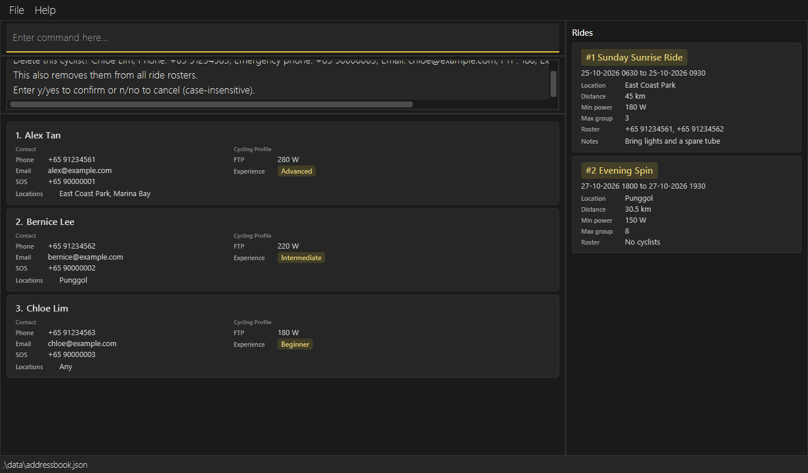

# Cyclique v1.4 Release Notes

Cyclique helps organisers of recreational cycling groups in Singapore manage
cyclists and plan group rides. Version 1.4 extends v1.3 with ride management,
participant rosters, more search options and emergency contact numbers. The
following changes are new compared with v1.3.

## What's New

* **Group ride planning:** Create rides with `rideadd`, specifying a name, start
  and end date/time, location, distance, minimum FTP and maximum group size.
  Optional notes support up to 10 words. Each ride receives a persistent ID that
  is not reused after deletion, clearing the book or restarting the application.
  Ride details and rosters are saved automatically alongside cyclist records.
  ([#101](https://github.com/AY2627S1-CS2103T-W11-1/tp/pull/101))
* **Dedicated Rides panel:** A new panel beside the cyclist list displays ride
  cards with their IDs, names, schedules, locations, distances, minimum power,
  maximum group sizes, roster phone numbers and optional notes. Long text wraps
  within the cards, and changes to rides and rosters update the panel.
  ([#104](https://github.com/AY2627S1-CS2103T-W11-1/tp/pull/104))
* **Ride editing and deletion:** Use `rideedit ID` to replace selected fields
  while retaining the ride ID, roster and unspecified details. Empty `notes/`
  clears existing notes. Edits reject an end time before the start, a maximum
  group size below the roster count, or a minimum FTP above an existing
  participant's FTP. `ridedelete ID` removes a ride and its roster associations
  immediately, while keeping the cyclists and other rides unchanged.
  ([editing: #108](https://github.com/AY2627S1-CS2103T-W11-1/tp/pull/108),
  [deletion: #109](https://github.com/AY2627S1-CS2103T-W11-1/tp/pull/109))
* **Participant rosters:** Add an existing cyclist with `rideaddcyclist ID PHONE`
  or remove them from one ride with `ridedeletecyclist ID PHONE`. Joining checks
  the cyclist's FTP against the ride minimum, available capacity and duplicate
  membership, even when the cyclist is hidden by a filter. Editing a cyclist's
  phone updates their roster references; confirming deletion of that cyclist
  removes them from every roster. Removing a ride participant preserves their
  cyclist record and other memberships.
  ([#106](https://github.com/AY2627S1-CS2103T-W11-1/tp/pull/106))
* **Live roster lists:** `ridelist ID` displays one ride's registered cyclists
  alphabetically in the cyclist panel. The display refreshes as that roster
  changes. If the ride is deleted, its roster display becomes empty instead of
  switching to another ride. `list` restores all cyclists, while `find` or another
  `ridelist` replaces the cyclist filter. Ride-panel filters remain independent.
  ([#110](https://github.com/AY2627S1-CS2103T-W11-1/tp/pull/110))
* **Ride searches:** `ridefind` filters rides by name, date range, location,
  distance, minimum power, maximum group size or notes. Supplied fields use AND
  matching. Date bounds are inclusive; date-only `from/` and `to/` values use
  `0000` and `2359` respectively. Names and locations match complete values,
  ignoring case; distance and group size match numerically, while `f/` selects
  rides whose minimum power is at least the supplied value. Use `ridefind all`
  to restore every ride without changing the cyclist display.
  ([#114](https://github.com/AY2627S1-CS2103T-W11-1/tp/pull/114))
* **More cyclist search filters:** `find` now accepts minimum FTP (`f/`),
  experience levels (`x/`), preferred locations (`l/`) and emergency contact
  numbers (`sos/`), alongside names and personal phone numbers. Values within
  a field use OR and different fields use AND. Cyclists with `l/any` match any
  location criterion. A multi-word `n/` value matches the complete full name,
  ignoring case; single-word queries retain whole-word matching.
  ([filters: #112](https://github.com/AY2627S1-CS2103T-W11-1/tp/pull/112),
  [full names: #114](https://github.com/AY2627S1-CS2103T-W11-1/tp/pull/114))
* **Emergency contacts:** New cyclists require an emergency contact number through
  `sos/EMERGENCY_PHONE`. The number uses the same international-style format as a
  personal phone number, appears as **SOS** on the cyclist card, and can be edited
  or searched. Multiple cyclists may share an emergency contact; it does not
  determine duplicate cyclist identity. Older records without one still load and
  show **Not provided** until updated.
  ([#99](https://github.com/AY2627S1-CS2103T-W11-1/tp/pull/99))
* **Cyclist deletion confirmation:** `delete PHONE` now displays the target's
  details before removing anything. Reply with `y` or `yes` to confirm, or `n`
  or `no` to cancel, ignoring case. Invalid replies keep the request pending;
  another recognised command cancels it and runs that command. Closing the
  application discards the pending request.
  ([#100](https://github.com/AY2627S1-CS2103T-W11-1/tp/pull/100))
* **Updated command help:** The Help dropdown and full Help window include ride
  creation, editing, deletion, searching, roster changes and roster listing.
  Dropdown entries insert command starter text into the command box. Cyclist
  command formats include the emergency contact field and no longer include tags.
  ([ride creation: #105](https://github.com/AY2627S1-CS2103T-W11-1/tp/pull/105),
  [roster help: #107](https://github.com/AY2627S1-CS2103T-W11-1/tp/pull/107))
* **Input and saved-data fixes:** Whitespace-separated prefixes, including tabs,
  are recognised correctly instead of being absorbed into an earlier field.
  Invalid saved data, including a JSON `null` root, duplicate roster members,
  over-capacity rosters and references to missing cyclists, is rejected through
  the normal loading-error path.
  ([#129](https://github.com/AY2627S1-CS2103T-W11-1/tp/pull/129))

## Upgrading from v1.3

* **Tags have been removed.** Cyclist commands, cards and saved output no longer
  use tags. Existing `tags` fields are ignored when loading and omitted on the
  next save; other supported cyclist details are retained. Back up
  `data/addressbook.json` before upgrading if you need to preserve the old tags.
  ([#98](https://github.com/AY2627S1-CS2103T-W11-1/tp/pull/98))
* Existing v1.3 data files load without emergency numbers or ride data. Supply
  missing emergency numbers with `edit PHONE sos/EMERGENCY_PHONE`; a book without
  saved rides starts with an empty Rides panel. Rides, rosters and the next ride
  ID are stored in the same `data/addressbook.json` file as cyclists.
* `clear` removes **both cyclists and rides** immediately, without confirmation,
  while preserving the next ride ID. Confirmation applies to cyclist `delete`,
  not `ridedelete` or `clear`.

## Cyclique in Action

### Cyclists, emergency contacts and group rides

Three demonstration cyclists appear alphabetically with labelled SOS numbers and
cycling profiles. Two group rides appear alongside them in the new Rides panel.

### Matching cyclists to a ride

Running `find l/Punggol x/Intermediate x/Advanced f/200` returns Bernice Lee,
whose preferred location is Punggol, experience is Intermediate and FTP is 220 W.
The ride display is unchanged.

### Finding rides by date and minimum power

After `list`, running `ridefind from/25-10-2026 to/25-10-2026 f/180` displays only Sunday Sunrise
Ride, which starts and ends on that day and requires at least 180 W. Evening Spin
is hidden; the cyclist list remains unchanged. `ridefind all` restores both rides.

### Managing a live participant list

After `rideaddcyclist 1 +65 91234561`, `ridelist 1` displays Alex Tan. Running
`rideaddcyclist 1 +65 91234562` adds Bernice Lee even though she is outside the
current roster display. The cyclist panel refreshes to show both participants,
and the ride card lists their phone numbers.

### Confirming cyclist deletion

After `list`, running `delete +65 91234563` displays Chloe Lim's details and asks
for confirmation. All three cyclists remain until `yes` is entered. Replying
`no` cancels the request and preserves every cyclist and ride.

